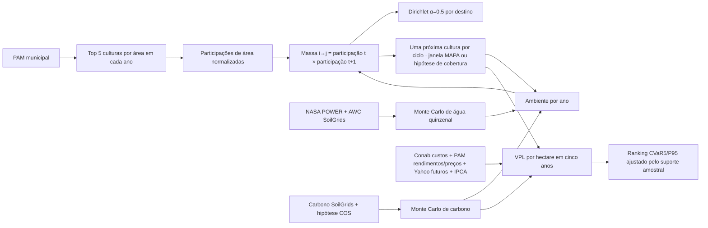

# Field Shift

Proposta de apoio à decisão para comparar rotações de culturas usando observações da Terra da NASA, informações locais de solo e prioridades do produtor.

O projeto responde ao desafio [Field Shift: Adapting Farms with NASA Data](https://www.spaceappschallenge.org/2026/challenges/adapting-farms-with-nasa-data/) do NASA Space Apps Challenge 2026.

> **Status:** NASA POWER/SoilGrids, PAM/IBGE, ZARC/MAPA e custos CONAB ingeridos para Ariquemes‑RO, Franca‑SP e Varginha‑MG. A página mostra a cadeia Markov de 14 culturas como grafo; o Monte Carlo evolui água e carbono por quinzena, decide a transição na próxima oportunidade municipal após a colheita e semeia o destino na janela MAPA standalone. Apenas coberturas sem linha MAPA no perfil podem usar qualquer decêndio, como hipótese explícita. A espera é pousio e as tábuas MAPA anual 2026/2027 e perene vigente são repetidas nos 60 meses. Cultura inicial é estabelecida; culturas novas aguardam maturação. Café e cana mantêm sua identidade perene; café tem uma subcadeia separada de coberturas entrelinhas, com prior uniforme e zero contagens observadas. Replantios consecutivos de anuais reduzem o rendimento bruto por uma hipótese editável e não calibrada. O VPL usa preços PAM históricos em R$ reais, tendência anual limitada e editável, e desconta cada fluxo pela data do ciclo. Probabilidade Markov e frequência Monte Carlo aparecem separadamente. Resultados exploratórios, não prova causal nem recomendação agronômica.

## Executar o motor

Para executar a simulação de referência nos três perfis, rode `python -m field_shift.demo`. Para um perfil isolado, use `python -m field_shift --profile data/profiles/ariquemes-ro --policy data/policies/balanco-hidrico-referencia.json --initial-state water_medium`. Os dados brutos estão em `data/raw/`, os normalizados e as contagens Markov em `data/profiles/`, e as fontes/gaps estão em `data/README.md`.

Abra a [demonstração interativa](docs/visualizacao.html) para escolher o município, definir a cultura principal inicial, inspecionar a matriz Markov completa e comparar o VPL em 60 meses. Regenere custos/entradas econômicas com `python data/pipeline/build_economic_benchmarks.py`, a cadeia com `python data/pipeline/build_crop_transition_markov.py` e a página com `python -m field_shift.visualize --output docs/visualizacao.html --seed 2026`.

## Ideia em uma figura

Na página, cada nó principal contém uma cultura individual. Para cada município-ano, o PAM fornece o top 5 entre os produtos mapeados; suas áreas viram participações normalizadas. Entre anos consecutivos, o modelo soma massas esperadas `participação_t(i) × participação_t+1(j)` sob independência das marginais municipais. Isso usa mais que a cultura rank 1, mas não é rotação observada do mesmo talhão; os pares rank 1 aparecem à parte como diagnóstico e não são somados de novo. O grafo mostra todas as setas e ocupação Monte Carlo no fechamento de cada ano ou no ciclo completo. O relógio agronômico e as durações estão em [crop-cycle-assumptions.json](data/reference/crop-cycle-assumptions.json); como a PAM não observa ciclos intranuais do mesmo talhão, a probabilidade anual é reaplicada em cada decisão após uma colheita como hipótese transparente. A decisão Markov acontece na próxima oportunidade municipal de plantio; destinos com janela MAPA standalone nos 365 dias seguintes continuam possíveis, e o talhão espera em pousio até o calendário aplicável ao destino sorteado. Nabo forrageiro, braquiária, crotalária, mucuna e aveia-preta só recebem a hipótese de qualquer decêndio se faltar linha MAPA standalone; calendário oficial presente sempre prevalece. O calendário ZARC 2026/2027 é repetido nos cinco anos e agrega classes de solo/grupos de cultivar, portanto é uma restrição exploratória, não uma elegibilidade parcelar oficial. Linhas identificadas como consórcio não entram na cadeia principal. A prior continua uniforme com α=0,5 por destino: uma cultura sem massa histórica permanece possível; com 14 destinos e suporte zero, a probabilidade-base é 7,1%, mas cai conforme cresce o suporte — não é um piso fixo de 6–7%. Essa prior da cadeia é independente do n₀ usado para ponderar a confiabilidade econômica das rotas. A hipótese editável de rendimento por repetição é específica por cultura: soja 8 pp por replantio até 20%; milho 2,2 pp até 4,3%; ambas reduzem o VPL, não a probabilidade Markov nem os custos. Para café, uma subcadeia separada sorteia entre coberturas de entrelinha com prior uniforme, sem inventar contagens empíricas. Água vem da NASA POWER; carbono inicial vem do solo mapeado e as mudanças são hipóteses explícitas, não medições.

O VPL parte de rendimento PAM, custo CONAB e preço-base pela mediana anual PAM real 2017–2025, convertido por IPCA ao mês de referência. A tendência entre medianas dos três primeiros e três últimos anos é limitada a ±5% ao ano e editável; as cotações futuras Yahoo de soja/milho ficam como referência separada. Cultura inicial é produtiva; novas anuais esperam um ciclo, café espera três anos e cana 18 meses. Custos de formação perene são frações editáveis de proxies de produção, lançadas no plantio e a cada ano de formação, com o último período proporcional; não são implantação medida. A primeira colheita após a maturação usa o rendimento PAM de lavouras adultas, pois falta curva de produção por idade; isso pode superestimar o primeiro corte. A demonstração usa 100.000 trajetórias e agrupa pelo percurso real: sequência de plantios ocorridos (incluindo replantios) e, no café, sequência de coberturas. Datas diferentes não criam rotas diferentes; as datas, água e solo de cada trajetória ainda determinam seus fluxos e VPL, e uma trilha de exemplo mantém esses eventos visíveis. Um único ranking paginado combina CVaR5 (resiliência) e P95 (retorno alto) com preferência ajustável. Para evitar que métricas de uma amostra dominem, o score é aproximado à referência geral de VPLs elegíveis com peso `n/(n+n₀)`; n₀ é editável e o peso aplicado aparece por rota. Frequência, amostra com VPL e valores de referência ficam visíveis. O ranking compara apenas sequências amostradas e não é uma política reotimizada em cada ciclo. Consulte [a cobertura e as limitações](data/reference/economic-input-coverage.json) e [as entradas rastreáveis](data/reference/economic-benchmarks.json).

## Documentação

- [Modelo Markov + Monte Carlo](docs/modelo-markov-monte-carlo.md): estados, ações, transições e simulação.
- [Dados e validação](docs/dados-e-validacao.md): fontes previstas, limitações e validação.
- [Plano do MVP](docs/plano-mvp.md): sequência de trabalho e decisões em aberto.
- [Materiais de pesquisa](research/README.md): rascunhos recebidos, preservados como contexto.

## Escopo proposto

O escopo nacional continua como objetivo do produto. Esta entrega contém três exemplos municipais com dados ambientais remotos e agrícolas públicos; não representa fazendas nem recomenda manejo. Os 55 arquivos originais citados para o Oeste do Paraná continuam fora do checkout; não foram usados nem substituídos por arquivos sintéticos.

O caminho de dados para meteorologia, solo, estados Markov, contagens de transição e Monte Carlo está descrito em [data/README.md](data/README.md). Os contratos ficam em versões imutáveis sob `data/contracts/v1/`; `data/contracts/registry.json` indica a versão ativa e os pipelines validam os dados com o registro. O inventário extraído do relatório e da planilha está em `data/catalog/` e `data/reference/`, com ausências e limites registrados.
