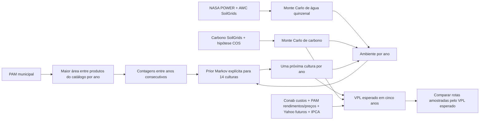

# Field Shift

Proposta de apoio à decisão para comparar rotações de culturas usando observações da Terra da NASA, informações locais de solo e prioridades do produtor.

O projeto responde ao desafio [Field Shift: Adapting Farms with NASA Data](https://www.spaceappschallenge.org/2026/challenges/adapting-farms-with-nasa-data/) do NASA Space Apps Challenge 2026.

> **Status:** NASA POWER/SoilGrids, PAM/IBGE, ZARC/MAPA e custos CONAB ingeridos para Ariquemes‑RO, Franca‑SP e Varginha‑MG. A página mostra a cadeia Markov completa de 14 culturas como grafo de nós e setas; o Monte Carlo colore a frequência de visita aos nós e atualiza as transições após sortear água e carbono do solo. O otimizador ranqueia por VPL as sequências de cinco transições que apareceram nas 10.000 trajetórias. As 14 culturas têm valores iniciais rastreáveis ou hipóteses/proxies editáveis; coberturas começam com receita comercial zero e custo proxy. Probabilidade Markov, incerteza Dirichlet e frequência Monte Carlo são expostas separadamente. Resultados exploratórios, não prova causal nem recomendação agronômica.

## Executar o motor

Para executar a simulação de referência nos três perfis, rode `python -m field_shift.demo`. Para um perfil isolado, use `python -m field_shift --profile data/profiles/ariquemes-ro --policy data/policies/balanco-hidrico-referencia.json --initial-state water_medium`. Os dados brutos estão em `data/raw/`, os normalizados e as contagens Markov em `data/profiles/`, e as fontes/gaps estão em `data/README.md`.

Abra a [demonstração interativa](docs/visualizacao.html) para escolher o município, definir uma cultura inicial, inspecionar a matriz Markov completa e comparar rotações de cinco safras pelo VPL esperado. Regenere custos/entradas econômicas com `python data/pipeline/build_economic_benchmarks.py`, a cadeia com `python data/pipeline/build_crop_transition_markov.py` e a página com `python -m field_shift.visualize --output docs/visualizacao.html --seed 2026`.

## Ideia em uma figura

Na página interativa, cada nó é uma cultura individual e uma trajetória ocupa exatamente um nó por ano. As contagens são derivadas da cultura de maior área colhida entre os produtos deste catálogo PAM em cada município-ano; produtos fora dele não competem e os dados não acompanham um talhão real. A cadeia tem pseudocontagem uniforme de 0,5 por destino. O grafo mostra todas as setas; ao selecionar um nó, exibe P média contextual, intervalo Dirichlet de 90%, contagem PAM, fatores ambientais e frequência de transições Monte Carlo. A água é derivada de NASA POWER; carbono inicial vem do solo mapeado e sua mudança anual é hipótese explícita, não dado medido.

O VPL parte de rendimentos e valores unitários PAM, preços futuros Yahoo congelados para soja/milho, custos totais CONAB e taxa real aproximada por ANBIMA/IPCA. As 14 linhas econômicas têm fonte e premissas editáveis; proxies de colheita/custo e receita comercial inicial zero para coberturas são identificados. A interface agrupa sequências completas vistas nas 10.000 trajetórias, calcula estatísticas de VPL nos ambientes em que cada sequência ocorreu e mostra a frequência Monte Carlo e a probabilidade Markov separadamente. Rotas raras têm baixa precisão; este ranking não avalia sequências nunca amostradas e não é política reotimizada anualmente. Consulte [a cobertura e as limitações](data/reference/economic-input-coverage.json) e [as entradas rastreáveis](data/reference/economic-benchmarks.json).

## Documentação

- [Modelo Markov + Monte Carlo](docs/modelo-markov-monte-carlo.md): estados, ações, transições e simulação.
- [Dados e validação](docs/dados-e-validacao.md): fontes previstas, limitações e validação.
- [Plano do MVP](docs/plano-mvp.md): sequência de trabalho e decisões em aberto.
- [Materiais de pesquisa](research/README.md): rascunhos recebidos, preservados como contexto.

## Escopo proposto

O escopo nacional continua como objetivo do produto. Esta entrega contém três exemplos municipais com dados ambientais remotos e agrícolas públicos; não representa fazendas nem recomenda manejo. Os 55 arquivos originais citados para o Oeste do Paraná continuam fora do checkout; não foram usados nem substituídos por arquivos sintéticos.

O caminho de dados para meteorologia, solo, estados Markov, contagens de transição e Monte Carlo está descrito em [data/README.md](data/README.md). Os contratos ficam em versões imutáveis sob `data/contracts/v1/`; `data/contracts/registry.json` indica a versão ativa e os pipelines validam os dados com o registro. O inventário extraído do relatório e da planilha está em `data/catalog/` e `data/reference/`, com ausências e limites registrados.
