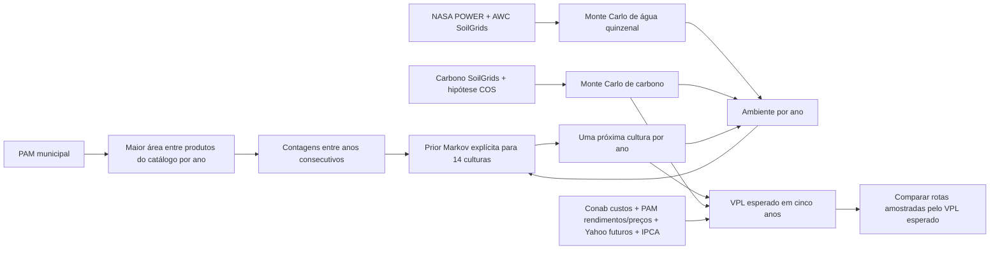

# Field Shift

Proposta de apoio à decisão para comparar rotações de culturas usando observações da Terra da NASA, informações locais de solo e prioridades do produtor.

O projeto responde ao desafio [Field Shift: Adapting Farms with NASA Data](https://www.spaceappschallenge.org/2026/challenges/adapting-farms-with-nasa-data/) do NASA Space Apps Challenge 2026.

> **Status:** NASA POWER/SoilGrids, PAM/IBGE, ZARC/MAPA e custos CONAB ingeridos para Ariquemes‑RO, Franca‑SP e Varginha‑MG. A página mostra a cadeia Markov de 14 culturas como grafo; o Monte Carlo evolui água e carbono por quinzena e sorteia transições ao fim de ciclos variáveis num horizonte de 60 meses. Cultura inicial é estabelecida; culturas novas aguardam maturação. Café e cana mantêm sua identidade perene; café tem uma subcadeia separada de coberturas entrelinhas, com prior uniforme e zero contagens observadas. O VPL usa preços PAM históricos em R$ reais, tendência anual limitada e editável, e desconta cada fluxo pela data do ciclo. Probabilidade Markov e frequência Monte Carlo aparecem separadamente. Resultados exploratórios, não prova causal nem recomendação agronômica.

## Executar o motor

Para executar a simulação de referência nos três perfis, rode `python -m field_shift.demo`. Para um perfil isolado, use `python -m field_shift --profile data/profiles/ariquemes-ro --policy data/policies/balanco-hidrico-referencia.json --initial-state water_medium`. Os dados brutos estão em `data/raw/`, os normalizados e as contagens Markov em `data/profiles/`, e as fontes/gaps estão em `data/README.md`.

Abra a [demonstração interativa](docs/visualizacao.html) para escolher o município, definir a cultura principal inicial, inspecionar a matriz Markov completa e comparar o VPL em 60 meses. Regenere custos/entradas econômicas com `python data/pipeline/build_economic_benchmarks.py`, a cadeia com `python data/pipeline/build_crop_transition_markov.py` e a página com `python -m field_shift.visualize --output docs/visualizacao.html --seed 2026`.

## Ideia em uma figura

Na página, cada nó principal contém uma cultura individual. As contagens são derivadas da cultura de maior área colhida entre os produtos deste catálogo PAM em cada município-ano; produtos fora dele não competem e os dados não acompanham um talhão real. A cadeia principal tem pseudocontagem uniforme de 0,5 por destino. O grafo mostra todas as setas e ocupação no fim de cada ano. O relógio agronômico e as durações estão em [crop-cycle-assumptions.json](data/reference/crop-cycle-assumptions.json); como a PAM não observa ciclos intranuais do mesmo talhão, a probabilidade anual é reaplicada no fim de cada ciclo como hipótese transparente. O calendário ainda não filtra janelas ZARC, então sequências que repetem uma cultura são possíveis na amostra e não são recomendação de plantio. Para café, uma subcadeia separada sorteia entre milheto, braquiária e outras coberturas de entrelinha com prior uniforme, sem inventar contagens empíricas. A água é derivada de NASA POWER; carbono inicial vem do solo mapeado e as mudanças são hipóteses explícitas, não medições.

O VPL parte de rendimento PAM, custo CONAB e preço-base pela mediana anual PAM real 2017–2025, convertido por IPCA ao mês de referência. A tendência entre medianas dos três primeiros e três últimos anos é limitada a ±5% ao ano e editável; as cotações futuras Yahoo de soja/milho ficam como referência separada. Cultura inicial é produtiva; novas anuais esperam um ciclo, café espera três anos e cana 18 meses. Custos de formação perene são frações editáveis de proxies de produção, lançadas no plantio e a cada ano de formação, com o último período proporcional; não são implantação medida. A primeira colheita após a maturação usa o rendimento PAM de lavouras adultas, pois falta curva de produção por idade; isso pode superestimar o primeiro corte. O otimizador agrupa o estado principal/cobertura no fim de cada ano, mas calcula os fluxos em cada evento de colheita e os desconta pelo tempo decorrido. Rotas raras podem permanecer no topo por VPL, com frequência e P Markov visíveis e precisão menor; este ranking não avalia sequências nunca amostradas e não é política reotimizada em cada ciclo. Consulte [a cobertura e as limitações](data/reference/economic-input-coverage.json) e [as entradas rastreáveis](data/reference/economic-benchmarks.json).

## Documentação

- [Modelo Markov + Monte Carlo](docs/modelo-markov-monte-carlo.md): estados, ações, transições e simulação.
- [Dados e validação](docs/dados-e-validacao.md): fontes previstas, limitações e validação.
- [Plano do MVP](docs/plano-mvp.md): sequência de trabalho e decisões em aberto.
- [Materiais de pesquisa](research/README.md): rascunhos recebidos, preservados como contexto.

## Escopo proposto

O escopo nacional continua como objetivo do produto. Esta entrega contém três exemplos municipais com dados ambientais remotos e agrícolas públicos; não representa fazendas nem recomenda manejo. Os 55 arquivos originais citados para o Oeste do Paraná continuam fora do checkout; não foram usados nem substituídos por arquivos sintéticos.

O caminho de dados para meteorologia, solo, estados Markov, contagens de transição e Monte Carlo está descrito em [data/README.md](data/README.md). Os contratos ficam em versões imutáveis sob `data/contracts/v1/`; `data/contracts/registry.json` indica a versão ativa e os pipelines validam os dados com o registro. O inventário extraído do relatório e da planilha está em `data/catalog/` e `data/reference/`, com ausências e limites registrados.
