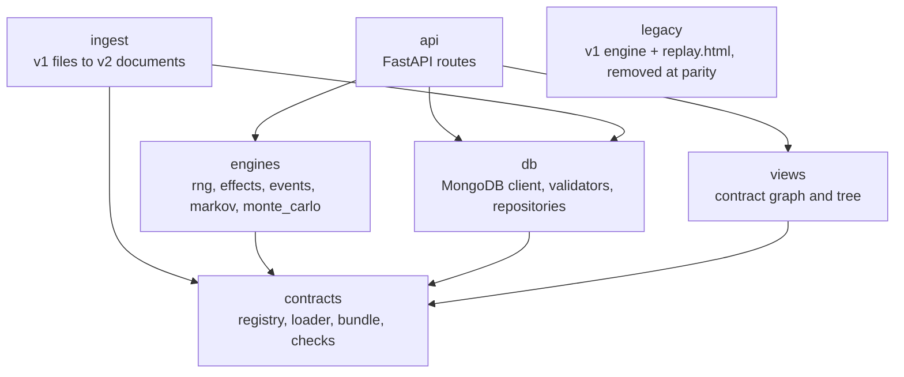
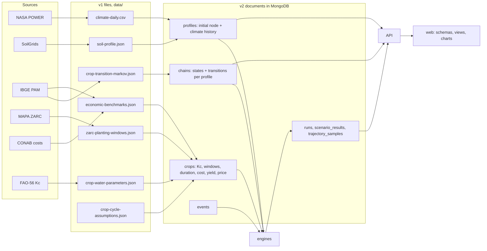
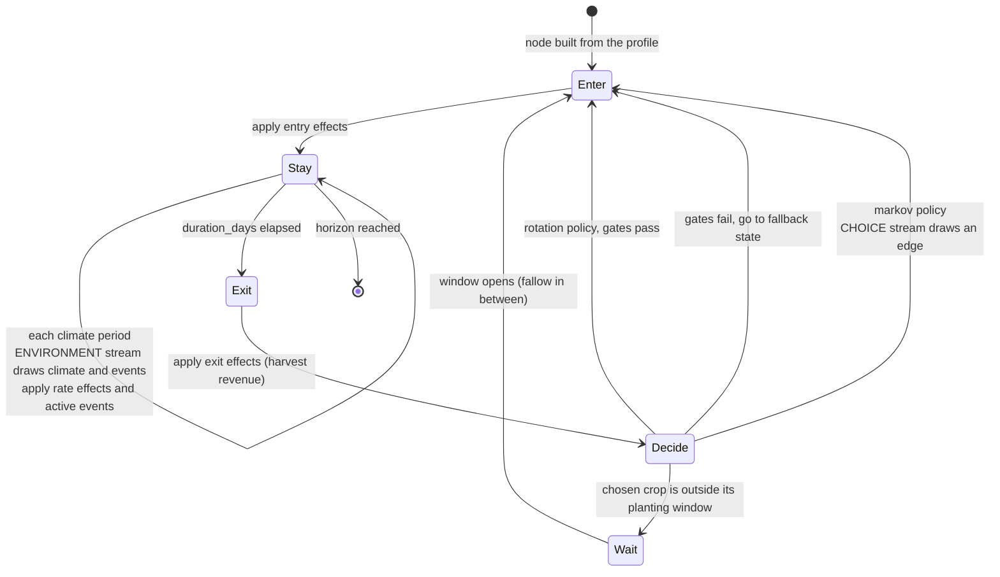
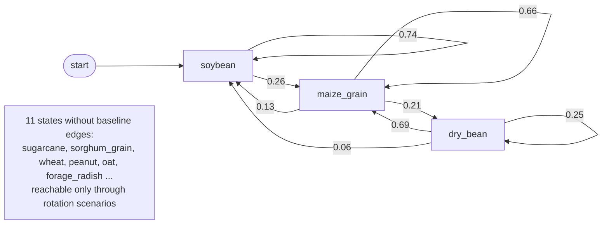
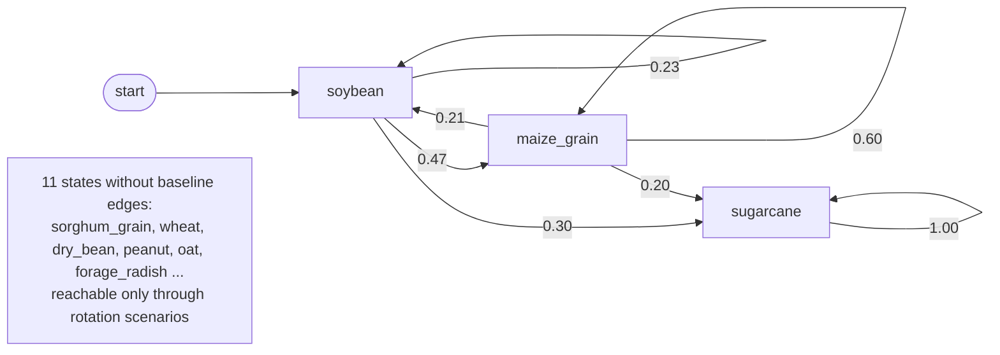
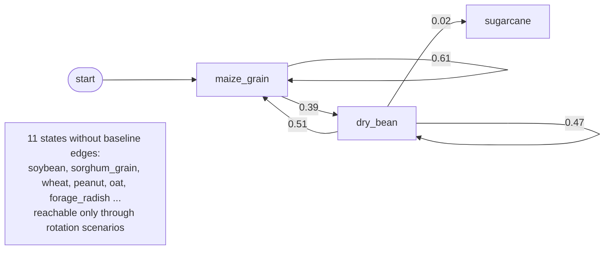
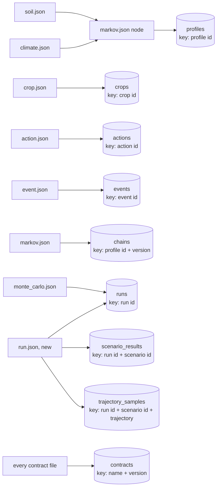
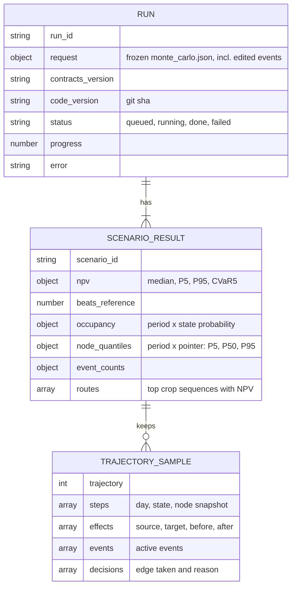

# Field Shift backend design

Status: validation layer implemented (contracts, ingestion, MongoDB validators, API, tests); engines not started. Branch: `refactor/backend-engine`.

## Goal

Turn the research app into a backend for a web application:

- FastAPI endpoints that expose the contracts, their views, profiles, chains and simulation results.
- `markov.py` and `monte_carlo.py` engines that implement contracts v2 (`data/contracts/v2/`).
- MongoDB collections validated by the same contracts.

Today the crop model (Markov, water, carbon, NPV, 100,000 trajectories) runs in JavaScript inside `field_shift/legacy/replay.html`. The Python engines only cover the v1 water-state model. The engine phase ports the JavaScript model to Python.

Out of scope: the geographic map overlay of simulations.

## Decisions taken

- FastAPI.
- Restructure `field_shift/` in place. v1 modules move to `field_shift/legacy/` so `docs/visualizacao.html` can still be rebuilt, and are removed when the new engine reproduces v1.
- A run separates environment (random, shared by all scenarios), choice (scenario policy) and outcomes (deterministic). See `data/contracts/v2/monte_carlo.json`.
- Generated edges are `derived`; no prior. Edges exist only where PAM gives mass.
- Coffee is out of the model: its profitable cycle (about 3 years) is too long for the horizon.
- The v1 reweighting of Markov probabilities by simulated water and carbon is dropped for now. If needed later it returns as optional `weight_modifiers` on transitions.

## G1. Module map

Target packages inside `field_shift/` and the only import directions allowed. `contracts` depends on nothing; `engines` never touches the database or HTTP, so it can be tested and audited alone.



## G2. Data lineage

Where every value comes from and where it ends up. Nothing in the ingestion step invents data: each v2 document keeps the support and provenance of its v1 source.



## G3. Trajectory lifecycle

One trajectory of one scenario. Random draws happen in three places only, each with its own stream: environment (climate and events, shared by all scenarios), parameters (uncertain effect values, shared by all scenarios) and choice (only the markov policy).



### Randomness

Streams are derived from keys, so a draw never depends on how many draws came before it:

| Stream | Key | Draws |
|---|---|---|
| environment | seed, trajectory | climate year blocks, event onsets and durations |
| parameters | seed, trajectory, contract location of the value | every distribution in effects, events and durations |
| choice | seed, trajectory, scenario | edges, only under the markov policy |

Same seed and trajectory give the same environment and parameters in every scenario, so scenarios differ only by the choice.

## G4. Chains generated from v1, per profile

Output of `python -m field_shift.ingest`, stored in `data/v2/chains/` with the audit trail in `data/v2/ingestion-report.json`. One state per catalog crop (`<crop>:skip_stages`) plus `fallow:skip_stages`; probability = mass / mass kept in the row.

### Findings to audit

1. **Rules applied.** Edges exist only where PAM gives mass and are labelled `derived`; there is no Dirichlet prior. Coffee is removed with its mass. A row needs at least 1.0 of mass to produce edges, and edges below 0.02 are dropped before renormalizing. Parameters live in `ChainRules` (`field_shift/ingest/chains.py`).
2. **Few crops carry the baseline.** Ariquemes: 8 edges from dry_bean, maize_grain, soybean. Franca: 7 edges from maize_grain, soybean, sugarcane. Varginha: 5 edges from dry_bean, maize_grain. Every other crop has no baseline edge and is reachable only through rotation scenarios.
3. **Sugarcane traps the baseline.** The v1 lifecycle rule keeps only sugarcane to sugarcane. In Franca it is absorbing: soybean goes there with 0.30 and maize with 0.20, and nothing leaves. In Varginha it is a dead end (dry_bean to sugarcane 0.02, no edge out). Open decision: remove sugarcane like coffee (semi-perennial, about five cuts) or keep it.
4. **Removing coffee changes Varginha.** Coffee was its dominant crop (mass 10 of the coffee row alone). The Varginha baseline now describes only maize and dry bean.
5. **The planting calendar is not in the chain.** In v2 it is an engine rule: after an edge is chosen the field waits in `fallow:skip_stages` until the crop's ZARC window opens.

### ariquemes-ro (1988-2025)



| From | Eligible PAM mass | Mass kept | Note | Destinations |
|---|---|---|---|---|
| soybean | 8.91 | 98% | - | soybean 0.74, maize_grain 0.26 |
| maize_grain | 19.11 | 99% | - | maize_grain 0.66, dry_bean 0.21, soybean 0.13 |
| sugarcane | 0.00 | 0% | lifecycle: sugarcane |  |
| sorghum_grain | 0.00 | 0% | no edges |  |
| wheat | 0.00 | 0% | no edges |  |
| dry_bean | 5.86 | 99% | - | maize_grain 0.69, dry_bean 0.25, soybean 0.06 |
| peanut | 0.00 | 0% | no edges |  |
| oat | 0.00 | 0% | no edges |  |
| forage_radish | 0.00 | 0% | no edges |  |
| brachiaria | 0.00 | 0% | no edges |  |
| millet | 0.00 | 0% | no edges |  |
| crotalaria | 0.00 | 0% | no edges |  |
| mucuna | 0.00 | 0% | no edges |  |
| fallow | 0.00 | 0% | engine state |  |

### franca-sp (1988-2025)



| From | Eligible PAM mass | Mass kept | Note | Destinations |
|---|---|---|---|---|
| soybean | 5.15 | 98% | - | maize_grain 0.47, sugarcane 0.30, soybean 0.23 |
| maize_grain | 12.98 | 98% | - | maize_grain 0.60, soybean 0.21, sugarcane 0.20 |
| sugarcane | 3.16 | 100% | lifecycle: sugarcane | sugarcane 1.00 |
| sorghum_grain | 0.17 | 0% | no edges |  |
| wheat | 0.00 | 0% | no edges |  |
| dry_bean | 0.39 | 0% | no edges |  |
| peanut | 0.00 | 0% | no edges |  |
| oat | 0.00 | 0% | no edges |  |
| forage_radish | 0.00 | 0% | no edges |  |
| brachiaria | 0.00 | 0% | no edges |  |
| millet | 0.00 | 0% | no edges |  |
| crotalaria | 0.00 | 0% | no edges |  |
| mucuna | 0.00 | 0% | no edges |  |
| fallow | 0.00 | 0% | engine state |  |

### varginha-mg (1988-2025)



| From | Eligible PAM mass | Mass kept | Note | Destinations |
|---|---|---|---|---|
| soybean | 0.01 | 0% | no edges |  |
| maize_grain | 13.49 | 98% | - | maize_grain 0.61, dry_bean 0.39 |
| sugarcane | 0.01 | 0% | lifecycle: sugarcane |  |
| sorghum_grain | 0.00 | 0% | no edges |  |
| wheat | 0.00 | 0% | no edges |  |
| dry_bean | 9.49 | 100% | - | maize_grain 0.51, dry_bean 0.47, sugarcane 0.02 |
| peanut | 0.01 | 0% | no edges |  |
| oat | 0.00 | 0% | no edges |  |
| forage_radish | 0.00 | 0% | no edges |  |
| brachiaria | 0.00 | 0% | no edges |  |
| millet | 0.00 | 0% | no edges |  |
| crotalaria | 0.00 | 0% | no edges |  |
| mucuna | 0.00 | 0% | no edges |  |
| fallow | 0.00 | 0% | engine state |  |

## G5. Collections and validators

Each collection is validated twice: by the JSON Schema contract in the application (clear error messages) and by a MongoDB `$jsonSchema` validator translated from the same contract (second line of defence).



## G6. Run state

What a simulation run stores. Full trajectories are never stored (100,000 trajectories times 120 steps); aggregates are accumulated while the run executes, and a few sampled trajectories are kept in full for audit.



### Contract to MongoDB validator

The contract is bundled (every `$ref` inlined) and translated: drop `$schema`, `$id`, `$comment`, `definitions`, `examples`, `default` and `format`; move `unit` into `description`; `integer` becomes `bsonType: [int, long]` and `number` becomes `[double, int, long, decimal]`; `const` becomes a one-value `enum`; `_id` is added to the root properties because the contracts use `additionalProperties: false`.

## G7. API

| Phase | Endpoint | Returns |
|---|---|---|
| Validation | `GET /contracts` | List contract names and versions |
| Validation | `GET /contracts/{name}` | One contract with every $ref inlined |
| Validation | `GET /contracts/{name}/mongo` | The MongoDB validator generated from it |
| Validation | `POST /validate/{name}` | Validate a document; returns the list of errors |
| Validation | `GET /views/graph, GET /views/tree` | Contract map data (the page in docs/contracts-v2.html) |
| Validation | `GET /profiles, GET /profiles/{id}` | Profiles and their initial node |
| Validation | `GET /profiles/{id}/chain` | The v2 chain of a profile |
| Validation | `GET /profiles/{id}/chain/matrix` | Probability, support and prior weight per row, for charts |
| Engines | `POST /runs` | Start a run from a monte_carlo.json request |
| Engines | `GET /runs/{id}` | Status, progress and scenario summaries |
| Engines | `GET /runs/{id}/scenarios/{sid}/occupancy` | State probability over time |
| Engines | `GET /runs/{id}/scenarios/{sid}/quantiles?pointer=` | P5/P50/P95 of one node value over time |
| Engines | `GET /runs/{id}/scenarios/{sid}/samples` | Sampled trajectories with every applied effect |

## Package layout

```
field_shift/
  contracts/   registry, loader (Draft-07 with cross-file refs), bundle, mongo_schema, checks
  ingest/      v1 files to v2 documents: profiles, crops, chains, economic inputs
  engines/     rng, effects, events, markov, monte_carlo, water
  db/          client, collections, validators, repositories
  api/         factory and routes: contracts, views, profiles, chains (runs with the engines)
  views/       contract graph and tree
  legacy/      v1 modules and replay.html
web/           front served at / (placeholder landing page until the real build lands)
docker/        entrypoint of the single image
tests/         unit per module, MongoDB integration, API
pyproject.toml, Dockerfile
```

### Deployment: single image

MongoDB, the API and the front ship in one image (`Dockerfile`, based on `mongo:7`). The entrypoint starts `mongod` bound to 127.0.0.1 inside the container, runs `python -m field_shift.ingest --mongo` (idempotent: installs the validators and upserts chains and profiles), then starts uvicorn on port 8000, the only published port. The API serves the front from `web/` at `/` (`FIELD_SHIFT_WEB_DIR` points it at another build) and the generated pages of `docs/` at `/pages`. The runtime data (`data/` without `raw` and `processed`, about 19 MB) is inside the image; nothing is loaded from outside. The database lives in the `/data/db` volume and is rebuilt from the image at every start, so losing it loses nothing.

## Reuse

| Existing code | Goes to |
|---|---|
| `data/pipeline/contract_registry.py` (v1 registry, still used by the v1 pipelines) | pattern reused in `contracts/registry.py` |
| former `data/pipeline/validate_v2_examples.py` | moved to `contracts/checks.py` and `python -m field_shift.contracts` |
| former `data/pipeline/build_contract_views.py` | moved to `views/` and `python -m field_shift.views` |
| `field_shift/markov.py` (`Distribution`) | markov policy draw |
| `field_shift/monte_carlo.py` (`FinancialSummary`, `SeasonalHistory`) | NPV summary, climate resampling |
| `field_shift/visualize.py` (`topsoil_carbon_g_kg`) | profile ingestion |
| `field_shift/legacy/replay.html` JS (`nextPlantingOpportunity`, `cycleDays`, `maturationDays`, `advanceWaterForCrop`, `soilDelta`, `repeatedCropYieldMultiplier`, `economicCashflow`, `scoreTrajectoryVpl`) | ported to `engines/` |

## Phases

1. **Validation layer (done).** `contracts/`, `views/`, `db/`, ingestion of chains and profiles, validation and profile/chain endpoints, tests, legacy move. Still missing from this phase: crop ingestion (Kc, ZARC windows, durations, costs).
2. **Engines.** `rng`, `effects`, `events`, `markov`, `monte_carlo`, `run.json`, run endpoints. Gate: parity report against the v1 JavaScript model on NPV distributions.
3. **Review package** for the code owners (README, OpenAPI, CI), then v1 removal.

## Open questions

- Sugarcane: remove it like coffee, or keep it with a renewal rule (finding 3)?
- Climate model: see the seasons proposal discussed with the project owner (rainy-season onset and climate regime as environment variables).
- Crop ingestion: map ZARC rows (crop x soil group x cultivar cycle) to `crop.planting_windows`.
