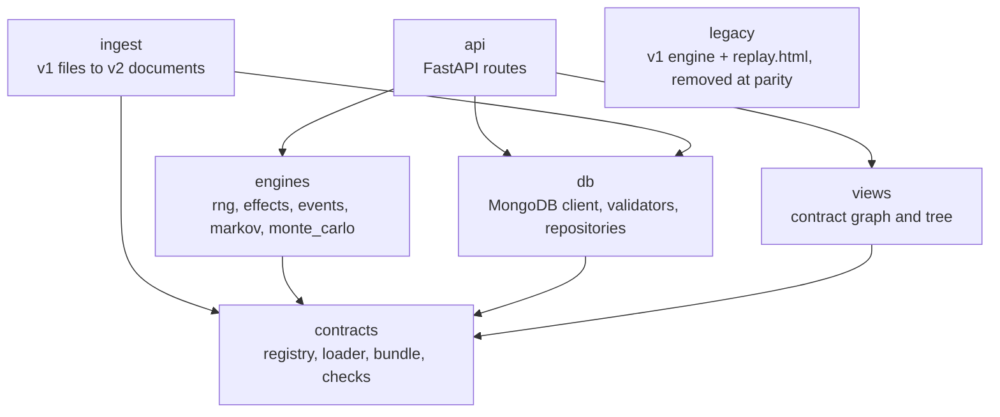
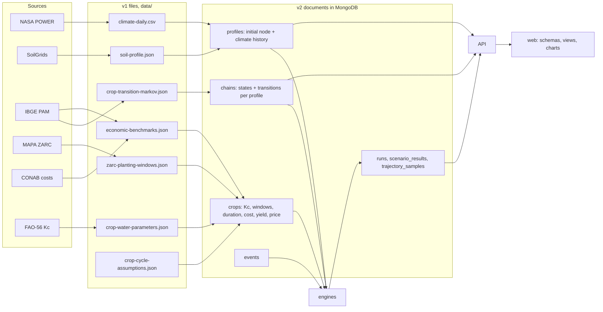
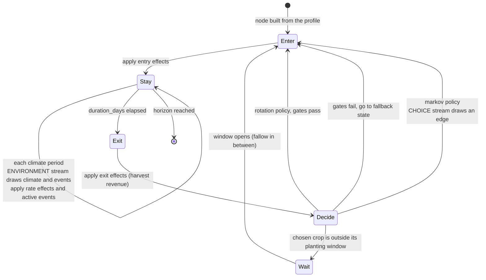
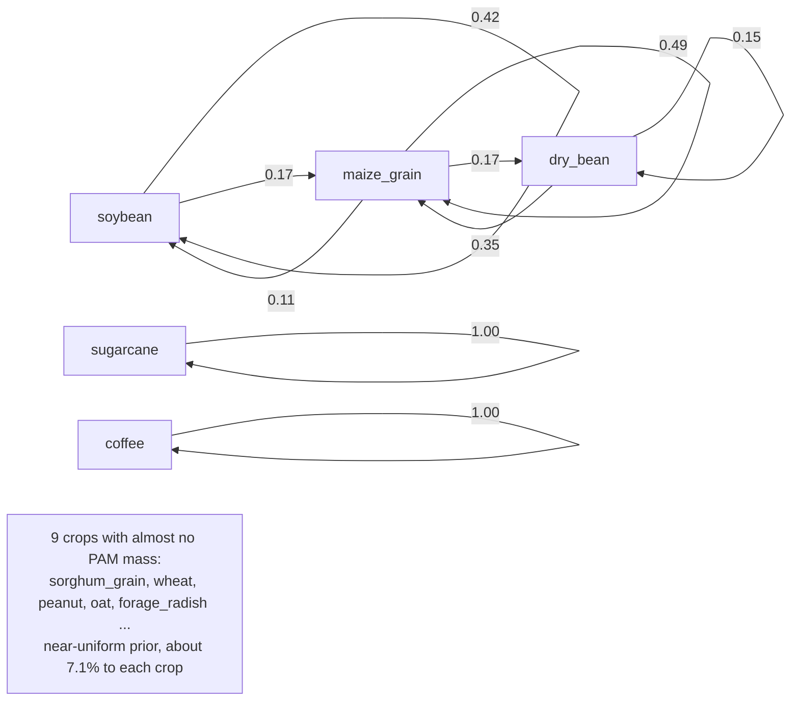
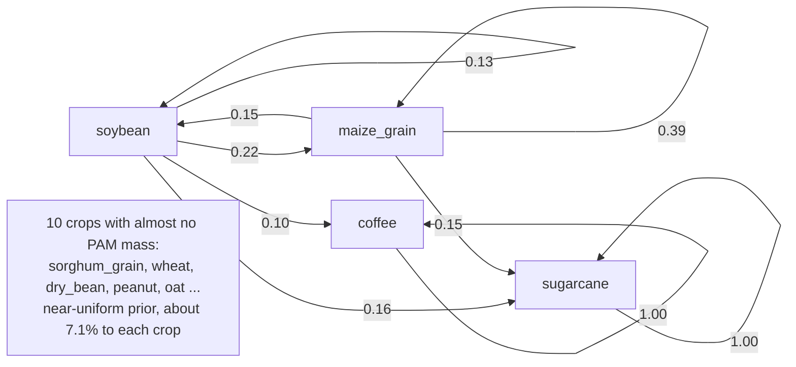
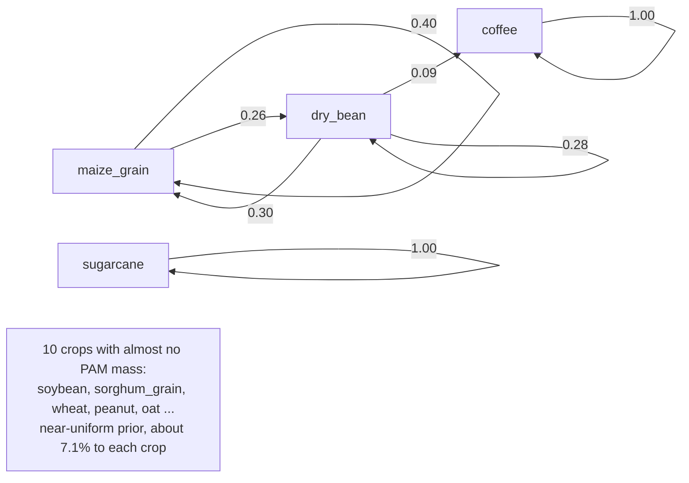
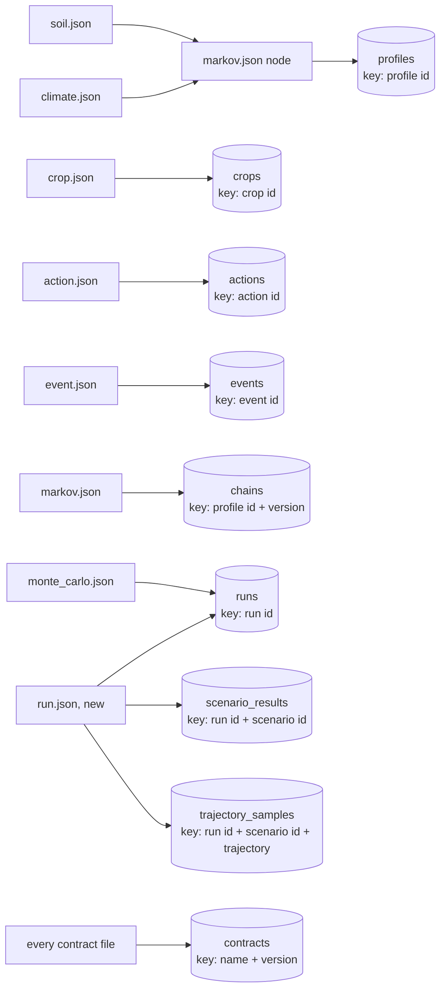
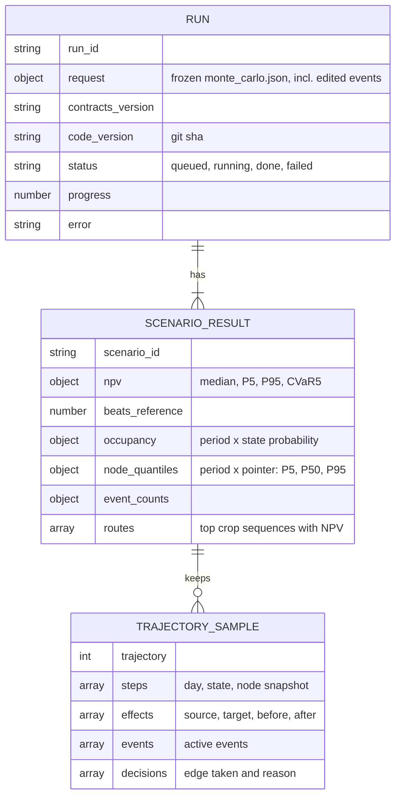

# Field Shift backend design

Status: design for review. No backend code exists yet; this document and its graphs are the audit step before implementation. Branch: `refactor/backend-engine`.

## Goal

Turn the research app into a backend for a web application:

- FastAPI endpoints that expose the contracts, their views, profiles, chains and simulation results.
- `markov.py` and `monte_carlo.py` engines that implement contracts v2 (`data/contracts/v2/`).
- MongoDB collections validated by the same contracts.

Today the crop model (Markov, water, carbon, NPV, 100,000 trajectories) runs in JavaScript inside `field_shift/replay.html`. The Python engines only cover the v1 water-state model. The engine phase ports the JavaScript model to Python.

Out of scope: the geographic map overlay of simulations.

## Decisions taken

- FastAPI.
- Restructure `field_shift/` in place. v1 modules move to `field_shift/legacy/` so `docs/visualizacao.html` can still be rebuilt, and are removed when the new engine reproduces v1.
- A run separates environment (random, shared by all scenarios), choice (scenario policy) and outcomes (deterministic). See `data/contracts/v2/monte_carlo.json`.
- The v1 reweighting of Markov probabilities by simulated water and carbon is dropped for now. If needed later it returns as optional `weight_modifiers` on transitions.

## G1. Module map

Target packages inside `field_shift/` and the only import directions allowed. `contracts` depends on nothing; `engines` never touches the database or HTTP, so it can be tested and audited alone.



## G2. Data lineage

Where every value comes from and where it ends up. Nothing in the ingestion step invents data: each v2 document keeps the support and provenance of its v1 source.



## G3. Trajectory lifecycle

One trajectory of one scenario. Random draws happen in three places only, each with its own stream: environment (climate and events, shared by all scenarios), parameters (uncertain effect values, shared by all scenarios) and choice (only the markov policy).



### Randomness

Streams are derived from keys, so a draw never depends on how many draws came before it:

| Stream | Key | Draws |
|---|---|---|
| environment | seed, trajectory | climate year blocks, event onsets and durations |
| parameters | seed, trajectory, contract location of the value | every distribution in effects, events and durations |
| choice | seed, trajectory, scenario | edges, only under the markov policy |

Same seed and trajectory give the same environment and parameters in every scenario, so scenarios differ only by the choice.

## G4. Chains generated from v1, per profile

Preview of the v1 to v2 mapping, computed read-only from `data/profiles/<profile>/crop-transition-markov.json`. Rule: one state per catalog crop (`<crop>:skip_stages`); probability = (mass + alpha) / (row mass + destinations x alpha) with alpha = 0.5; perennials keep only their allowed destinations. Solid arrows have PAM mass (`derived`), dashed arrows are prior only. Arrows below 0.08 are hidden.

### Findings to audit

1. **Edge mass is derived, not observed.** v1 computes it as the product of the top-5 crop area shares in consecutive years (`max_entropy_outer_product_of_top5_area_shares`), which assumes independence. v2 edges with mass get `support: derived`; edges without mass get `support: prior`. Only the rank-1 pairs are real counts, and v1 keeps them as a diagnostic.
2. **Most rows are almost pure prior.** Per profile only 3 or 4 crops have PAM mass. For the others the Dirichlet prior (alpha 0.5 per destination) is 90% or more of the row, so they go to each of the 14 crops with about 7% chance. The `regional-baseline` scenario is only informative when it starts from a crop with mass.
3. **Coffee and sugarcane never leave** (v1 lifecycle rules: perennial, no renewal data). A baseline that reaches them stays there for the whole horizon.
4. **The preview ignores the planting calendar.** v1 also restricts destinations to crops with a ZARC window in the next 365 days and renormalizes. In v2 that is an engine rule (wait in fallow until the window), so probabilities here are the calendar-free ones.
5. **Contract changes this mapping needs:** `transition.mass` (number; `count` is an integer and the mass is fractional), a `fallow:skip_stages` state, and a shape for the coffee inter-row cover subchain (not mapped yet).

### ariquemes-ro (1988-2025)



| From | PAM mass | Prior weight | Rule | Main destinations |
|---|---|---|---|---|
| soybean | 9.62 | 42% | - | soybean 0.42, maize_grain 0.17, coffee 0.07 |
| maize_grain | 19.50 | 26% | - | maize_grain 0.49, dry_bean 0.17, soybean 0.11 |
| sugarcane | 0.00 | 99% | perennial: stays | sugarcane 1.00 |
| coffee | 0.25 | 67% | perennial: stays | coffee 1.00 |
| sorghum_grain | 0.00 | 100% | - | soybean 0.07, maize_grain 0.07, sugarcane 0.07 |
| wheat | 0.00 | 100% | - | soybean 0.07, maize_grain 0.07, sugarcane 0.07 |
| dry_bean | 6.09 | 53% | - | maize_grain 0.35, dry_bean 0.15, soybean 0.06 |
| peanut | 0.00 | 100% | - | maize_grain 0.07, dry_bean 0.07, soybean 0.07 |
| oat | 0.00 | 100% | - | soybean 0.07, maize_grain 0.07, sugarcane 0.07 |
| forage_radish | 0.00 | 100% | - | soybean 0.07, maize_grain 0.07, sugarcane 0.07 |
| brachiaria | 0.00 | 100% | - | soybean 0.07, maize_grain 0.07, sugarcane 0.07 |
| millet | 0.00 | 100% | - | soybean 0.07, maize_grain 0.07, sugarcane 0.07 |
| crotalaria | 0.00 | 100% | - | soybean 0.07, maize_grain 0.07, sugarcane 0.07 |
| mucuna | 0.00 | 100% | - | soybean 0.07, maize_grain 0.07, sugarcane 0.07 |

### franca-sp (1988-2025)



| From | PAM mass | Prior weight | Rule | Main destinations |
|---|---|---|---|---|
| soybean | 5.95 | 54% | - | maize_grain 0.22, sugarcane 0.16, soybean 0.13 |
| maize_grain | 13.44 | 34% | - | maize_grain 0.39, soybean 0.15, sugarcane 0.15 |
| sugarcane | 3.16 | 14% | perennial: stays | sugarcane 1.00 |
| coffee | 4.93 | 9% | perennial: stays | coffee 1.00 |
| sorghum_grain | 0.26 | 96% | - | coffee 0.08, sugarcane 0.08, maize_grain 0.08 |
| wheat | 0.00 | 100% | - | soybean 0.07, maize_grain 0.07, sugarcane 0.07 |
| dry_bean | 0.39 | 95% | - | maize_grain 0.10, soybean 0.08, sugarcane 0.07 |
| peanut | 0.00 | 100% | - | soybean 0.07, maize_grain 0.07, sugarcane 0.07 |
| oat | 0.00 | 100% | - | soybean 0.07, maize_grain 0.07, sugarcane 0.07 |
| forage_radish | 0.00 | 100% | - | soybean 0.07, maize_grain 0.07, sugarcane 0.07 |
| brachiaria | 0.00 | 100% | - | soybean 0.07, maize_grain 0.07, sugarcane 0.07 |
| millet | 0.00 | 100% | - | soybean 0.07, maize_grain 0.07, sugarcane 0.07 |
| crotalaria | 0.00 | 100% | - | soybean 0.07, maize_grain 0.07, sugarcane 0.07 |
| mucuna | 0.00 | 100% | - | soybean 0.07, maize_grain 0.07, sugarcane 0.07 |

### varginha-mg (1988-2025)



| From | PAM mass | Prior weight | Rule | Main destinations |
|---|---|---|---|---|
| soybean | 0.11 | 99% | - | coffee 0.08, maize_grain 0.07, dry_bean 0.07 |
| maize_grain | 14.40 | 33% | - | maize_grain 0.40, dry_bean 0.26, coffee 0.07 |
| sugarcane | 0.01 | 98% | perennial: stays | sugarcane 1.00 |
| coffee | 10.02 | 5% | perennial: stays | coffee 1.00 |
| sorghum_grain | 0.00 | 100% | - | maize_grain 0.07, dry_bean 0.07, sugarcane 0.07 |
| wheat | 0.01 | 100% | - | coffee 0.07, dry_bean 0.07, maize_grain 0.07 |
| dry_bean | 10.63 | 40% | - | maize_grain 0.30, dry_bean 0.28, coffee 0.09 |
| peanut | 0.01 | 100% | - | maize_grain 0.07, dry_bean 0.07, sugarcane 0.07 |
| oat | 0.00 | 100% | - | soybean 0.07, maize_grain 0.07, sugarcane 0.07 |
| forage_radish | 0.00 | 100% | - | soybean 0.07, maize_grain 0.07, sugarcane 0.07 |
| brachiaria | 0.00 | 100% | - | soybean 0.07, maize_grain 0.07, sugarcane 0.07 |
| millet | 0.00 | 100% | - | soybean 0.07, maize_grain 0.07, sugarcane 0.07 |
| crotalaria | 0.00 | 100% | - | soybean 0.07, maize_grain 0.07, sugarcane 0.07 |
| mucuna | 0.00 | 100% | - | soybean 0.07, maize_grain 0.07, sugarcane 0.07 |

## G5. Collections and validators

Each collection is validated twice: by the JSON Schema contract in the application (clear error messages) and by a MongoDB `$jsonSchema` validator translated from the same contract (second line of defence).



## G6. Run state

What a simulation run stores. Full trajectories are never stored (100,000 trajectories times 120 steps); aggregates are accumulated while the run executes, and a few sampled trajectories are kept in full for audit.



### Contract to MongoDB validator

The contract is bundled (every `$ref` inlined) and translated: drop `$schema`, `$id`, `$comment`, `definitions`, `examples`, `default` and `format`; move `unit` into `description`; `integer` becomes `bsonType: [int, long]` and `number` becomes `[double, int, long, decimal]`; `const` becomes a one-value `enum`; `_id` is added to the root properties because the contracts use `additionalProperties: false`.

## G7. API

| Phase | Endpoint | Returns |
|---|---|---|
| Validation | `GET /contracts` | List contract names and versions |
| Validation | `GET /contracts/{name}` | One contract with every $ref inlined |
| Validation | `GET /contracts/{name}/mongo` | The MongoDB validator generated from it |
| Validation | `POST /validate/{name}` | Validate a document; returns the list of errors |
| Validation | `GET /views/graph, GET /views/tree` | Contract map data (the page in docs/contracts-v2.html) |
| Validation | `GET /profiles, GET /profiles/{id}` | Profiles and their initial node |
| Validation | `GET /profiles/{id}/chain` | The v2 chain of a profile |
| Validation | `GET /profiles/{id}/chain/matrix` | Probability, support and prior weight per row, for charts |
| Engines | `POST /runs` | Start a run from a monte_carlo.json request |
| Engines | `GET /runs/{id}` | Status, progress and scenario summaries |
| Engines | `GET /runs/{id}/scenarios/{sid}/occupancy` | State probability over time |
| Engines | `GET /runs/{id}/scenarios/{sid}/quantiles?pointer=` | P5/P50/P95 of one node value over time |
| Engines | `GET /runs/{id}/scenarios/{sid}/samples` | Sampled trajectories with every applied effect |

## Package layout

```
field_shift/
  contracts/   registry, loader (Draft-07 with cross-file refs), bundle, mongo_schema, checks
  ingest/      v1 files to v2 documents: profiles, crops, chains, economic inputs
  engines/     rng, effects, events, markov, monte_carlo, water
  db/          client, collections, validators, repositories
  api/         app and routes: contracts, views, profiles, chains, runs
  views/       contract graph and tree
  legacy/      v1 modules and replay.html
tests/         unit per module, MongoDB integration, API
pyproject.toml, docker-compose.yml (MongoDB + API)
```

## Reuse

| Existing code | Goes to |
|---|---|
| `data/pipeline/contract_registry.py` (registry by logical name) | `contracts/registry.py` |
| `data/pipeline/validate_v2_examples.py` (`markov_graph_errors`, `monte_carlo_errors`) | `contracts/checks.py` |
| `data/pipeline/build_contract_views.py` (`load_schemas`, `resolve`, `tree`, `build_graph`) | `views/` and the bundler |
| `field_shift/markov.py` (`Distribution`) | markov policy draw |
| `field_shift/monte_carlo.py` (`FinancialSummary`, `SeasonalHistory`) | NPV summary, climate resampling |
| `field_shift/visualize.py` (`topsoil_carbon_g_kg`) | profile ingestion |
| `field_shift/replay.html` JS (`nextPlantingOpportunity`, `cycleDays`, `maturationDays`, `advanceWaterForCrop`, `soilDelta`, `repeatedCropYieldMultiplier`, `economicCashflow`, `scoreTrajectoryVpl`) | ported to `engines/` |

## Phases

1. **Validation layer.** Scaffold, `contracts/`, `views/`, `db/`, ingestion v1 to v2, validation and profile/chain endpoints, tests, legacy move. Gate: G4 regenerated from the real ingestion matches the audited preview.
2. **Engines.** `rng`, `effects`, `events`, `markov`, `monte_carlo`, `run.json`, run endpoints. Gate: parity report against the v1 JavaScript model on NPV distributions.
3. **Review package** for the code owners (README, OpenAPI, CI), then v1 removal.

## Open questions

- Accept `derived` / `prior` as the support of generated edges (finding 1)?
- Keep the 14-crop uniform prior for crops without PAM mass, or restrict the baseline to crops with mass (finding 2)?
- Shape of the coffee inter-row cover subchain in v2.
- Climate per period: resample whole historical years (v1 behaviour) or individual periods?
