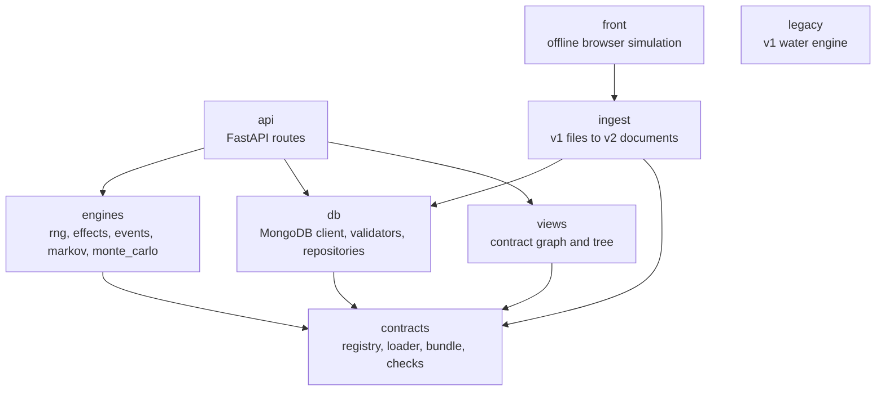
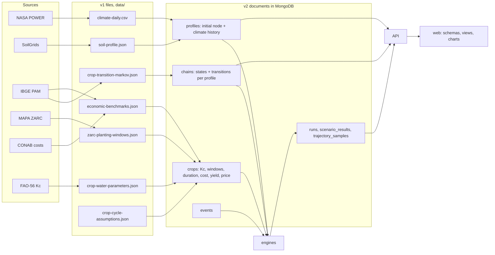
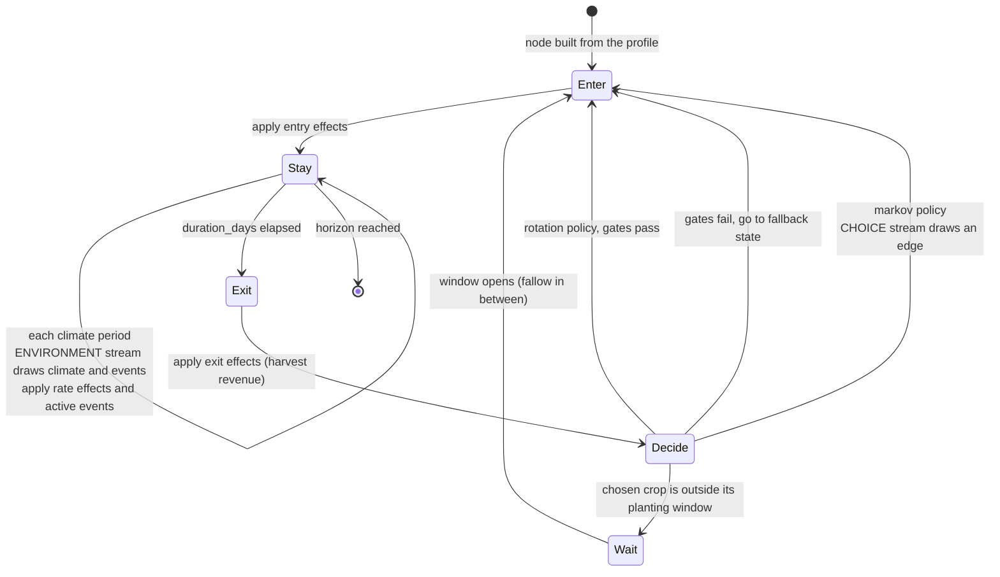
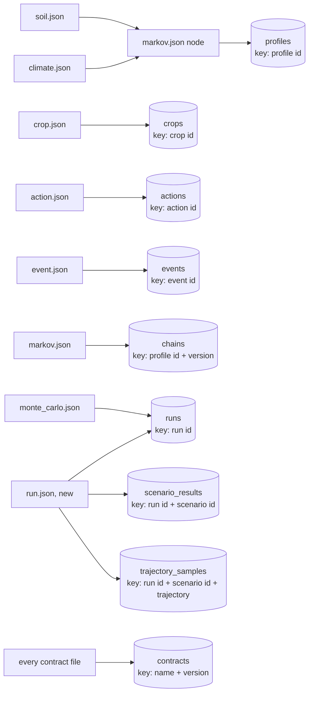
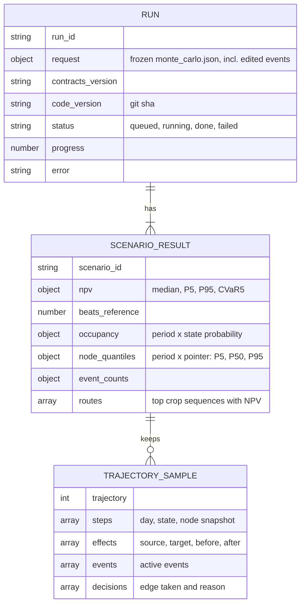

# Field Shift backend design

Status: validation layer implemented (contracts, ingestion, MongoDB validators, API, tests); engines not started. Branch: `refactor/backend-engine`.

## Goal

Turn the research app into a backend for a web application:

- FastAPI endpoints that expose the contracts, their views, profiles, chains and simulation results.
- `markov.py` and `monte_carlo.py` engines that implement contracts v2 (`data/contracts/v2/`).
- MongoDB collections validated by the same contracts.

The crop model runs in the browser. The sources and generator live in `field_shift/front/`, and `python -m field_shift.front` builds the self-contained `docs/visualizacao.html`. Running the visualizer requires no API or MongoDB. A server-side simulation engine is a separate future step.

Out of scope: the geographic map overlay of simulations.

## Decisions taken

- FastAPI.
- Keep the browser simulation and the Python legacy water model in separate packages.
- A run separates environment (random, shared by all scenarios), choice (scenario policy) and outcomes (deterministic). See `data/contracts/v2/monte_carlo.json`.
- Generated edges with PAM mass are `derived`; edges supported only by the Dirichlet prior are `prior`.
- Coffee is out of the model: its profitable cycle (about 3 years) is too long for the horizon.
- The browser keeps the v1 calendar gates and water/carbon reweighting. The API matrix reports the baseline before these adjustments.

## G1. Module map

Target packages inside `field_shift/` and the only import directions allowed. `contracts` depends on nothing; `engines` never touches the database or HTTP, so it can be tested and audited alone.



## G2. Data lineage

Where every value comes from and where it ends up. Nothing in the ingestion step invents data: each v2 document keeps the support and provenance of its v1 source.



## G3. Trajectory lifecycle

One trajectory of one scenario. Random draws happen in three places only, each with its own stream: environment (climate and events, shared by all scenarios), parameters (uncertain effect values, shared by all scenarios) and choice (only the markov policy).



### Randomness

Streams are derived from keys, so a draw never depends on how many draws came before it:

| Stream | Key | Draws |
|---|---|---|
| environment | seed, trajectory | climate year blocks, event onsets and durations |
| parameters | seed, trajectory, contract location of the value | every distribution in effects, events and durations |
| choice | seed, trajectory, scenario | edges, only under the markov policy |

Same seed and trajectory give the same environment and parameters in every scenario, so scenarios differ only by the choice.

## G4. Chains generated from v1, per profile

Run `python -m field_shift.ingest` to write the v2 documents and the [ingestion report](../data/v2/ingestion-report.json). Each crop has a `<crop>:skip_stages` state; `fallow:skip_stages` is reserved for waiting and is not a PAM destination. The browser projects the v2 state IDs to crop IDs for the UI and consumes `from`, `to` and raw `mass`.

- **Probability.** Every allowed destination receives Dirichlet alpha 0.5. The API reports the mean `(mass + alpha) / (outgoing_mass + alpha × destinations)`; there is no minimum mass or probability cutoff. The browser samples a row per trajectory, restricts it to the current planting calendar, applies water/carbon factors and normalizes. A prior edge represents an assumption, not municipal or field evidence.
- **Crop lifecycle.** Coffee and its interrow simulation are excluded. The regional Markov chain keeps the sugarcane self-transition. In the browser, `initial_sugarcane_cut` identifies the next harvest of standing cane. Newly planted cane starts at cut 1 after maturation. After cut 5, the browser samples annual crops with eligible calendars using regional PAM mass as a prior. The five-cut cycle is a modeling assumption. The current inputs do not split yield, price or costs by cut, and the simulation has no separate stool-removal cost.
- **PAM audit.** `pam_history` preserves the original annual top five, including coffee when reported. Shares retain their historical denominator. Counts of consecutive rank-one crops are a separate diagnostic, not observed field transitions.
- **Water.** The profile keeps a continuous fraction of available water capacity and documents how to present it as low, medium or high (thirds). The browser estimates the fraction each period from the historical water classes and the crop demand adjustment. It uses the continuous fraction to reweight crop transitions and the classes for the existing yield and chart rules.
- **Economics.** The v2 profile retains v1 yield, price, trend, costs, eligibility, discount rate and currency month. The browser retains the v1 ranking rules (P95/CVaR5 within economics, and the weight on final soil and water). Editing assumptions applies to the browser session.

## G5. Collections and validators

Each collection is validated twice: by the JSON Schema contract in the application (clear error messages) and by a MongoDB `$jsonSchema` validator translated from the same contract (second line of defence).



## G6. Run state

What a simulation run stores. Full trajectories are never stored (100,000 trajectories times 120 steps); aggregates are accumulated while the run executes, and a few sampled trajectories are kept in full for audit.



### Contract to MongoDB validator

The contract is bundled (every `$ref` inlined) and translated: drop `$schema`, `$id`, `$comment`, `definitions`, `examples`, `default` and `format`; move `unit` into `description`; `integer` becomes `bsonType: [int, long]` and `number` becomes `[double, int, long, decimal]`; `const` becomes a one-value `enum`; `_id` is added to the root properties because the contracts use `additionalProperties: false`.

## G7. API

| Phase | Endpoint | Returns |
|---|---|---|
| Validation | `GET /contracts` | List contract names and versions |
| Validation | `GET /contracts/{name}` | One contract with every $ref inlined |
| Validation | `GET /contracts/{name}/mongo` | The MongoDB validator generated from it |
| Validation | `POST /validate/{name}` | Validate a document; returns the list of errors |
| Validation | `GET /views/graph, GET /views/tree` | Contract map data (the page in docs/contracts-v2.html) |
| Validation | `GET /profiles, GET /profiles/{id}` | Profiles and their initial node |
| Validation | `GET /profiles/{id}/chain` | The v2 chain of a profile |
| Validation | `GET /profiles/{id}/chain/matrix` | Probability, support and prior weight per row, for charts |
| Engines | `POST /runs` | Start a run from a monte_carlo.json request |
| Engines | `GET /runs/{id}` | Status, progress and scenario summaries |
| Engines | `GET /runs/{id}/scenarios/{sid}/occupancy` | State probability over time |
| Engines | `GET /runs/{id}/scenarios/{sid}/quantiles?pointer=` | P5/P50/P95 of one node value over time |
| Engines | `GET /runs/{id}/scenarios/{sid}/samples` | Sampled trajectories with every applied effect |

## Package layout

```
field_shift/
  contracts/   registry, loader (Draft-07 with cross-file refs), bundle, mongo_schema, checks
  ingest/      v1 files to v2 documents: profiles, crops, chains, economic inputs
  engines/     rng, effects, events, markov, monte_carlo, water
  db/          client, collections, validators, repositories
  api/         factory and routes: contracts, views, profiles, chains (runs with the engines)
  views/       contract graph and tree
  front/       HTML, styles, browser simulation, producer flow and offline generator
  legacy/      v1 water model and compatibility entry point
web/           front served at / (placeholder landing page until the real build lands)
docker/        entrypoint of the single image
tests/         unit per module, MongoDB integration, API
pyproject.toml, Dockerfile
```

### Deployment: single image

MongoDB, the API and the front ship in one image (`Dockerfile`, based on `mongo:7`). The entrypoint starts `mongod` bound to 127.0.0.1 inside the container, runs `python -m field_shift.ingest --mongo` (idempotent: installs the validators and upserts chains and profiles), then starts uvicorn on port 8000, the only published port. The API serves the front from `web/` at `/` (`FIELD_SHIFT_WEB_DIR` points it at another build) and the generated pages of `docs/` at `/pages`. The runtime data (`data/` without `raw` and `processed`, about 19 MB) is inside the image; nothing is loaded from outside. The database lives in the `/data/db` volume and is rebuilt from the image at every start, so losing it loses nothing.

## Reuse

| Existing code | Goes to |
|---|---|
| `data/pipeline/contract_registry.py` (v1 registry, still used by the v1 pipelines) | pattern reused in `contracts/registry.py` |
| former `data/pipeline/validate_v2_examples.py` | moved to `contracts/checks.py` and `python -m field_shift.contracts` |
| former `data/pipeline/build_contract_views.py` | moved to `views/` and `python -m field_shift.views` |
| `field_shift/markov.py` (`Distribution`) | markov policy draw |
| `field_shift/monte_carlo.py` (`FinancialSummary`, `SeasonalHistory`) | NPV summary, climate resampling |

## Phases

1. **Validation layer (done).** `contracts/`, `views/`, `db/`, ingestion of chains and profiles, validation and profile/chain endpoints, tests, legacy move. Still missing from this phase: crop ingestion (Kc, ZARC windows, durations, costs).
2. **Engines.** `rng`, `effects`, `events`, `markov`, `monte_carlo`, `run.json`, run endpoints. Gate: parity report against the v1 JavaScript model on NPV distributions.
3. **Review package** for the code owners (README, OpenAPI, CI), then v1 removal.

## Open questions

- Sugarcane reform costs and yield by cut still need field or panel data. The browser uses the aggregate PAM and CONAB benchmarks at every cut.
- Climate model: see the seasons proposal discussed with the project owner (rainy-season onset and climate regime as environment variables).
- Crop ingestion: map ZARC rows (crop x soil group x cultivar cycle) to `crop.planting_windows`.
