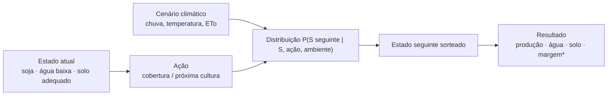
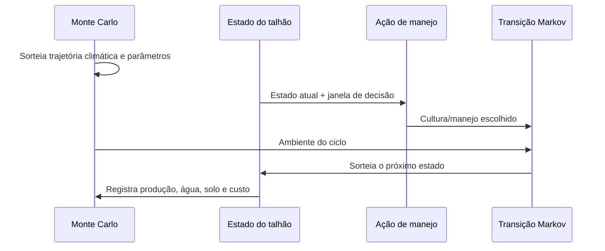

# Modelo Markov + Monte Carlo

## Unidade do modelo

A unidade é o talhão ou uma área de manejo homogênea. Em cinco anos, o motor atualiza o estado em 120 passos quinzenais, com balanço hídrico diário. A política escolhe ações nas janelas elegíveis, como semeadura, colheita ou reforma.

## Estado, ação e ambiente

O estado reúne apenas fatores que afetam a próxima decisão:

| Componente | Representação inicial |
|---|---|
| Cultura e sequência recente | Cultura atual e as últimas culturas ou famílias plantadas |
| Água disponível | Baixa, média ou alta, como fração da água disponível na zona de raízes |
| Condição do solo | Limitante, adequada ou favorável, considerando análise local e exigências da cultura |
| Calendário | Janela de plantio/colheita ou fase da cultura |

As classes são uma simplificação para o MVP. Os limites de água devem ser definidos em relação à capacidade de água disponível do solo e calibrados por cultura. A condição do solo deve usar indicadores observáveis — por exemplo, pH, nutrientes, carbono orgânico e textura — sem tratar mapas globais como análise de campo.

**Ação** é o manejo escolhido: cultura a plantar, cobertura, manejo de resíduos, irrigação disponível ou decisão de não plantar. A lista de ações viáveis depende do calendário, da infraestrutura e das prioridades do produtor.

**Ambiente** é externo ao estado: chuva, temperatura, radiação e evapotranspiração. Umidade relativa e vento podem entrar quando forem necessários para estimar evapotranspiração. Os valores formam uma trajetória sazonal, não sorteios independentes por variável.

O clima altera a água no perfil por um balanço simples:

$$
SW_{t+1} = \min(AWC,\ \max(0,\ SW_t + P_t + I_t - ETc_t - R_t - D_t))
$$

Aqui, SW é a água armazenada na zona de raízes, AWC sua capacidade disponível, P chuva, I irrigação, ETc consumo da cultura, R escoamento e D drenagem. O resultado é convertido em classe baixa, média ou alta. A condição do solo também pode mudar com nutrientes removidos, fertilização e resíduos.

## Probabilidade de transição

Para cada estado atual, ação, cenário ambiental e área, estima-se:

$$
P(S_{t+1}=j \mid S_t=i,\ a_t,\ E_t,\ local)
$$

E_t resume as condições do ciclo, como chuva e estresse térmico. A probabilidade representa a chance de o talhão chegar a cada estado seguinte — por exemplo, manter água baixa ou recuperar para água média após uma cultura de cobertura e uma estação chuvosa favorável.

Quando houver histórico, uma estimativa inicial é a frequência observada:

$$
\hat P_{ij} = \frac{N(i,a,E,j)}{\sum_j N(i,a,E,j)}
$$

Probabilidades precisam somar 1 em cada linha. Com poucos dados, usar suavização ou uma distribuição a priori explícita; marcar os valores como provisórios e atualizá-los com dados observados e referências agronômicas. Não apresentar probabilidades inventadas como evidência.

*Margem só é calculada quando custos e preços locais estiverem disponíveis.

## Como o Monte Carlo se conecta

Cada trajetória Monte Carlo representa um futuro plausível. Ela combina:

1. **Clima:** reamostrar períodos históricos por estação ou fase da cultura, preservando a sequência entre dias chuvosos e secos e a relação entre variáveis. Cenários de aquecimento ou seca podem ser aplicados como deslocamentos explícitos.
2. **Parâmetros de transição:** sortear probabilidades coerentes com os dados. Com contagens por transição, uma distribuição Dirichlet permite representar a incerteza mantendo cada linha somada a 1.
3. **Resposta agronômica:** incluir variação de produtividade e resposta do solo após calibrar funções com observações ou literatura regional. Modelar somente a incerteza residual da água após aplicar o balanço hídrico.
4. **Mercado:** usar a curva de futuros por safra como preço base, com extensão do último vencimento líquido. Atualizar os choques de preço e custo mensalmente e descontar os fluxos nominais com os juros longos definidos no [plano do MVP](plano-mvp.md#5-economia-e-comparação).

Para cada trajetória, o modelo aplica a ação, calcula a resposta da cultura e do solo sob o clima sorteado, consulta a transição condicionada e sorteia o estado seguinte. Repete até o fim do horizonte. As mesmas trajetórias climáticas devem ser usadas ao comparar estratégias, reduzindo ruído na comparação.

## Comparação e limites

Comparar a distribuição de resultados de cada estratégia: mediana e intervalo de produtividade ou margem, probabilidade de ultrapassar limites de água/solo e desempenho contra a rotação de referência. A preferência entre retorno, risco e conservação deve ser configurável pelo produtor; não há uma estratégia universalmente melhor.

Monte Carlo quantifica incerteza; não valida a matriz. As transições precisam ser confrontadas com histórico de campo, observações de solo e resultados agronômicos. Se faltarem dados, o protótipo deve exibir a incerteza e a origem das premissas.
