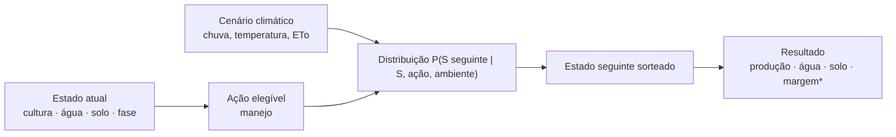
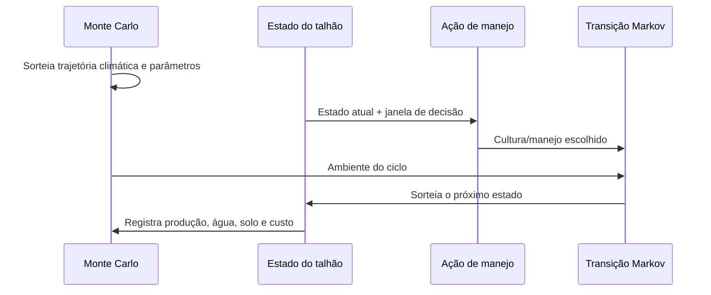

# Modelo Markov + Monte Carlo

## Unidade do modelo

A unidade final do produto é o talhão ou uma área de manejo homogênea. O horizonte do MVP é de cinco anos em 120 passos quinzenais; o balanço diário alimenta cada passo. **No código executável atual**, três perfis municipais têm clima NASA POWER diário, solo SoilGrids, calendário ZARC, histórico municipal PAM e parâmetros hídricos FAO‑56. Além da matriz de referência Kc=1, o pipeline gera matrizes derivadas condicionadas à cultura e à fase para ciclos anuais consistentes com Kc e com decêndio elegível ZARC. A ação agrícola ainda não é um efeito medido em talhão; a simulação não é recomendação.

## Estado, ação e ambiente

O estado reúne apenas fatores que afetam a próxima decisão:

| Componente | Representação inicial |
|---|---|
| Cultura e sequência recente | Cultura atual e as últimas culturas ou famílias plantadas |
| Água disponível | Baixa, média ou alta, como fração da água disponível na zona de raízes |
| Condição do solo | Limitante, adequada ou favorável, considerando análise local e exigências da cultura |
| Calendário | Janela de plantio/colheita ou fase da cultura |

As classes são uma simplificação para o MVP. Os limites de água devem ser definidos em relação à capacidade de água disponível do solo e calibrados por cultura. A condição do solo deve usar indicadores observáveis — por exemplo, pH, nutrientes, carbono orgânico e textura — sem tratar mapas globais como análise de campo.

**Ação** é o manejo escolhido: cultura a plantar, cobertura, manejo de resíduos, irrigação disponível ou decisão de não plantar. A lista de ações viáveis depende do calendário, da infraestrutura e das prioridades do produtor.

**Ambiente** é externo ao estado: chuva, temperatura, radiação e evapotranspiração. Umidade relativa e vento podem entrar quando forem necessários para estimar evapotranspiração. Os valores formam uma trajetória sazonal, não sorteios independentes por variável.

O clima altera a água no perfil por um balanço simples:

$$
SW_{t+1} = \min(AWC,\ \max(0,\ SW_t + P_t + I_t - ETc_t - R_t - D_t))
$$

Aqui, SW é a água armazenada na zona de raízes, AWC sua capacidade disponível, P chuva, I irrigação, ETc consumo da cultura, R escoamento e D drenagem. O resultado é convertido em classe baixa, média ou alta. A condição do solo também pode mudar com nutrientes removidos, fertilização e resíduos.

Os contratos de entrada ficam em [`data/contracts/`](../data/contracts/). O clima diário deve preservar data local, fuso, variável, unidade, produto/versão e flags de qualidade. O perfil de solo registra escopo, profundidade, CAD, fonte e incerteza. Mapa de solo é prior regional; não substitui análise do talhão. A documentação do fluxo e as regras de lacunas estão em [`data/README.md`](../data/README.md).

## Probabilidade de transição

Para cada estado atual, ação, cenário ambiental e área, estima-se:

$$
P(S_{t+1}=j \mid S_t=i,\ a_t,\ E_t,\ local)
$$

E_t resume as condições do ciclo, como chuva e estresse térmico. A probabilidade representa a chance de o talhão chegar a cada estado seguinte — por exemplo, manter água baixa ou recuperar para água média após uma cultura de cobertura e uma estação chuvosa favorável.

Quando houver histórico, uma estimativa inicial é a frequência observada:

$$
\hat P_{ij} = \frac{N(i,a,E,j)}{\sum_j N(i,a,E,j)}
$$

Probabilidades precisam somar 1 em cada linha. Com poucos dados, usar suavização ou uma distribuição a priori explícita; marcar os valores como provisórios e atualizá-los com dados observados e referências agronômicas. Não apresentar probabilidades inventadas como evidência.

O formato de referência usa `states.json`, `transitions.json` e `environment.json`. `crop-markov-scenarios.json` mantém, para cada cultura×decêndio, os estados água×fase e as linhas de transição. Cada linha é indexada por `(state, action, environment)` e guarda contagens inteiras por destino, `support`, tamanho amostral e `provenance`. `support=observed` é observação pareada de campo; `derived` é transição calculada por processo físico; `pooled` identifica contextos agrupados; `prior` identifica regra sem observações. A média posterior usa `alpha_j = count_j + 0,5` somente nos destinos que têm contagem positiva na linha e `P_j = alpha_j / soma(alpha)`. O carregador rejeita rótulos ambientais sem história e linhas sem origem.

As contagens `observed` exigem observações pareadas da mesma unidade de manejo: estado atual, manejo aplicado, contexto climático e próximo estado. PAM, ZARC e MapBiomas apoiam contexto/elegibilidade, mas seus agregados não equivalem a transições observadas de água/solo de um talhão. A matriz de referência deriva da demanda ET₀. A matriz de cultura deriva a demanda ETc=Kc×ET₀ ao longo das fases FAO‑56 e inclui a fase no estado; fora do ciclo, usa Kc=1 de referência. Seu decêndio precisa ocorrer em pelo menos uma combinação municipal de grupo, código de solo ZARC e risco de 20/30/40%. Esse código oficial é escolhido no registro do MAPA; não é inferido de SoilGrids. Nenhuma contagem de efeito de manejo, transição de cultura ou resposta de produtividade foi criada.

*Margem só é calculada quando custos e preços locais estiverem disponíveis.

## Como o Monte Carlo se conecta

Cada trajetória Monte Carlo representa um futuro plausível. No MVP, a configuração é 60 meses, duas atualizações por mês, 10.000 trajetórias por estratégia e semente registrada. A planilha de pesquisa foi extraída para [`data/reference/desenho-markov-monte-carlo.json`](../data/reference/desenho-markov-monte-carlo.json): suas 42 variáveis e famílias de distribuição são um desenho arquitetural não calibrado. O [plano vigente](plano-mvp.md) define as premissas ativas. Cada trajetória combina:

1. **Clima:** reamostrar períodos históricos por estação ou fase da cultura, preservando a sequência entre dias chuvosos e secos e a relação entre variáveis. Cenários de aquecimento ou seca podem ser aplicados como deslocamentos explícitos.
2. **Parâmetros de transição:** sortear probabilidades coerentes com os dados. Com contagens por transição, uma distribuição Dirichlet permite representar a incerteza mantendo cada linha somada a 1.
3. **Resposta agronômica:** incluir variação de produtividade e resposta do solo após calibrar funções com observações ou literatura regional. Modelar somente a incerteza residual da água após aplicar o balanço hídrico.
4. **Mercado:** usar a curva de futuros por safra como preço base, com extensão do último vencimento líquido. Atualizar os choques de preço e custo mensalmente e descontar os fluxos nominais com os juros longos definidos no [plano do MVP](plano-mvp.md#5-economia-e-comparação).

Para cada trajetória, o núcleo executável amostra blocos sazonais da história categórica, sorteia uma realização das linhas Dirichlet uma vez para a trajetória, e usa um uniforme por quinzena para escolher o próximo estado. Se a economia for fornecida, desconta os fluxos no fim de cada quinzena e calcula mediana, P5, P95 e média dos 5% piores. As mesmas séries de ambientes, uniformes de transição, matrizes e sorteios de pragas são compartilhados entre políticas dentro da trajetória, reduzindo ruído na comparação.

O fluxo de caixa continua sem preço/custo e não conecta curva B3/ANBIMA ou função de produtividade. `python -m field_shift.demo` executa os três perfis de referência; `field_shift.crop_demo` consome a matriz água×fase e compara a ação Kc×ZARC com a referência, compartilhando os mesmos blocos de clima e os mesmos uniforms por passo. O HTML repete essa comparação no navegador. A saída mede apenas estados de água: ainda faltam estado inicial de campo, transições observadas de manejo, Kc regional, função calibrada de resposta do rendimento, custos e preços para produtividade prevista, VPL ou ranking.

## Comparação e limites

**Política de ações.** O CLI recebe um arquivo de política com ação por estado e, opcionalmente, janelas permitidas por ação. A política e a elegibilidade devem citar calendário, cultura, infraestrutura e origem das regras. Sem uma política local válida, o motor não presume uma sequência nem recomenda manejo.

**Pragas e economia.** O motor pode receber callbacks condicionais de risco e perda por praga e de fluxo de caixa. Preços, custos e perdas exigem fonte local, unidade, data base e versão. Sem callback econômico, o resultado inclui estados finais, não VPL.

Apresentar a sequência proposta a partir da cultura inicial e a distribuição de resultados de cada estratégia elegível. Mostrar mediana e intervalo de produtividade ou margem e a probabilidade de ultrapassar limites de água e solo. O produtor pode ajustar a preferência entre retorno, risco e conservação.

Monte Carlo quantifica incerteza; não valida a matriz. As transições precisam ser confrontadas com histórico de campo, observações de solo e resultados agronômicos. Se faltarem dados, o protótipo deve exibir a incerteza e a origem das premissas.

## Estado da ingestão nesta versão

O relatório disponível cobre Cascavel, Toledo e Assis Chateaubriand no Paraná e resume a existência de 55 arquivos processados em outra máquina. Esses arquivos não estão no checkout; `data/catalog/coleta-oeste-pr.json` preserva o inventário sem tratá-los como carregados. Nos municípios de demonstração, a ingestão e o balanço de referência estão em `data/profiles/`; as limitações e fontes estão em `data/README.md` e `data/catalog/fontes-desafio-nasa.json`.
