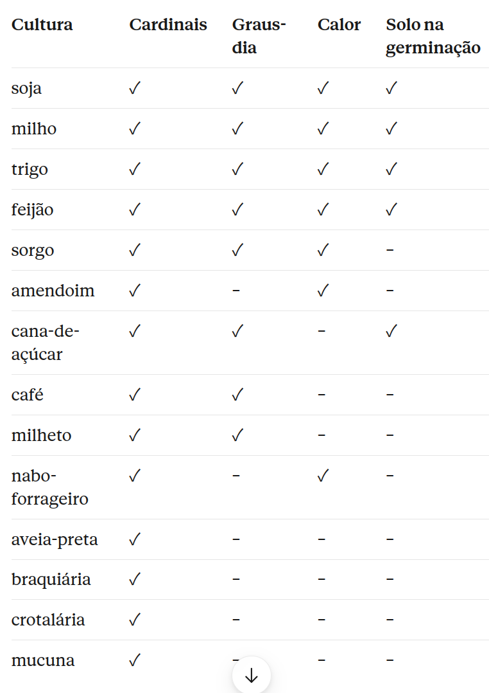

- Soil (ISRIC SoilGrids 2.0) - via API
- [ ] phh20_mean 
- [ ] sand/slid/clay_mean
- [ ] soc_mean (carbono orgânico)
- [ ] cec_mean (CTC)
- [ ] nitrogen_mean 
- Temperature
- [ ] API
- Window
- [x] ZARC
- Finance
- [ ]
- Phenology
- [x] effect of temperature

OBS: 
FAO 
- Substituição do Kc em duas culturas
- 3 culturas sem valor(nabo-forrageiro, crotalária, mucuna)

Como usar o csv da temperatura característica 

- Temperaturas cardiais 
  - Mínima(Tb, Temp_base): abaixo dela a planta não se desenvolve
  - Ótima(Tot): planta se desenvolve na velocidade máxima
  - Máxima(TB): acima dela o desenvolvimento para ou cai
- Graus dias (soma térmica - tb):
  - GDD = max(0, Tmedia - Tb) [C.dia]
  - Dá informação para o cálculo de dias para florescer
- Limiares de calor: 
  - Limites de temperaturas as quais quando passarem causam danos à planta (entra como penalidade de produtividade)
  
  

---
### Soilgrid

``` 
## O que foi usado

O script benchmark_escalabilidade.py (benchmark_escalabilidade.py) recebeu GeoJSONs, criou ee.FeatureCollections e calculou as estatísticas no servidor do Earth Engine.

| Fonte | Método usado |
|---|---|
| SoilGrids 2.0 | Bandas mean de 0–5 cm, agrupadas por propriedade, com redutor regional e fatores de escala |
| ERA5-Land | Seleção da imagem horária mais recente válida na área de referência; redução regional |
| IMERG v07 | Seleção da imagem mais recente válida; redução regional |
| CHIRPS | Seleção da imagem diária mais recente válida; redução regional |
| NASADEM | Elevação e declividade calculadas no Earth Engine |

Para cada região, o redutor calculou média, mínimo, máximo, desvio padrão e contagem de pixels válidos. As escalas usadas foram as nativas dos produtos: aproximadamente 250 m para SoilGrids, 11,1 km para ERA5-Land e IMERG, 5,6 km para CHIRPS e 30 m para NASADEM.

### Conversão do SoilGrids

O script consultou os ativos *_mean em 0–5 cm e dividiu os valores pelos fatores de escala usados nessa implementação:

- pH, areia, silte, argila, carbono orgânico e CTC: divisão por 10.
- Nitrogênio: divisão por 1.000.

O nitrogênio foi convertido para g/kg. Esses dados são estimativas do produto SoilGrids, não medições laboratoriais da propriedade.

### Seleção temporal

Para ERA5-Land, IMERG e CHIRPS, o script restringiu a busca a janelas recentes, ordenou as imagens por data e verificou se havia valores válidos na geometria de referência. As imagens selecionadas foram reutilizadas nas áreas e repetições do benchmark.

O getInfo() foi usado para trazer resultados pequenos, como datas e estatísticas. Não foram transferidas imagens ou coleções raster completas.

### Ponto climático quando a área é menor que um pixel

Primeiro, o código tentou a redução regional. Se uma fonte climática não retornasse pixels válidos para um polígono, calculou o centroide e consultou o pixel nativo que o contém. Os centroides sem valor foram agrupados em uma única operação por lote.

Isso evita transformar um pixel de 11 km em uma falsa medição de alta resolução. Polígonos próximos podem, corretamente, receber o mesmo valor climático quando compartilham o pixel.

## Credenciais e autenticação

No benchmark, as credenciais do Earth Engine não foram copiadas para o computador local nem incluídas nos arquivos de resultado.

O script rodou no servidor non, carregou GEE_PROJECT do .env sem imprimir o valor e chamou ee.Initialize(project=...). A autenticação persistente do Earth Engine já existente no servidor foi reutilizada. O .env não foi alterado.

O arquivo contém também possíveis variáveis CDS e Earthdata, mas elas não foram usadas nesta execução. Não preciso nem devo reproduzir valores de chaves ou tokens na documentação.

Exemplo simplificado do padrão usado:

import os
from dotenv import load_dotenv
import ee

load_dotenv("/home/non/field-shift-run/.env", override=False)

# Reutiliza a autenticação persistente do processo/servidor.
# O valor do projeto vem do ambiente e não deve ser impresso.
ee.Initialize(project=os.getenv("GEE_PROJECT"))

## Exemplos de consultas no Earth Engine

### Um ponto

Para um ponto, a ideia é filtrar uma coleção por período recente, ordenar por data, selecionar a imagem que contém valor válido no ponto e retornar somente o resultado:

import ee

ponto = ee.Geometry.Point([-46.060894, -12.232628])

colecao = (
    ee.ImageCollection("ECMWF/ERA5_LAND/HOURLY")
    .filterDate("2026-11-01", "2026-11-15")
    .sort("system:time_start", False)
)

# Na implementação real, verificar valores válidos antes de escolher a imagem.
imagem = ee.Image(colecao.first())

resultado = imagem.select([
    "temperature_2m",
    "soil_temperature_level_1",
]).reduceRegion(
    reducer=ee.Reducer.first(),
    geometry=ponto,
    scale=11132,
    maxPixels=1000,
)

# Aqui getInfo() retorna somente as bandas desse ponto.
valores = resultado.getInfo()

Esse trecho ilustra o padrão; para dados confiáveis, é importante fazer a verificação de valor válido antes de aceitar a imagem mais recente.

### Vários polígonos em uma chamada regional

Para regiões, construímos uma FeatureCollection e aplicamos reduceRegions:

features = ee.FeatureCollection([
    ee.Feature(ee.Geometry(g["geometry"]), g["properties"])
    for g in lista_geojson
])

estatisticas = imagem.reduceRegions(
    collection=features,
    reducer=(
        ee.Reducer.mean()
        .combine(ee.Reducer.min(), sharedInputs=True)
        .combine(ee.Reducer.max(), sharedInputs=True)
        .combine(ee.Reducer.stdDev(), sharedInputs=True)
        .combine(ee.Reducer.count(), sharedInputs=True)
    ),
    scale=escala_nativa_m,
    tileScale=2,
)

# Transfere apenas as feições e estatísticas resultantes.
linhas = estatisticas.getInfo()["features"]

No código do benchmark, isso foi feito separadamente para cada fonte, porque as resoluções nativas diferem. Assim, NASADEM não foi agregado na resolução grosseira de ERA5-Land, por exemplo.

## Lotes e paralelismo

A função reutilizável é:

resultado = coletar_propriedades_em_lote(
    geometrias=lista_geojson,
    tamanho_lote=250,
    concorrencia=4,
)

Ela divide a lista em lotes e usa um número limitado de workers. O paralelismo ocorre no cliente para submeter consultas independentes; os cálculos geoespaciais continuam no Earth Engine.

No teste de mil polígonos:

- Concorrência 1, lotes de 250: 67,80 s.
- Concorrência 2: 33,43 s.
- Concorrência 4: 17,68 s.
- Não testamos concorrência 8.
- Houve zero erros e zero retries nesses ensaios.

O código configura timeout por chamada, limita tentativas transitórias a três e aplica backoff com jitter. O teste de concorrência foi uma medição por configuração, então é um resultado inicial, não uma garantia de desempenho sustentado.

```