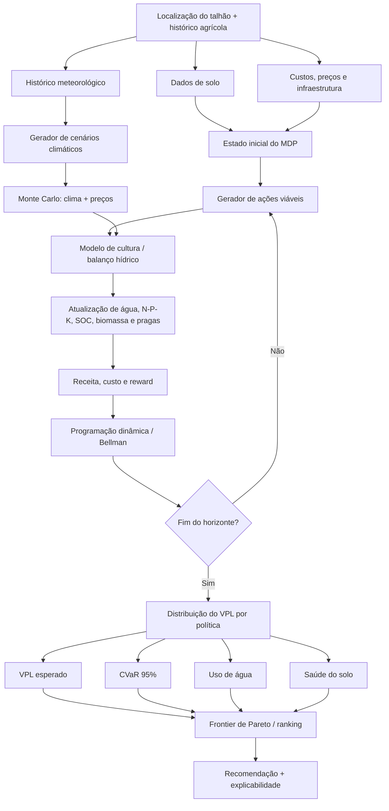

# Field Shift Brasil — framework rigoroso para rotação de culturas, risco climático e otimização de VPL

## Sumário executivo

A formulação mais robusta para o **Field Shift** é tratar a decisão agrícola como um **problema estocástico de planejamento intertemporal**: em cada talhão e janela de cultivo, o sistema observa clima, água disponível, solo, nutrientes, histórico de culturas, preços e restrições operacionais; escolhe uma ação de plantio; simula a resposta produtiva e a evolução do solo; e otimiza uma política para os cinco anos seguintes. A unidade de decisão deve ser o **talhão**, e não apenas a fazenda, porque textura, fertilidade, histórico e disponibilidade hídrica variam espacialmente. SoilGrids pode fornecer o prior geográfico, mas a Embrapa recomenda caracterizar química e fisicamente cada talhão por amostragem local. citeturn979732search9turn979732search10turn880608search9

iturn906037image2turn906037image3turn906037image5turn906037image1

Para um MVP brasileiro, **soja e milho no Cerrado são o melhor ponto de partida**: existe forte lógica de sucessão soja–milho, amplo suporte agronômico e climático e grande variação de risco pela data de semeadura. A Embrapa destaca soja, milho, sorgo, girassol, milheto, crotalárias e braquiárias como componentes de sistemas de rotação/sucessão; o sistema milho + braquiária também é amplamente usado em ILP no Centro-Oeste. citeturn690497search1turn690497search2turn690497search4 A segunda frente recomendada é **cana-de-açúcar**, porque a reforma do canavial cria uma janela discreta e altamente modelável para soja, amendoim e adubos verdes. citeturn690497search5turn690497search6 Café exige uma formulação diferente: por ser perene, o modelo deve otimizar principalmente **cobertura/consórcio de entrelinha, poda, renovação e manejo hídrico**, e não “rotacionar o café” anualmente. citeturn880608search3turn695816search23turn695816search14

O núcleo quantitativo recomendado é um **MDP finito com programação dinâmica**, alimentado por **Monte Carlo climático**. Markov entra na transição do estado; Monte Carlo representa a incerteza de clima e preços; e DP encontra a melhor sequência. Para seis a dez ações e horizonte de cinco anos, não há necessidade inicial de reinforcement learning: enumeração podada ou backward dynamic programming é mais auditável. CNN só deve entrar depois, se houver uma tarefa espacial concreta — por exemplo, estimar vigor, cobertura ou estresse a partir de Sentinel/Landsat — e não como componente obrigatório do motor decisório.

O resultado final para o produtor não deve ser “plante cultura X”. Deve ser algo como: **“Esta política possui VPL esperado de R$ X/ha, CVaR95 de −R$ Y/ha, utiliza Z mm de água, mantém K acima do limite crítico e apresenta 13% de probabilidade de quebra superior a 30%; a alternativa conservadora reduz o VPL esperado em 7%, mas corta o risco extremo pela metade.”** Esse formato explicita os trade-offs entre retorno, água, risco e conservação.

## Base agronômica, convenções e hipóteses

As janelas de calendário abaixo são **janelas típicas de planejamento**, e não autorização de plantio. A data admissível de uma propriedade deve ser consultada por município, grupo de cultivar, tipo de solo e nível de risco no **ZARC/SISZARC**. O ZARC publica períodos em decêndios e níveis de risco de 20%, 30% e 40%; a base aberta da safra 2026/27 está disponível pelo MAPA. Para soja, o calendário também precisa respeitar vazio sanitário e calendário oficial de semeadura; para 2026/27, o MAPA publicou a Portaria nº 1.579/2026. citeturn760157search0turn760157search18turn760157search25turn690497search0

As necessidades hídricas usadas como prior no modelo devem ser posteriormente calculadas por balanço hídrico diário. A Embrapa indica aproximadamente **450–800 mm por ciclo para soja**, com melhor desempenho em experimentos de Londrina próximo de 650–700 mm bem distribuídos; milho de grãos usa aproximadamente **400–700 mm**, podendo aparecer em referências agronômicas como 500–800 mm conforme clima e ciclo. citeturn760157search1turn760157search6turn760157search9turn760157search24 Para cana, experimentos e referências da Embrapa mostram forte variação com ambiente e duração do ciclo; um experimento irrigado acumulou aproximadamente 1.710 mm de ETc e outro, em ciclo de 498 dias, 2.650 mm. citeturn760157search74turn760157search28 Para café arábica, 1.200–1.800 mm de chuva anual é a faixa climática frequentemente indicada; isso **não é equivalente a ETc**, por isso o modelo deve representar balanço hídrico em vez de assumir precipitação como consumo. citeturn630272search0turn630272search4

Em termos de sensibilidade temporal, soja é particularmente vulnerável ao déficit hídrico de florescimento a enchimento de grãos; no milho, florescimento, emissão de estigmas e fecundação são fases críticas. citeturn760157search5turn760157search72 Na cana, a deficiência é especialmente problemática durante a fase de elevado crescimento vegetativo; a Embrapa ressalta o quinto e sexto mês como período de grande demanda. citeturn880608search7 No café, florada, formação de “chumbinhos” e granação são fases críticas; chuvas de primavera/verão sustentam a frutificação, enquanto períodos mais secos favorecem maturação e colheita. citeturn880608search13turn880608search0

Para solo, usem os seguintes **priors de triagem**, nunca como substitutos da análise local: soja em Cerrado costuma requerer correção para pH em torno de 5,5–6,0 ou V≥50%; milho apresenta bom desempenho em solos médios a argilosos, profundos, bem drenados e pH próximo a 6, com V de aproximadamente 50–60%; cana prefere solos profundos, com boa infiltração e armazenamento de água, e apresenta ótimo próximo a pH 6–6,5; café deve ser implantado em solo profundo e bem drenado, com correção definida a partir de pH, Al, P, K e saturação por bases. citeturn118028search14turn880608search5turn118028search3turn118028search1turn118028search2

As faixas econômicas da tabela seguinte são **priors para screening do protótipo**, não orçamentos agronômicos nem previsões de preços. “Margem bruta” significa receita bruta menos custo operacional variável, antes de terra, financiamento, impostos e depreciação completa. Na produção real, custos devem ser importados por município/tecnologia do painel da Conab e atualizados com preço de venda, produtividade e contratos do produtor. A Conab mantém sistemas públicos de custos e acompanhamento de mercado para esse fim. citeturn203958search0turn203958search3turn203958search1

## As dezesseis hipóteses de rotação

Na tabela, **fator de rendimento relativo** é um prior de modelagem da produtividade da cultura principal versus uma referência regional bem manejada (=1,00), e não um efeito causal comprovado. Da mesma forma, “risco” é uma classificação de triagem que combina exposição hídrica, complexidade operacional, dependência de janela e volatilidade econômica. Esses parâmetros devem ser atualizados por backtesting e dados de campo.

| ID | Cultura principal e ciclo proposto | Região sugerida | Calendário típico | Água a modelar | Fator relativo* | Margem bruta indicativa** | Risco |
|---|---|---|---|---:|---:|---:|---|
| S1 | **Soja → milho 2ª safra + braquiária → soja** | MT/GO, Cerrado | soja set-nov/jan-fev; milho jan-mar/jun-jul | ~900–1.400 mm/ano agrícola | 1,03–1,10 | R$ 2,5–7,0 mil/ha/ano | Médio |
| S2 | **Soja → sorgo + braquiária → soja → milheto/crotalária → soja** | GO/MT/MS, Cerrado | soja primavera-verão; coberturas/sorgo pós-colheita | ~750–1.250 | 1,02–1,08 | R$ 1,8–5,5 mil | Médio-baixo |
| S3 | **Soja → aveia-preta+nabo → milho verão → trigo → soja** | PR, Mata Atlântica/subtropical | verão soja/milho; outono-inverno aveia/trigo | ~1.000–1.600 | 1,04–1,10 | R$ 2,0–6,5 mil | Médio |
| S4 | **Soja → milheto → milho verão → crotalária → soja** | oeste BA/TO, Cerrado/MATOPIBA | soja out-fev; coberturas após colheita; evitar 2ª safra tardia | ~750–1.300 | 1,00–1,07 | R$ 1,5–5,0 mil | Médio-alto |
| M1 | **Milho verão → aveia-preta → soja → trigo → milho** | PR/SC/RS | milho set-out/fev-mar; inverno abr-ago | ~950–1.550 | 1,03–1,09 | R$ 1,8–6,0 mil | Médio |
| M2 | **Soja precoce → milho 2ª safra + braquiária → soja → milho** | MT/MS/GO | soja set-out/jan; milho jan-fev/jun | ~900–1.400 | 1,00–1,08 | R$ 2,2–6,5 mil | Médio-alto |
| M3 | **Milho verão → feijão 2ª safra → braquiária/cobertura → milho** | GO/MG Cerrado | milho out-fev; feijão fev-mai; cobertura seca | ~850–1.350 | 1,02–1,08 | R$ 2,0–7,0 mil | Alto econômico |
| M4 | **Milho → aveia+ervilhaca → soja → cobertura → milho** | RS/PR | milho primavera-verão; mix no inverno | ~950–1.500 | 1,04–1,10 | R$ 2,0–6,0 mil | Médio |
| A1 | **Cana 4–5 cortes → soja precoce na reforma → replantio** | SP/PR, Mata Atlântica/Cerrado transição | retirada set-out; soja nov-dez/fev-mar; cana mar-abr | ~1.200–1.800 mm/ano equivalente | 1,03–1,10 | R$ 4–10 mil/ha/ano*** | Médio |
| A2 | **Cana → amendoim na reforma → cana** | SP, especialmente áreas com cadeia de amendoim | reforma primavera; amendoim out/nov–fev/mar | ~1.200–1.850 | 1,03–1,10 | R$ 4–12 mil*** | Médio-alto |
| A3 | **Cana → Crotalaria juncea → cana** | SP/GO/MS | crotalária nov-dez; manejo antes da cana | ~1.150–1.750 | 1,02–1,08 | R$ 3,5–9 mil*** | Baixo-médio |
| A4 | **Cana → mucuna/crotalária + palhada → cana** | GO/MS/SP | reforma no período úmido; replantio posterior | ~1.150–1.750 | 1,02–1,08 | R$ 3,5–9 mil*** | Baixo-médio |
| C1 | **Café arábica + braquiária manejada na entrelinha** | Cerrado Mineiro, MG | café perene; roçadas/biomassa conforme chuva | ~1.200–1.800 mm chuva/ano | 1,03–1,12 | R$ 10–35 mil/ha/ano*** | Médio |
| C2 | **Café + feijão intercalar na formação + feijão-de-porco/lablabe** | Zona da Mata MG | anuais nas entrelinhas durante formação | ~1.200–1.700 | 0,98–1,07 | R$ 8–30 mil*** | Médio-alto |
| C3 | **Conilon + milheto/feijão-de-porco/mucuna manejados** | ES/RO | coberturas em entrelinha e corte antes de competição hídrica | ~1.400–1.900 | 0,98–1,08 | R$ 10–35 mil*** | Médio-alto |
| C4 | **Arábica + leguminosa perene/amendoim-forrageiro em entrelinha** | MG Cerrado/Sul de MG | cobertura contínua, faixa limpa junto ao cafeeiro | ~1.200–1.800 | 1,00–1,08 | R$ 10–35 mil*** | Médio |

\* Prior de modelagem, a calibrar. ** Faixas de screening em reais de 2026, não orçamento oficial. *** Equivalente anualizado para cultura perene/semiperene.

### Soja

**S1 — Soja → milho 2ª safra + braquiária** é a hipótese de maior prioridade para o MVP. O milho de segunda safra é cultivado tipicamente depois da soja precoce no Centro-Sul; quanto mais tardia a semeadura, maior a exposição a seca no Centro-Oeste e a geada em regiões mais ao sul. A braquiária deixa raiz viva e palhada durante a seca, aumenta diversidade funcional e pode preparar a área para soja seguinte. citeturn690497search3turn690497search8turn690497search4 Solos médios/argilosos e profundos dão maior buffer de água; solos arenosos exigem janela mais conservadora. citeturn690497search3turn880608search5 Principais custos: sementes híbridas, fertilizantes do milho, defensivos, dessecação e colheita. Restrição crítica: capacidade de colher soja e semear milho quase simultaneamente.

**S2 — Soja → sorgo/braquiária → soja → milheto/crotalária** sacrifica parte da receita potencial da segunda safra em troca de maior resiliência e biomassa. A lógica é particularmente útil onde a chuva termina cedo ou a janela de milho já ficou arriscada. A Embrapa recomenda sorgo, milheto, crotalárias e braquiárias como opções para diversificação/cobertura do Cerrado. citeturn690497search1turn690497search8 Sorgo e milheto reduzem exposição hídrica relativa ao milho tardio; crotalária adiciona diversidade e N biológico, embora o resultado dependa de espécie e manejo.

**S3 — Soja → aveia+nabo → milho verão → trigo → soja**, no Paraná, aproveita a disponibilidade de culturas de inverno e produz alternância de famílias e arquiteturas radiculares. A Embrapa cita aveia, nabo e trigo entre os componentes clássicos de sistemas envolvendo soja e milho. citeturn690497search1turn690497search2 O principal risco passa de “fim precoce das chuvas” para excesso de umidade, geada e doenças do inverno.

**S4 — MATOPIBA conservador** deve deliberadamente limitar segunda safra de alta demanda onde a estação chuvosa termina cedo. A paisagem de oeste da Bahia contém grandes sistemas de soja/milho e pivôs, mas a decisão de dupla safra deve ser condicionada pela distribuição pluviométrica e pelo ZARC, e não pela média anual isolada. citeturn906037image3turn760157search25

### Milho

O milho demanda aproximadamente 400–700 mm por ciclo em condições usuais, e é extremamente sensível ao déficit durante florescimento, emissão de estigmas e fecundação. citeturn760157search9turn760157search72

**M1 e M4**, no Sul, colocam milho em alternância com soja e cobertura de inverno. A aveia fornece grande quantidade de resíduo de relação C:N alta; ervilhaca adiciona uma leguminosa ao sistema. O objetivo é evitar milho após milho e aumentar matéria orgânica, cobertura e diversidade radicular. A rotação de famílias botânicas também ajuda a interromper ciclos de pragas e doenças. citeturn690497search2turn690497search8

**M2** representa o sistema dominante de Cerrado com milho de segunda safra, mas o algoritmo deve poder rejeitar o milho quando a soja é colhida tarde. A Embrapa enfatiza que a decisão da segunda safra deve ser planejada desde a cultura anterior e condicionada a água, temperatura e ciclo do híbrido. citeturn690497search3 Esse é um excelente caso para o Field Shift: “plantar milho” e “não plantar milho” são ações concorrentes com valor econômico dependente da data e do clima.

**M3 — milho/feijão/cobertura** pode gerar mais valor por hectare, mas requer maior capacidade operacional, maior atenção fitossanitária e mercado para feijão. Deve ser penalizado no modelo quando mão de obra, irrigação ou colheita estiverem limitadas.

### Cana-de-açúcar

Cana exige outra escala temporal. O ciclo típico do canavial envolve vários cortes antes da reforma; portanto, dentro do MDP, “manter soqueira”, “reformar agora” e “reformar + cultura intermediária” devem ser ações explícitas. A Embrapa relata que a reforma tradicional ocorre com retirada da cana em setembro/outubro, destruição da soqueira e implantação de cultura anual ou adubo verde, seguida por nova cana após a colheita. Soja, amendoim e Crotalaria juncea estão entre as opções recomendadas. citeturn690497search5turn690497search6

**A1, soja**, cria receita durante reforma e adiciona N por fixação biológica. **A2, amendoim**, é particularmente interessante em São Paulo onde existe cadeia industrial, mas introduz maquinário e mercado específicos. **A3, crotalária**, favorece biomassa, cobertura, reciclagem e manejo fitossanitário, com menor complexidade comercial. **A4, mucuna/crotalária**, privilegia recuperação do solo. A cultura de reforma deve ser escolhida também em função de nematoides e pragas presentes; não existe um adubo verde universalmente seguro para qualquer talhão. citeturn690497search6

Cana tolera faixa ampla de pH, embora a Embrapa indique ótimo próximo de 6,5 e enfatize solos profundos, boa infiltração e capacidade de armazenamento de água. citeturn880608search7 O modelo deve incorporar palhada, vinhaça e torta de filtro como fluxos de N/K/P e carbono quando estiverem disponíveis, já que são importantes fontes orgânicas no sistema canavieiro. citeturn880608search11

### Café

Em café, as quatro hipóteses são **estratégias de entrelinha e renovação**, e não rotações anuais da cultura principal. Isso deve aparecer explicitamente na interface para evitar uma interpretação agronomicamente incorreta.

**C1 — café arábica + braquiária**, no Cerrado Mineiro, tem boa evidência experimental: trabalhos da Embrapa mostram melhoria de atributos físico-hídricos e armazenamento de água, e resultados de campo reportaram maior água prontamente disponível e maior estoque de carbono em sistemas bem manejados. citeturn880608search3turn695816search14 A restrição é competição por água se a braquiária não for roçada/manejada corretamente.

**C2 — café + feijão + leguminosas**, na Zona da Mata, é adequado sobretudo a agricultura familiar e fase de formação. Feijão é usado entre linhas, e estudo em Minas avaliou feijão-de-porco e lablabe; o feijão-de-porco acumulou quantidade relevante de N, embora não tenha aumentado a produtividade do feijão subsequente naquele experimento. citeturn880608search4turn880608search12

**C3 — conilon + coberturas**, em ES/RO, pode usar milheto, feijão-de-porco, mucuna ou guandu, que já foram avaliados em sistemas com conilon. citeturn695816search6 É indispensável penalizar competição hídrica: a própria literatura da Embrapa registra casos de competição de coberturas em conilon sob condições de baixa fertilidade/água. citeturn695816search24

**C4 — café + leguminosa perene**, como amendoim-forrageiro, soja perene ou calopogônio, é uma hipótese para redução de plantas espontâneas e maior cobertura. Essas espécies foram testadas em cafezais do Cerrado, mas o benefício deve ser tratado como efeito condicionado, não garantia. citeturn695816search2turn695816search19

## Arquitetura Markov–MDP, Monte Carlo e programação dinâmica

A unidade temporal ideal é **mensal internamente**, com decisão agronômica em eventos discretos: plantio, colheita, reforma, poda ou início de safra. Isso evita um MDP diário gigantesco, mas permite calcular balanço hídrico e fenologia com meteorologia diária.

Defina o estado do talhão no tempo \(t\):

\[
S_t=
\{
c_t,\;a_t,\;SOC_t,\;N_t,\;P_t,\;K_t,\;pH_t,\;
AWC_t,\;\theta_t,\;B_t,\;D_t,\;Pest_t,\;
m_t,\;I_t,\;C_t^{cash}
\}
\]

em que \(c_t\) é cultura/histórico; \(a_t\), idade da cultura perene ou número de corte; \(SOC\), carbono orgânico; N/P/K, pools disponíveis; AWC, capacidade de água disponível; \(\theta\), água atual; \(B\), biomassa/palhada; \(D\), compactação/estrutura; \(Pest\), vetor de pressão de pragas/doenças/nematoides; \(m_t\), mês/janela; \(I_t\), infraestrutura disponível; e \(C_t^{cash}\), caixa/orçamento.

As **ações** incluem plantar soja, milho, sorgo, feijão ou cobertura; implantar milho+braquiária; manter pousio protegido; irrigar quando possível; reformar canavial; manter soqueira; plantar cultura de reforma; roçar entrelinha de café; renovar/podar café; e “não plantar” quando o risco for excessivo.

A transição é:

\[
S_{t+1}=f(S_t,A_t,W_t,M_t,\varepsilon_t)
\]

onde \(W_t\) é o cenário meteorológico e \(M_t\) representa manejo. O clima não deve ser um simples rótulo “seco/normal/chuvoso”; deve atualizar diariamente precipitação, temperatura, radiação e ETo.

O balanço hídrico básico pode seguir:

\[
SW_{d+1}
=\min\left[
AWC,\;
SW_d+P_d+I_d-ET_{c,d}-R_d-D_d
\right]
\]

e:

\[
ET_{c,d}=K_{c,\phi(d)}ETo_d\,K_s(SW_d)
\]

onde \(\phi(d)\) é a fase fenológica e \(K_s\) reduz evapotranspiração quando há estresse.

Produtividade potencial:

\[
Y=Y_{pot}(GDD,Rad,T)\times
f_W\times f_N\times f_P\times f_K
\times f_{pest}\times f_{rotation}
\]

A contribuição das culturas para nutrientes pode ser representada como:

\[
N_{t+1}=N_t
+N_{fert}
+N_{FBN}
+N_{min}
-N_{uptake}
-N_{leach}
-N_{vol}
\]

com equações análogas para P e K. Resíduos entram no pool de carbono; biomassa com C:N alto decompõe mais lentamente, enquanto leguminosas adicionam N mais rapidamente. Esses coeficientes precisam ser calibrados em experimentos da Embrapa e dados locais; não devem ser inventados a partir de uma regra universal. A Embrapa destaca justamente que rotação combina diferentes sistemas radiculares, produção de palha e reciclagem de nutrientes. citeturn690497search2turn690497search8

O objetivo de cinco anos pode ser:

\[
\max_{\pi}
\left[
E(VPL_\pi)
-\lambda\,CVaR_{95}(Loss_\pi)
-\eta\,E(Water_\pi)
+\gamma\,SOC_{5}
+\delta\,SoilHealth_{5}
\right]
\]

com:

\[
VPL=
\sum_{t=0}^{T}
\frac{
Receita_t-Custo_t
}{
(1+r)^{t}
}
\]

e:

\[
CVaR_{95}
=
E[
Loss \mid Loss\ge VaR_{95}
]
\]

Para que unidades diferentes não distorçam o resultado, água, carbono e saúde do solo devem ser **normalizados ou monetizados**. Em um MVP, uma abordagem mais interpretável é colocar água, SOC e nutrientes como restrições e deixar a função objetivo econômica:

\[
\max_\pi E(VPL)-\lambda CVaR_{95}
\]

sujeita a limites ambientais.

As principais restrições são: calendário ZARC; vazio sanitário; mínimo de água disponível; capacidade de máquinas por dia; horas de colheita; orçamento; irrigação; culturas incompatíveis; intervalo mínimo para determinadas espécies; limites de N/P/K; frequência mínima da cultura principal; idade mínima/máxima de canavial; competição de entrelinhas no café; e capacidade de armazenamento/comercialização. O ZARC já fornece uma camada de risco por município, solo, cultivar e decêndio que pode funcionar como **hard constraint** ou prior de risco. citeturn760157search25turn760157search11

### Fluxo da solução



### Pseudocódigo

```text
INPUT:
    farm, fields
    horizon = 5 years
    weather_history
    soil_data
    crop_parameters
    prices_and_costs
    operational_constraints
    risk_aversion lambda

CALIBRATE:
    soil_state <- infer from field samples + SoilGrids
    crop_water_functions <- calibrate from ET / yield data
    nutrient_transition_parameters <- Embrapa + field history
    weather_generator <- fit seasonal correlated generator

FOR mc = 1 ... N_MONTE_CARLO:

    weather_path[mc] <- simulate_correlated_weather(5 years)
    price_path[mc]   <- simulate_correlated_prices(5 years)

    FOR each field:
        state_0 <- initialize_state(field)

    # backward dynamic programming
    FOR t = T down to 0:

        FOR each reachable state s:

            feasible_actions =
                actions(s)
                FILTER ZARC_calendar
                FILTER rotation_rules
                FILTER machinery_capacity
                FILTER irrigation_capacity
                FILTER budget
                FILTER phytosanitary_rules

            FOR each action a:

                climate <- weather_path[mc][t]

                water_result =
                    daily_water_balance(
                        soil=s,
                        crop=a,
                        climate=climate
                    )

                stress =
                    phenology_weighted_stress(
                        water_result,
                        temperature,
                        crop_stage
                    )

                yield =
                    yield_model(
                        potential_yield,
                        stress,
                        nutrients=s.NPK,
                        pest_pressure=s.pest,
                        rotation_history=s.history
                    )

                next_state =
                    transition(
                        s,
                        a,
                        yield,
                        residues,
                        N_fixation,
                        nutrient_export,
                        soil_water,
                        pest_effect
                    )

                cashflow =
                    revenue(yield, price_path[mc])
                    - variable_cost(a)
                    - machinery_cost(a)
                    - irrigation_cost(a)

                immediate_reward =
                    discounted(cashflow)
                    - water_penalty
                    - constraint_penalties

                Q[s,a,mc] =
                    immediate_reward
                    + V[next_state,t+1,mc]

            V[s,t,mc] = max_a Q[s,a,mc]
            policy[s,t,mc] = argmax_a Q[s,a,mc]

AGGREGATE policies across Monte Carlo scenarios

FOR each candidate policy pi:
    VPL_distribution[pi] <- all simulated VPLs
    expected_VPL[pi] <- mean(VPL_distribution)
    VaR95[pi] <- percentile(loss, 95)
    CVaR95[pi] <- mean(loss | loss >= VaR95)
    water[pi] <- mean(total_water)
    soil5[pi] <- terminal_soil_health

    score[pi] =
        expected_VPL
        - lambda * CVaR95

RETURN Pareto-efficient policies
       + best policy by producer risk preference
       + explanation of rejected alternatives
```

Para o MVP, recomendo **5.000 trajetórias Monte Carlo por política**. Durante desenvolvimento, 500–1.000 bastam para testes rápidos; na versão final, rodem 5.000–20.000 e façam análise de convergência do VPL médio, quantis 5/50/95 e CVaR. Essa quantidade é uma escolha computacional de projeto, não uma constante agronômica.

Com seis culturas e cinco anos, **enumeração com poda** pode ser o baseline. Se o espaço aumentar, migrem para programação dinâmica com discretização do estado. Policy iteration só passa a ser interessante quando o problema for tratado como MDP estacionário/infinito; para horizonte fixo de cinco anos, backward induction é mais simples e transparente.

## Dados, APIs e geração dos cenários

A arquitetura de dados recomendada é hierárquica: fonte observacional → feature diária → agregação fenológica → estado MDP.

**NASA POWER** deve fornecer temperatura, radiação, umidade, vento e variáveis necessárias à ETo. A API diária fornece séries desde 1º de janeiro de 1981 até near-real-time e formatos JSON, CSV, NetCDF e ICASA. citeturn979732search0turn979732search2

**GPM IMERG V07** deve ser a fonte principal de precipitação espacial. O produto IMERG possui resolução de 0,1° (~10 km) e 30 minutos; a NASA recomenda o Final Run como produto de maior qualidade para pesquisa. citeturn979732search3turn979732search4turn979732search6

**SMAP** deve atuar como observação/assimilação de umidade do solo, particularmente útil para validar estados hídricos. Os produtos L4 incluem umidade superficial e da zona radicular derivada de assimilação/modelagem. citeturn979732search7turn979732search8

**SoilGrids 2.0** fornece priors em 250 m para textura, carbono orgânico, N total, pH, CTC, densidade e água volumétrica em seis profundidades. Como é um produto de mapeamento global por machine learning, deve entrar com incerteza explícita e ser substituído por análise laboratorial quando disponível. citeturn979732search9turn979732search10

**Embrapa** deve ser a fonte prioritária para relações agronômicas: calendários fenológicos, exigências de solo, consumo de água, efeitos de coberturas, parâmetros de rotação e regras fitossanitárias. O ZARC/MAPA deve fornecer a camada operacional de aptidão e risco. citeturn760157search25turn690497search1turn690497search5

Uma pilha de dados prática seria:

| Prioridade | Dataset | Uso |
|---|---|---|
| P0 | NASA POWER Daily | T, radiação, RH, vento, ETo/features |
| P0 | GPM IMERG Final | chuva, extremos, veranicos |
| P0 | ZARC/MAPA | janela e risco oficial de plantio |
| P0 | análise de solo local | estado real N/P/K/pH/C/texture |
| P1 | SMAP L4 | validação/atualização de umidade |
| P1 | SoilGrids 250 m | prior espacial do solo |
| P1 | Embrapa | parâmetros agronômicos/transições |
| P1 | Conab | custos, produtividade e mercado |
| P2 | Sentinel-2/Landsat/HLS | NDVI/EVI, cobertura, fenologia |
| P2 | dados da fazenda | operações, produtividade, aplicação de insumos |

Para os cenários meteorológicos, não sorteiem dias independentemente. Chuva, temperatura e radiação possuem autocorrelação e sazonalidade; quebrá-las produz anos meteorologicamente impossíveis. O baseline recomendado é **moving/block bootstrap** com blocos de 10–30 dias ou, preferencialmente, blocos fenológicos, amostrados dentro do mesmo período do ano. Uma segunda versão pode usar gerador estocástico: cadeia de Markov para ocorrência chuva/não chuva + distribuição Gamma/mista para volume, combinada a VAR/copula para temperatura, radiação e umidade.

Uma alternativa particularmente robusta para o MVP é:

\[
Weather_t =
HistoricalBlock_t
+
ScenarioShift_t
\]

em que `HistoricalBlock` preserva sequências históricas reais e `ScenarioShift` permite estressar temperatura, início da estação chuvosa ou frequência de veranicos. Isso oferece interpretabilidade muito maior que uma rede generativa.

Os features climáticos mais importantes para o modelo devem incluir: chuva por fase fenológica, número máximo de dias secos consecutivos, atraso do início da estação chuvosa, ETo, balanço P−ETc, graus-dia, dias acima do limiar térmico, noites quentes, umidade do solo e profundidade estimada do déficit. A existência de uma média anual adequada não elimina risco: soja, milho e café são sensíveis ao **timing** do déficit. citeturn760157search5turn760157search72turn880608search13

## Validação, gráficos de VPL e itens ainda não especificados

O backtesting deve ser temporal, nunca aleatório. Por exemplo: calibrar parâmetros em 2001–2018, selecionar hiperparâmetros em 2019–2022 e testar a política em 2023–2026. O algoritmo deve ser executado como se estivesse no início de cada safra, usando apenas informação que já estaria disponível naquele momento. O objetivo é medir se o Field Shift teria escolhido uma sequência melhor **ex ante**, e não se consegue explicar o passado depois de conhecê-lo.

A validação precisa ter quatro camadas. A primeira é **meteorológica**: comparar distribuição simulada e observada de chuva, dias secos consecutivos, ETo e extremos. A segunda é **hídrica**: comparar umidade simulada com SMAP e/ou sensores de campo. A terceira é **produtiva**: comparar produtividade prevista contra Conab, cooperativas e dados da fazenda. A quarta é **decisional**: comparar a política Field Shift com baseline “manejo atual”, “soja-milho sempre”, “reforma da cana no intervalo fixo” ou “café sem cobertura”. Conab já publica acompanhamento de plantio, colheita e fenologia por estado, útil para essa validação. citeturn203958search6

As principais métricas devem ser \(MAE\), RMSE e bias de produtividade; CRPS ou cobertura dos intervalos probabilísticos; erro do balanço hídrico; VPL médio; mediana; percentil 5%; probabilidade de VPL negativo; CVaR95; água consumida por real de margem; kg de N aplicado por tonelada produzida; e variação final de SOC.

Para as **distribuições de VPL**, o dashboard deveria obrigatoriamente gerar quatro gráficos por comparação de políticas: histograma/densidade dos 5.000 VPLs; CDF acumulada mostrando probabilidade de ficar abaixo de um limiar; box/violin plot comparando políticas; e scatter VPL × consumo hídrico com tamanho ou cor representando CVaR. Um quinto gráfico muito útil é a **fronteira de Pareto VPL esperado × CVaR**, com cada ponto representando uma política. Esses gráficos devem mostrar a distribuição, não apenas o VPL médio, porque duas rotações com mesmo retorno esperado podem ter caudas de perda radicalmente diferentes.

Os elementos ainda não especificados e que devem virar parâmetros configuráveis são: taxa real de desconto; tamanho da propriedade e número de talhões; irrigação disponível e custo por mm; capacidade diária de plantio/colheita; frota de máquinas; produtividade histórica; preços contratados versus spot; custo de semente, fertilizante, defensivos e diesel; teor inicial de N/P/K e C orgânico; compactação; pragas/nematoides presentes; cultivares; objetivo mínimo de frequência da cultura principal; limite de retirada de água; e preferência de risco \(\lambda\).

Há ainda uma decisão estrutural importante: **“cultura principal” não deve significar necessariamente presença em todos os anos**. A formulação mais interessante é impor uma restrição como “soja em pelo menos três dos cinco anos” ou “manter cana enquanto a produtividade esperada da soqueira exceder um limiar”, permitindo que o modelo encontre sequências que sacrifiquem uma safra principal quando isso aumenta o VPL de cinco anos e melhora solo ou risco. Para café, a restrição seria “café permanece no talhão”, e as decisões ocorrem nas entrelinhas e na renovação.

A recomendação de escopo é, portanto, implementar primeiro **S1, S2, M2 e A1** em dois municípios-piloto do Cerrado/Centro-Sul, com S1 — soja → milho + braquiária — como benchmark. Depois, adicionar cana e café como módulos específicos. Essa sequência maximiza a chance de demonstrar rapidamente o valor do motor Markov/Monte Carlo/DP sem forçar uma única abstração agronômica sobre quatro sistemas produtivos muito diferentes.