# **Field Shift — coleta de dados** Relatório final da coleta, padronização e validação

### **Gerado em 2026-11-10 11:14 (UTC−3)**

Hackathon NASA Space Apps 2026 (tema 7). Região demonstrativa: Cascavel, Toledo e Assis Chateaubriand, no Oeste do Paraná. Escopo desta fase: coleta, padronização e validação de dados; nenhuma modelagem foi feita.

Versão v3 (2026-11-10): incorpora a nova tentativa de acesso ao INMET (a rota por ZIP anual funcionou), a validação da chuva por pluviômetro, o kanban atualizado (R045, R009, R010, R017 e R031) e correções de texto; mantém as 12 seções do v2. Substitui as versões anteriores do mesmo dia e o parcial de 2026-11-09 20:27 (todas continuam no disco). Foi montado só com arquivos que já existem no PC (manifesto, dicionário de dados, relatório de ingestão, riscos e lacunas, CHANGELOG, kanban, fichas, tabela mestre, gráficos e tabelas de validação, extrato do FAO-56). Cada tabela cita o arquivo de origem. O que não existe, não foi lido ou não foi encontrado está marcado como **NÃO ENCONTRADO** , **NÃO LEGÍVEL** ou **pendente** . Quando dois arquivos discordam, os dois valores aparecem e o texto diz qual foi considerado a fonte. Nenhuma credencial aparece neste documento.

## **1. Resumo**

**Pronto.** Todos os conjuntos do núcleo de ingestão: limites IBGE; POWER diário com ET0; chuva IMERG (padrão de 1998 em diante) e ERA5-Land (desde 1981); SMAP L4; NDVI MOD13Q1 agrícola; MapBiomas Coleção 11; PAM; ZARC; solo (SoilGrids, CAD, SiBCS) e relevo; ONI v6; NEX-GDDP-CMIP6 (rodada histórica, cenários 2015–2020 e 2021–2060); tabela diária observada. Todas as validações obrigatórias foram feitas, com uma tabela e um gráfico cada (seção 5).

**Pendente.** (1) Conferência dos Kc do FAO-56 contra o PDF e preenchimento do Kc inicial (usuário). (2) Dados bônus: futuros via yfinance, PTAX e custos CONAB. (3) Rotação das credenciais coladas no chat. Nada mais da ingestão está pendente. (4) Valores que a modelagem ainda precisa fixar: gradiente de temperatura com a altitude, critério de relevante no D3, umidade mínima diária para a eq. 62 e pesos do M8 (seção 12).

##### **O que mudou desde o v2 (o mesmo dia):**

- INMET: **a rota por ZIP anual do portal funcionou** (21 anos, 2006 a 2026; 1904,8 MB no total, o maior com 117,9 MB). A API de dados continua sem retorno (204 e 404, inclusive para Porto Alegre) e o BDMEP exige cadastro por e-mail. Fonte: `validacao/inmet_nova_tentativa.md` e `validacao/inmet/inmet_testes_rotas.csv` .

- Chuva contra pluviômetros (10 estações a 31 a 158 km dos centroides; 2006-01-01 a 2025-09-29; pixel da estação): IMERG com r diário 0,784 e viés de 7,4%; ERA5-Land com r diário 0,626 e viés de -4,1%. O POWER não entrou. Fonte: `validacao/inmet/inmet_comparacao_estacoes.csv` (seção 5.8).

- Kanban: R009, R010, R017 e R031 (INMET) e R045 (SiBCS) passaram a `verificado` ; contagem atual 67 verificado, 37 em_andamento, 2 bloqueado e 2 descartado (no v2 eram 63 verificado e 41 em_andamento). Fonte: `Field_Shift_Status.csv` .

- Textos corrigidos: o INMET deixou de constar como sem acesso, e a distância das estações é de 31 a 158 km para as 10 (31 a 136 km só para as seis pedidas).

##### **Já constava no v2 (mudanças desde o relatório de 2026-11-09 20:27):**

- NEX-GDDP histórico e cenários 2015–2020: **101 de 101 séries, 0 falhas, 1 707 228 linhas** (fonte: `manifesto_ingestao.csv` ); o relatório anterior mostrava 27 de 101.

- ERA5-Land: **1981-01-01 a 2026-11-02** com 50 226 linhas (antes: 1998-01-01 a 2026-11-02 com 31 599 linhas). Fonte: `manifesto_ingestao.csv` .

- Tabela diária observada final: **50 238 linhas e 41 colunas, de 1981-01-01 a 2026-11-06** , já no PC ( `clima_observado_diario_municipio` ). Fonte: contagem direta no arquivo CSV.

- Viés dos modelos GDDP em 1981–2014 contra o POWER (temperatura) e contra IMERG, POWER e ERA5-Land (chuva), sem correção (seção 5.7).

- Descontinuidade entre `historical` e cenários: TaiESM1 tem salto de +3,6 °C na banda `tas` (seção 6).

- Conferência de integridade no PC: **55 de 55 arquivos do manifesto com sha256 igual** ; máquina de coleta sem dados brutos nem credenciais (seção 9).

#### **Números principais**

|**Item**|**Valor**|**Arquivo de origem**|
|---|---|---|
|Recursos mapeados no kanban|108|Field_Shift_Status.csv|
|verificado / em_andamento / bloqueado / descartado (status do mapeamento, não de jobs)|67 / 37 / 2 / 2|Field_Shift_Status.csv|
|Conjuntos de dados na tabela de inventário (seção 2)|22|manifesto_ingestao.csv e fichas|
|Estações do INMET com chuva horária extraída / anos de ZIP baixados|10 / 21|validacao/inmet/inmet_estacoes_series.c sv; inmet_testes_rotas.csv|
|Arquivos no manifesto|55|manifesto_ingestao.csv|
|Arquivos do manifesto com sha256 conferido no PC|55 de 55|recalculado a partir de data/processed/|
|Modelos do GDDP / comuns aos dois cenários / com tmax e tmin entre os comuns|34 / 33 / 30|gddp_modelos_por_cenario.csv|

Fonte: `data/processed/manifesto_ingestao.csv` , `data/processed/gddp_modelos_por_cenario.csv` , `Field_Shift_Status.csv` , `CHANGELOG.md` .

## **2. Inventário de dados**

Uma linha por conjunto. Categoria e ref são as do kanban (`Field_Shift_Status.csv`); "extra" lista outros IDs do mesmo dado. Períodos de `manifesto_ingestao.csv`; resolução da tabela mestre (`mapeamento/tabela_mestre.csv`) e do dicionário; tamanhos medidos nos arquivos do PC (Parquet mais CSV quando existem).

|**Categoria**|**Ref**|**Conjunto**|**Fonte**|**Período real**|**Resolução** **espacial**|**Municíp** **ios**|**Tamanh** **o**|**Status**|**Uso na modelagem**|
|---|---|---|---|---|---|---|---|---|---|
|1. Localização e limites|R001|Limites municipais|IBGE Malha Municipal 2025 (PR)|edição 2025|polígonos municipais; escala 1:250.000 (ficha)|3|506 kB|pronto|Base de todas as agregações municipais; áreas oficiais em limites_municipios_atributos.csv|
|2. Temperatura e radiação|R004 (+R015, R027)|NASA POWER diário com ET0 FAO-56|NASA POWER (comunidade AG), API diária; ET0 calculada|1981-01-01 a 2026-11-06|0,5° × 0,625°; radiação 1° × 1° (dicionário); a tabela mestre diz 0.5°|3 (ponto e média regional)|13,8 MB|pronto|Temperatura, radiação, vento, umidade e ET0 do balanço hídrico; chuva só como alternativa (viés medido)|
|3. Chuva|R013|Chuva IMERG V07 (dia local UTC−3)|NASA GPM IMERG V07 via Earth Engine|1998-01-01 a 2026-11-07|0,1°|3|2,1 MB|pronto|Chuva padrão de 1998 em diante (prec_padrao_mm)|
|2. Temperatura e radiação|R011|Chuva ERA5-Land (dia local UTC−3)|ECMWF ERA5-Land horário via Earth Engine|1981-01-01 a 2026-11-02|0,1° (~9 km)|3|2,7 MB|pronto|Alternativa de chuva e série de 1981–1997, sem correção; validação|
|7. Água no solo|R033 (+R048)|Umidade do solo SMAP L4|NASA SMAP L4 SPL4SMGP v008 via Earth Engine|2015-03-31 a 2026-11-04|9 km (EASE-Grid 2.0)|3|825 kB|pronto|Umidade de superfície e de zona radicular (apoio e validação)|
|11. Vegetação e fenologia|R055|NDVI e EVI MOD13Q1 (pixels agrícolas)|MODIS MOD13Q1 v061 via Earth Engine; máscara MapBiomas|2000-02-18 a 2026-10-16|250 m|3|203 kB|pronto|Índice de vegetação por safra (máximo de NDVI)|
|5. Teleconexões (El Niño / La Niña)|R024|ONI v6 (El Niño / La Niña)|NOAA CPC ONI v6|1950-01-15 a 2026-09-15|índice único (Niño 3.4)|índice global|112 kB|pronto|Fase do ENOS por safra|
|12. Histórico de uso e cultivo|R062 (+R040)|MapBiomas Coleção 11 (6 tabelas)|MapBiomas Coleção 11 via Earth Engine|1985 a 2025|30 m|3|591 kB|pronto|Sequência de culturas e áreas por classe; soja +11% a +21% acima da PAM|
|12. Histórico de uso e cultivo|R063 (+R078, R093)|PAM (IBGE)|IBGE PAM via SIDRA (tabelas 5457 e 839)|1988 a 2025|municipal|3|81 kB|pronto|Rendimento e área municipais (magnitude)|
|13. Calendário e janelas de plantio|R070 (+R088)|ZARC, tábua de risco|MAPA, ZARC (CKAN), 11 safras|safra 2016/2017 a safra 2026/2027|município × cultura × ciclo × solo|3|1,1 MB|pronto|Janelas de plantio por safra|
|9. Solo|R042|Solo: SoilGrids, CAD e textura|ISRIC SoilGrids 2.0 via Earth Engine; CAD por Saxton e Rawls (2006)|estático|250 m|3|86 kB|pronto|Capacidade de água disponível (103 a 121 mm até 1 m) e textura|
|9. Solo|R045|Solo: ordem SiBCS (IBGE)|IBGE Mapa de Solos 1:250.000 (WFS CREN:PD_ORDEM)|estático|1:250.000 (vetorial)|3|8 kB|pronto|Ordem de solo dominante (Latossolo)|
|10. Relevo|R049|Relevo NASADEM|NASADEM_HGT v001 via Earth Engine|2000-02-11 a 2000-02-21|1 arco-segundo (~30 m)|3 (2 más caras)|18 kB|pronto|Altitude e declive; altitude da célula do POWER para a correção futura|
|14. Clima futuro|R074|NEX-GDDP-CMIP6 (clima futuro e rodada histórica)|NASA NEX-GDDP-CMIP6 v1.1 via Earth Engine|1981-01-01 a 2060-12-31|0,25° (ficha); pixel de 27,8 km (dicionário)|3|86,1 MB|pronto|Cenários SSP2-4.5 e SSP5-8.5; viés de cada modelo em 1981–2014|
|Derivado das fontes acima|derivada|Tabela diária observada (derivada)|POWER, IMERG, ERA5-Land e SMAP (união por município e data)|1981-01-01 a 2026-11-06|município|3|19,4 MB|pronto|Entrada diária do balanço hídrico e dos índices de safra|

|**Categoria**|**Ref**|**Conjunto**|**Fonte**|**Período real**|**Resolução** **espacial**|**Municíp** **ios**|**Tamanh** **o**|**Status**|**Uso na modelagem**|
|---|---|---|---|---|---|---|---|---|---|
|Derivado das fontes acima|derivada|Tabelas de validação (qc_*)|derivadas das tabelas acima|—|—|3|191 kB|pronto|Evidência para as decisões de modelagem|
|16. Características das culturas|R084 (+R032)|FAO-56: Kc e duração dos estágios|FAO Irrigation and Drainage Paper 56, Tabelas 11 e 12 (extrato mínimo)|1998|não aplicável|—|5 kB|pendente: conferência com o PDF e Kc inicial (usuário)|Kc para o balanço hídrico (chuva − ET0 × Kc)|
|3. Chuva|R017 (+R009, R010, R031)|Chuva horária do INMET (10 estações do PR)|INMET, portal de dados históricos: ZIP anual por URL direta (/uploads/dados historicos/<ano>.zip); catálogo pela API /estacoes/T|2006-01-01 a 2026-10-31|estação (pontual); 10 estações a 31 a 158 km dos centroides|nenhum|2,7 MB|pronto (só a chuva foi extraída; temperatura, radiação, umidade e vento só tiveram o cabeçalho conferido)|Validação da chuva contra pluviômetro (IMERG e ERA5-Land no pixel da estação); POWER fora da comparação|
|3. Chuva|R018|ANA HidroWeb|Agência Nacional de Águas|NÃO ENCONTRADO|estação|—|—|fora do escopo: bloqueado (cadastro com CPF ou CNPJ)|Apoio opcional (decisão do usuário: não cadastrar)|
|18. Módulo bônus: preço, custo e câmbio|R098|Bônus: futuros CBOT/ICE via yfinance|Yahoo Finance via yfinance (fonte não oficial)|—|não aplicável|—|—|pendente (bônus, não iniciado)|Módulo bônus de preço|
|18. Módulo bônus: preço, custo e câmbio|R094|Bônus: câmbio PTAX|Banco Central do Brasil|—|não aplicável|—|—|pendente (bônus, não iniciado)|Módulo bônus de preço|
|18. Módulo bônus: preço, custo e câmbio|R091|Bônus: custos de produção CONAB|CONAB|—|região ou UF (não confirmado)|—|—|pendente (bônus, não iniciado)|Módulo bônus de custo|

Fonte: `data/processed/manifesto_ingestao.csv` , `mapeamento/tabela_mestre.csv` , `data/dicionario_dados.md` , `Field_Shift_Status.csv` .

## **3. Frequência e atualização**

"Medida" = dias entre a última amostra ingerida e a data de acesso (2026-11-09). "Calculado" = última amostra + intervalo nominal, só onde a cadência é regular. Onde a ficha e a medição discordam, a coluna mostra os dois valores e a seção 3.1 diz qual foi considerado.

|**Conjunto**|**Frequência** **nativa**|**Intervalo no** **arquivo**|**Agregação aplicada (regra)**|**Latência: ficha | medida em** **2026-11-09**|**Última amostra / próxima** **esperada**|**Lacunas temporais** **conhecidas**|**Origem**|
|---|---|---|---|---|---|---|---|
|Limites IBGE|edição anual|estático (malha 2025)|nenhuma na tabela; geometria simplificada a 500 m nas consultas do Earth Engine|~11 meses (ficha R001) | não se aplica|edição 2025 / próxima: NÃO ENCONTRADO|sem edição anual desde 1981|ficha R001|
|POWER diário + ET0|diária (hora solar local)|1 dia|ponto no centroide e média regional ponderada pela área (por parâmetro); ET0 FAO-56 por dia|2 dias (meteorologia) e 69 dias (radiação) | 3 dias (meteorologia) e 6 dias|meteorologia 2026-11-06, radiação 2026-11-03 / próxima: 2026-11-07 (calculado: +1 dia)|radiação só desde 1984-01-01; ET0 de 1981–83 com radiação estimada|ficha R004; medição|
|IMERG V07|meia hora|1 dia local UTC−3|soma de 48 imagens × 0,5 (mm/h → mm) entre UTC 03:00 e 03:00 do dia seguinte; média sobre os pixels do município|404 dias (metadado do catálogo, Final) | 2 dias (provisório)|2026-11-07 / próxima: diária (calculado: +1 dia); Final V08: NÃO ENCONTRADO|Final termina em 2025-09-29; provisório depois (403 dias por município); 6 dias incompletos|ficha R013; medição|
|ERA5-Land|horária|1 dia local UTC−3|soma de 24 incrementos horários na janela UTC 04:00 de D a 04:00 de D+1|6 dias (ficha R011) | 7 dias|2026-11-02 / próxima: diária (calculado: +1 dia)|3 dias incompletos|ficha R011; medição|
|SMAP L4|3 horas|1 dia local UTC−3|média dos 8 passos de 3 h de `sm_surface`e`sm_rootzone`|~2 dias 16 h (ficha R033) | 5 dias|2026-11-04 / próxima: diária (calculado: +1 dia)|aviso de geolocalização do NSIDC em 2026-05-14 a 2026-07-28 (76 dias, sinalizado)|ficha R033; medição|
|NDVI MOD13Q1|composição de 16 dias|16 dias|média de NDVI e EVI nos pixels de 250 m com fração agrícola MapBiomas ≥ 0,5 e SummaryQA ≤ 1|8 dias (ficha R055) | 24 dias desde a data da composição|2026-10-16 / próxima: 2026-11-01 (calculado: +16 dias)|2000 tem 20 composições; 16 com menos de 50% de pixels válidos|ficha R055; medição|
|ONI v6|mensal (trimestre móvel)|1 valor por mês|nenhuma; fase por limiar de ±0,5 °C|~68 dias (ficha R024, inferido) | 55 dias desde o mês central|ASO 2026 / próxima: NÃO ENCONTRADO (calendário não achado)|nenhuma na série|ficha R024; medição|
|MapBiomas C11|anual|1 ano|área por classe, município e ano (pixels de 30 m)|~7,5 meses (ficha R062, inferido) | não se aplica|2025 / próxima coleção: NÃO ENCONTRADO|2ª safra é beta; ciclos desde 2017|ficha R062|
|PAM|anual|1 ano|nenhuma; símbolos do IBGE em colunas separadas|NÃO ENCONTRADO (ficha R063) | não se aplica|2025 / próxima: NÃO ENCONTRADO|soja sem valor em 1985–87; valores repetidos em anos seguidos|ficha R063; riscos|
|ZARC|por safra, em decêndios|36 decêndios por linha|filtro dos 3 municípios e das culturas do projeto|0 dia (metadado do catálogo, ficha R070) | não se aplica|safra 2026/2027 / próxima: NÃO ENCONTRADO|sem dado antes da safra 2016/17|ficha R070|
|Solo e relevo|estáticos|estático|média por município e por máscara agrícola; CAD por Saxton e Rawls; SiBCS por área|não se aplica|estático / NÃO ENCONTRADO|data de origem do SoilGrids: NÃO ENCONTRADO|fichas R042, R045, R049|
|NEX-GDDP-CMIP6|diária (dia do modelo)|1 dia|média espacial por município; pr × 86 400; K → °C; GFDL-CM4 só na grade gr1|não se aplica (projeção)|até 2060-12-31 ingerido (fonte vai a 2100) / próxima versão: NÃO ENCONTRADO|3 modelos sem tmax e tmin; HadGEM3-GC31-MM só no SSP5-8.5|ficha R074; dicionário 17|
|Tabela diária observada|diária|1 dia local|união por município e data de POWER, IMERG, ERA5-Land e SMAP; `prec_padrao_mm`= IMERG|herdada das fontes|2026-11-06 (POWER) / depende de cada fonte|ERA5-Land antes de 1998 só como alternativa|dicionário 19|

|**Conjunto**|**Frequência** **nativa**|**Intervalo no** **arquivo**|**Agregação aplicada (regra)**|**Latência: ficha | medida em** **2026-11-09**|**Última amostra / próxima** **esperada**|**Lacunas temporais** **conhecidas**|**Origem**|
|---|---|---|---|---|---|---|---|
|INMET (chuva horária)|horária (hora em UTC)|1 hora|soma das 24 horas do dia local UTC−3 (dia só com as 24 horas válidas); carimbo tratado como fim da hora (convenção não documentada)|NÃO ENCONTRADA na documentação lida | 9 dias desde a última hora válida; atualização do ZIP: NÃO ENCONTRADA|2026-10-31 23:00 UTC / próxima: NÃO ENCONTRADA (cadência do ZIP anual não documentada)|A843 e A855 sem dado em 2021; A846 sem dado em 2025 e 2026; B803 com 13% a 18% em 2020 e 2021; A820 consta como Pane no catálogo mas tem dado até 2026-10-31; -9999 como ausente nos anos antigos|portal INMET (ZIP anual); validacao/inme t_nova_tentativa.md|

Fonte: `mapeamento/tabela_mestre.csv` , `mapeamento/fichas/` , `data/processed/manifesto_ingestao.csv` , `data/dicionario_dados.md` .

#### **3.1 Divergências entre arquivos**

|**Item**|**Arquivo A (valor)**|**Arquivo B (valor)**|**Fonte considerada e motivo (uma linha)**|
|---|---|---|---|
|IMERG, última amostra|tabela mestre R013: 2025-09-30|manifesto: 1998-01-01 a 2026-11-07|manifesto: descreve o que foi ingerido; a ficha mede só o produto Final e a tabela inclui o provisório|
|ERA5-Land, última amostra|tabela mestre R011: 2026-11-01 (CDS)|manifesto: 1981-01-01 a 2026-11-02|manifesto: descreve o que foi ingerido (Earth Engine); a ficha vem do catálogo do CDS, consultado em outro momento|
|SMAP L4, última amostra|tabela mestre R033: L4 2026-11-06|manifesto: 2015-03-31 a 2026-11-04|manifesto: descreve o que foi ingerido; a diferença de 2 dias para a ficha não foi investigada|
|NDVI, última composição|tabela mestre R055: MOD13Q1: 2026-10-31 (R083, bbox)|manifesto: 2000-02-18 a 2026-10-16|manifesto: descreve o que foi ingerido (Earth Engine); a diferença de 15 dias para a ficha (consulta ao CMR) não foi investigada|
|POWER, radiação, última amostra|tabela mestre R004: 2026-11-06 (T2M*); 2026-08-31 (ALLSKY_SFC_SW_DWN)|tabela diária (CSV): 2026-11-03|tabela diária: é o arquivo ingerido; a diferença de 64 dias para a ficha (consulta de 1 dia antes) não foi investigada|
|NEX-GDDP, resolução|tabela mestre R074: 0,25° (~25 km)|dicionário: pixel de ~27,8 km (escala 27 830 m)|dicionário: registra o pixel usado na consulta; a ficha arredonda para 0,25°|
|POWER, resolução|tabela mestre R004: 0.5° grid aprox; point/bbox|dicionário: 0,5° × 0,625° (radiação 1° × 1°)|dicionário: detalha as duas grades usadas nos pesos da média regional; a ficha diz só 0.5°|
|IMERG, linhas|manifesto: 31 614|qc_lacunas_por_fonte_ano.csv: 31611 dias esperados|manifesto, para a tabela do IMERG: a diferença de 3 linhas é o dia 2026-11-07, depois do último dia da tabela diária (2026-11-06)|
|SiBCS (R045), situação|kanban em 2026-11-09: em_andamento|kanban em 2026-11-10: verificado; manifesto: ingerido|resolvido: kanban atualizado para verificado porque o dado foi ingerido|
|INMET, início do período|pedido da tarefa: 2006-01-01|inmet_estacoes_series.csv: primeira hora válida 2006-11-16 13:00 UTC (A824)|os dois valores constam: 2006-01-01 é o início dos ZIPs usados; o primeiro dado válido é de 2006-11|
|INMET, distância das estações|texto anterior e pedido: 31 a 136 km|inmet_estacoes_oeste_pr.csv: 30.9 a 158.4 km (10 estações); seis pedidas: 30,9 a 135,9 km|inmet_estacoes_oeste_pr.csv: 31 a 136 km vale só para as seis pedidas|

Fonte: `mapeamento/tabela_mestre.csv` , `data/processed/manifesto_ingestao.csv` , `data/processed/clima_observado_diario_municipio.csv` , `data/processed/qc_lacunas_por_fonte_ano.csv` , `Field_Shift_Status.csv` .

## **4. Linha do tempo dos conjuntos**

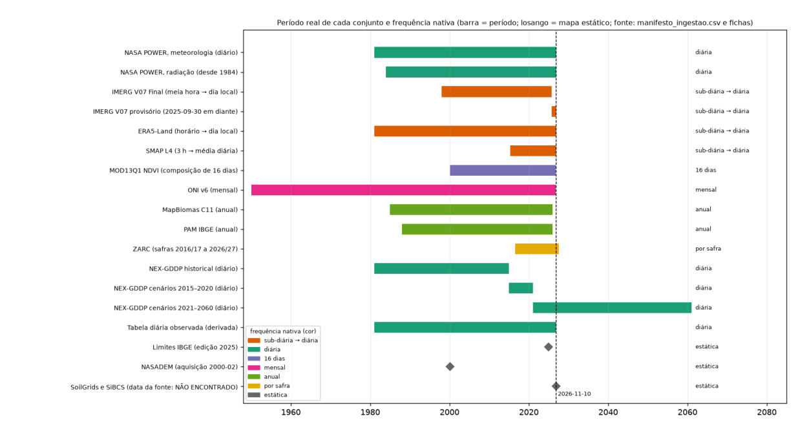

Figura 1: validacao/ingestao_linha_do_tempo_final.png. Todas as barras estão completas. Períodos de manifesto_ingestao.csv e das fichas; ZARC: ano civil de início da safra 2016/17 ao fim da 2026/27 (aproximação).

## **5. Validações**

#### **5.1 ET0 Penman-Monteith contra o Exemplo 18 do FAO-56**

|**Grandeza**|**Esperado (FAO-56)**|**Obtido**|**Diferença**|**Dif. %**|
|---|---|---|---|---|
|u2 (m/s)|2,078|2,0778|-0,0002|-0,0107|
|P (kPa)|100,1|100,1235|0,0235|0,0235|
|Tmean (°C)|16,9|16,9|0,0|0,0|
|Delta (kPa/°C)|0,122|0,1221|0,0001|0,0923|
|gamma (kPa/°C)|0,0666|0,0666|-0,0|-0,0268|
|e°(Tmax) (kPa)|2,564|2,5644|0,0004|0,0164|
|e°(Tmin) (kPa)|1,431|1,4306|-0,0004|-0,0313|
|es (kPa)|1,997|1,9975|0,0005|0,0243|
|ea (kPa)|1,409|1,4086|-0,0004|-0,0267|
|Ra (MJ/m2/dia)|41,09|41,0884|-0,0016|-0,004|
|N (h)|16,1|16,1046|0,0046|0,0286|
|Rs (MJ/m2/dia)|22,07|22,0721|0,0021|0,0093|
|Rso (MJ/m2/dia)|30,9|30,8985|-0,0015|-0,005|
|Rnl (MJ/m2/dia)|3,71|3,7123|0,0023|0,0618|
|Rn (MJ/m2/dia)|13,28|13,2832|0,0032|0,024|
|ET0 (mm/dia), Rs calculada de n|3,88|3,8803|0,0003|0,0072|
|ET0 (mm/dia), com Rs/u2/P impressos|3,88|3,8803|0,0003|0,0072|

Uccle (Bruxelas), 6 de julho, 50,80°N, 100 m. ET0 3,880 contra 3,88 mm/dia; todas as grandezas dentro de 0,1%. O exemplo tem duas inconsistências de impressão (N = 16,1 e 16,3; "es" sem o /2). Valida as equações em um dia; não valida a radiação estimada nem o preenchimento de lacunas do POWER.

Fonte: `validacao/et0_fao56_exemplo18.csv` .

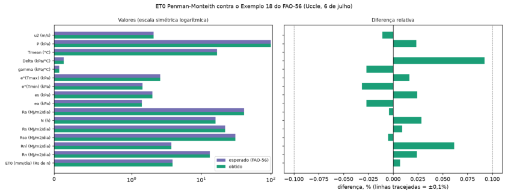

Figura 2: validacao/ingestao_et0_exemplo18.png.

#### **5.2 Chuva: POWER × IMERG × ERA5-Land**

|**Escala**|**Comparação (referência → teste)**|**r (3 municípios)**|**Viés da soma, % (teste − referência)**|
|---|---|---|---|
|diaria|power → imerg|0,72 a 0,75|16,7 a 18,3|
|diaria|power → era5land|0,67 a 0,70|9,0 a 11,9|
|diaria|imerg → era5land|0,66 a 0,69|-7,9 a -4,7|
|semanal|power → imerg|0,85 a 0,88|16,7 a 18,3|
|semanal|power → era5land|0,79 a 0,81|8,9 a 11,8|
|semanal|imerg → era5land|0,75 a 0,77|-7,9 a -4,8|
|mensal|power → imerg|0,93 a 0,95|16,7 a 18,3|
|mensal|power → era5land|0,85 a 0,86|9,0 a 11,9|
|mensal|imerg → era5land|0,86 a 0,87|-7,9 a -4,7|

Janela 1998-01-01 a 2025-09-29 (IMERG Final). O IMERG tem de 16,7% a 18,3% mais chuva que o POWER (o POWER fica 14% a 16% abaixo). A comparação com pluviômetros do INMET está na seção 5.8. Toledo e Assis têm chuva idêntica no POWER (mesma célula).

Fonte: `data/processed/qc_chuva_validacao.csv` .

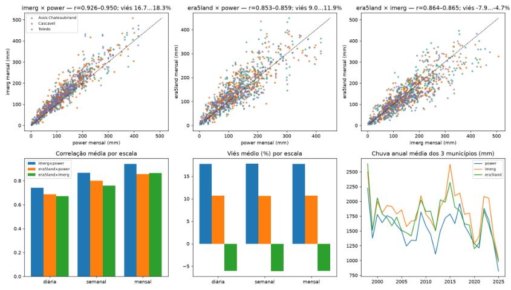

Figura 3: validacao/ingestao_chuva.png.

#### **5.3 Área de soja: MapBiomas × PAM**

|**Município**|**Anos comparados**|**Média %**|**Mediana %**|**Mínimo %**|**Máximo %**|
|---|---|---|---|---|---|
|Assis Chateaubriand|38|11,5|12,1|-11,9|27,2|
|Cascavel|38|12,6|9,2|-30,5|75,4|
|Toledo|38|20,7|17,2|-8,7|62,0|

Diferença = (MapBiomas − PAM área plantada) / PAM. PAM sem valor em 1985–1987. Hipótese de uso (a testar na modelagem): MapBiomas para a sequência de culturas e PAM para a magnitude; cautela antes de ~1995.

Fonte: `data/processed/qc_soja_mapbiomas_x_pam.csv` .

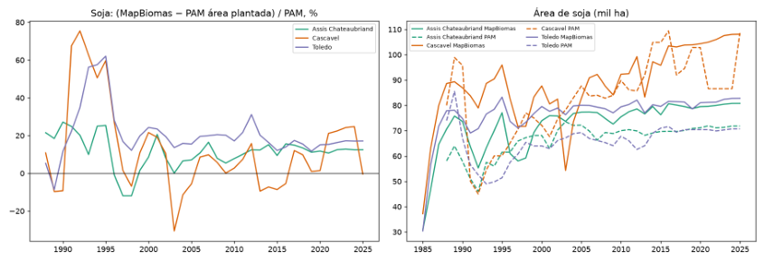

Figura 4: validacao/ingestao_soja_mapbiomas_pam.png.

#### **5.4 Faixas físicas**

|**Fonte**|**Variável**|**Mínimo**|**Máximo**|**Limites plausíveis**|**Valores fora**|
|---|---|---|---|---|---|
|diario|tmax_c|6,820|42,590|-10 a 50|0|
|diario|tmin_c|-3,150|26,740|-10 a 40|0|
|diario|tmean_c|2,630|33,580|-10 a 45|0|
|diario|tdew_c|-4,310|24,850|-20 a 35|0|
|diario|prec_power_mm|0,000|134,080|0 a 400|0|
|diario|prec_imerg_mm|0,000|135,377|0 a 400|0|
|diario|prec_era5land_mm|0,000|130,164|0 a 400|0|
|diario|rs_mj_m2_dia|0,770|33,590|0 a 40|0|
|diario|rh_pct|24,420|99,360|0 a 100|0|
|diario|u2_ms|0,020|3,850|0 a 30|0|
|diario|ps_kpa|93,240|97,980|80 a 105|0|

|**Fonte**|**Variável**|**Mínimo**|**Máximo**|**Limites plausíveis**|**Valores fora**|
|---|---|---|---|---|---|
|diario|et0_mm|0,098|7,718|0 a 12|0|
|diario|et0_preench_mm|0,098|7,718|0 a 12|0|
|diario|sm_surface_m3m3|0,177|0,528|0 a 0,65|0|
|diario|sm_rootzone_m3m3|0,272|0,544|0 a 0,65|0|
|diario|tmin>tmax|—|—|—|0|
|ndvi|ndvi_medio|0,248|0,924|-1 a 1|0|
|ndvi|evi_medio|0,127|0,865|-1 a 2|0|
|ndvi|frac_valida|0,106|1,000|0 a 1|0|

Nenhum valor fora dos limites; Tmin nunca passa de Tmax nas fontes observadas. No GDDP há linhas com Tmin > Tmax (seção 6).

Fonte: `data/processed/qc_faixas_fontes.csv` .

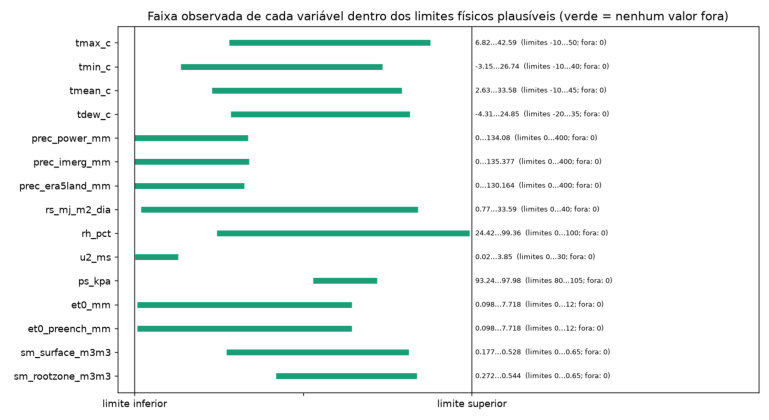

Figura 5: validacao/ingestao_faixas.png.

#### **5.5 Lacunas por fonte e ano (versão final)**

|**Fonte**|**Esperado (3 municípios)**|**Faltante**|**%**|
|---|---|---|---|
|POWER meteorologia (tmax)|50238|0|0,000|
|POWER radiação (rs)|46944|3|0,006|
|POWER chuva|50238|0|0,000|
|IMERG (dias completos)|31611|6|0,019|
|ERA5-Land (dias completos)|50226|3|0,006|
|SMAP L4 (dias completos)|12711|0|0,000|
|NDVI (composições 16 dias)|1842|0|0,000|
|NDVI (composições com <50% de pixels válidos)|1842|16|0,869|

Versão final, com ERA5-Land desde 1981. Unidade: dias (composições, no NDVI) somados nos 3 municípios.

Fonte: `data/processed/qc_lacunas_por_fonte_ano.csv` .

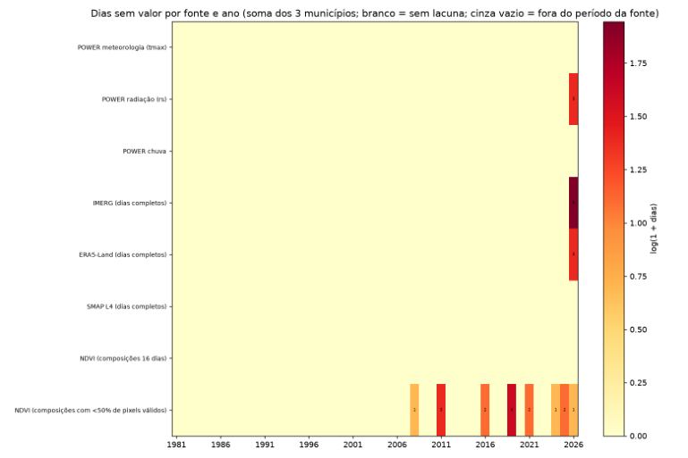

Figura 6: validacao/ingestao_lacunas.png.

#### **5.6 Clima futuro 2021–2025 contra o observado**

|**Cenário**|**Viés Tmax °C (mediana entre** |**Viés Tmin °C**|**Viés Tmédia °C**|**Viés chuva %**|
|---|---|---|---|---|
||**modelos)**||||
|ssp245|0,12|0,22|0,58|-2,50|
|ssp585|0,24|0,33|0,71|-2,85|

Temperatura contra o POWER, chuva contra o IMERG Final, 1 733 dias (2021-01-01 a 2025-09-29); modelo − observado. **Nota:** período curto e com El Niño forte (2023–24): a diferença por modelo mistura viés e variabilidade natural; o viés de referência é o de 1981–2014 (seção 5.7).

Fonte: `data/processed/qc_gddp_2021_2025_vs_observado.csv` .

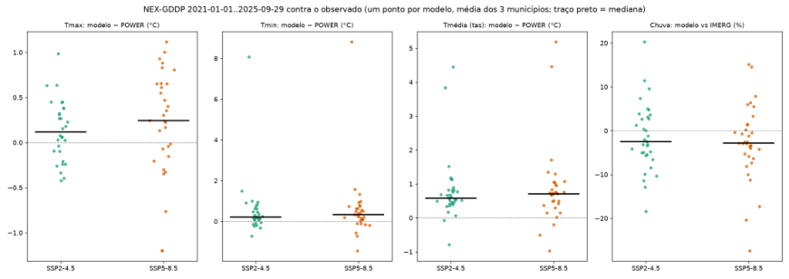

Figura 7: validacao/ingestao_gddp_2021_2025.png.

#### **5.7 Viés dos modelos em 1981–2014 (sem correção)**

|**Variável**|**Referência**|**Período**|**Modelos**|**Mediana**|**Mínimo (modelo)**|**Máximo (modelo)**|
|---|---|---|---|---|---|---|
|tmax|POWER|1981-2014|31|0,52 °C|0,28 °C (EC-Earth3)|0,75 °C (HadGEM3-GC31-LL)|
|tmin|POWER|1981-2014|31|0,13 °C|-0,16 °C (HadGEM3-GC31-MM)|8,21 °C (CMCC-CM2-SR5)|
|tmedia|POWER|1981-2014|34|0,74 °C|-0,06 °C (CESM2-WACCM)|4,83 °C (CMCC-CM2-SR5)|
|chuva|IMERG Final|1998-2014|34|-9,11 %|-14,36 % (MRI-ESM2-0)|1,97 % (KACE-1-0-G)|
|chuva|POWER|1981-1997|34|-7,21 %|-12,49 % (IPSL-CM6A-LR)|5,85 % (KACE-1-0-G)|
|chuva|ERA5-Land|1981-1997|34|-15,27 %|-20,09 % (IPSL-CM6A-LR)|-3,36 % (KACE-1-0-G)|

Rodada `historical` contra os mesmos observados do período: temperatura contra o POWER; chuva contra o IMERG Final em 1998–2014 e contra o POWER e o ERA5-Land em 1981–1997, cada referência identificada. Viés médio dos 3 municípios; na chuva, em % da soma. Nenhuma correção aplicada.

Fonte: `data/processed/qc_gddp_vies_historico_1981_2014.csv` , `data/processed/qc_gddp_vies_mensal_1981_2014.csv` .

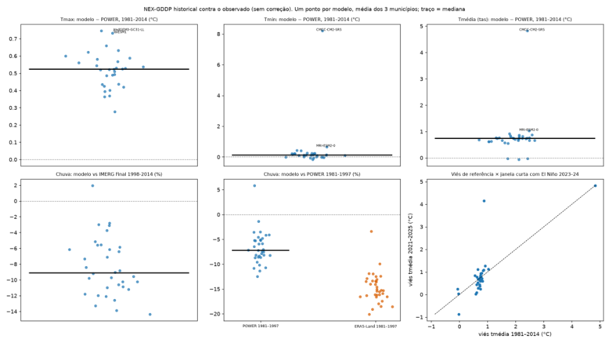

Figura 8: validacao/ingestao_gddp_vies_1981_2014.png.

#### **5.8 Chuva contra pluviômetros do INMET**

Comparação da chuva dos 10 pluviômetros automáticos do INMET do Paraná que ficam a até 170 km de algum centroide com o **pixel que contém a estação** no IMERG V07 e no ERA5-Land, de **2006-01-01 a 2025-09-29** (IMERG Final). As estações ficam de 31 a 158 km dos centroides de Cascavel, Toledo e Assis Chateaubriand (as seis pedidas, de 31 a 136 km): **nenhuma está dentro dos municípios** . **O POWER não entrou na comparação.** Dia local UTC−3, só dias com as 24 horas válidas; semana e mês só completos. Viés = (produto − INMET) / INMET na soma.

|**Estação**|**Dist.** **mín.** **(km)**|**Dist. Cascavel /** **Toledo / Assis** **(km)**|**Anos** **no** **ZIP**|**Anos** **com ≥** **80%** **das** **horas**|**% de** **horas** **válidas**|**Maior** **lacuna** **(dias)**|**Lacun** **as >** **30** **dias**|**Situação** **no** **catálogo**|**Última hora** **válida (UTC)**|
|---|---|---|---|---|---|---|---|---|---|
|A820 MAL. CANDIDO RONDON|30,9|84,8 / 30,9 / 45,6|21|19|93,4|40,5|4|Pane|2026-10-31 23:00|
|A825 GOIOERE|60,6|99,6 / 93,8 / 60,6|8|3|48,6|437,4|4|Operante|2026-02-19 23:00|
|B803 CAMPINA DA LAGOA|77,5|77,5 / 99,9 / 81,0|11|5|64,1|556,5|5|Pane|2026-10-31 23:00|
|A843 DOIS VIZINHOS|80,0|80,0 / 130,2 / 149,9|20|13|82,3|561,2|9|Operante|2026-10-31 23:00|
|A855 PLANALTO|85,6|85,6 / 113,1 / 145,0|20|14|81,6|556,6|6|Operante|2026-10-31 23:00|
|B804 LARANJEIRAS DO SUL|105,7|105,7 / 157,3 / 159,1|11|7|72,1|514,6|3|Operante|2026-10-31 23:00|
|A824 ICARAIMA|115,3|183,9 / 146,9 / 115,3|21|12|62,1|1280,0|8|Pane|2023-04-30 23:00|
|A846 FOZ DO IGUACU|122,4|128,0 / 122,4 / 159,0|19|9|65,7|975,0|9|Pane|2024-02-29 23:00|
|A869 CIDADE GAUCHA|135,9|191,0 / 172,5 / 135,9|19|14|83,6|299,4|9|Operante|2026-10-31 23:00|
|A822 NOVA TEBAS|158,4|158,4 / 186,9 / 165,1|20|11|72,1|1089,9|15|Operante|2026-10-31 23:00|

Fonte: `validacao/inmet/inmet_estacoes_series.csv` , `validacao/inmet/inmet_estacoes_oeste_pr.csv` .

Correlação e viés por estação (r diária / semanal / mensal; viés da soma diária e mensal):

|**Estação**|**n dias**|**IMERG: r d / s / m**|**IMERG: viés d / m (%)**|**ERA5-Land: r d / s / m**|**ERA5-Land: viés d / m** **(%)**|
|---|---|---|---|---|---|
|A820|6104|0,79 / 0,83 / 0,90|8,8 / 6,9|0,64 / 0,75 / 0,82|-5,1 / -7,5|
|A825|1362|0,83 / 0,87 / 0,90|10,7 / 15,9|0,68 / 0,78 / 0,90|-6,4 / -6,6|
|B803|1887|0,78 / 0,84 / 0,82|1,0 / -0,7|0,61 / 0,76 / 0,76|-24,8 / -26,1|
|A843|5271|0,81 / 0,83 / 0,85|2,9 / 4,2|0,65 / 0,75 / 0,75|-13,0 / -12,6|
|A855|4938|0,83 / 0,85 / 0,88|4,0 / 2,1|0,67 / 0,77 / 0,79|-5,5 / -7,4|
|B804|2360|0,76 / 0,79 / 0,87|-3,1 / -4,4|0,63 / 0,75 / 0,87|-3,5 / -1,4|
|A824|4144|0,78 / 0,83 / 0,93|15,5 / 7,8|0,58 / 0,74 / 0,85|1,8 / -2,7|
|A846|3895|0,73 / 0,75 / 0,78|17,2 / 19,2|0,56 / 0,58 / 0,60|18,6 / 24,2|
|A869|4868|0,79 / 0,84 / 0,88|2,8 / 5,1|0,61 / 0,72 / 0,76|-13,9 / -11,5|
|A822|4176|0,74 / 0,79 / 0,81|16,2 / 8,6|0,65 / 0,75 / 0,73|9,0 / 0,4|
|todas juntas|39005|0,78 / 0,82 / 0,86|7,4 / 5,7|0,63 / 0,72 / 0,76|-4,1 / -5,3|

Fonte: `validacao/inmet/inmet_comparacao_estacoes.csv` .

**Viés por estação (soma diária):** IMERG de -3,1% (B804) a 17,2% (A846); ERA5-Land de -24,8% (B803) a 18,6% (A846). Todas as estações juntas: IMERG 7,4% (diário) e 5,7% (mensal); ERA5-Land -4,1% e -5,3%. A correlação com o IMERG é maior que com o ERA5-Land em todas as 33 combinações de estação e escala. **Cuidados:** estações fora dos municípios; lacunas longas (A843 e A855 sem dado em 2021; A846 sem dado em 2025 e 2026; B803 com 13% a 18% em 2020 e 2021); A820 consta como Pane no catálogo mas tem dado até 2026-10-31; convenção do carimbo horário não documentada (r diário 0,7058 com o carimbo como fim da hora e 0,7057 como início).

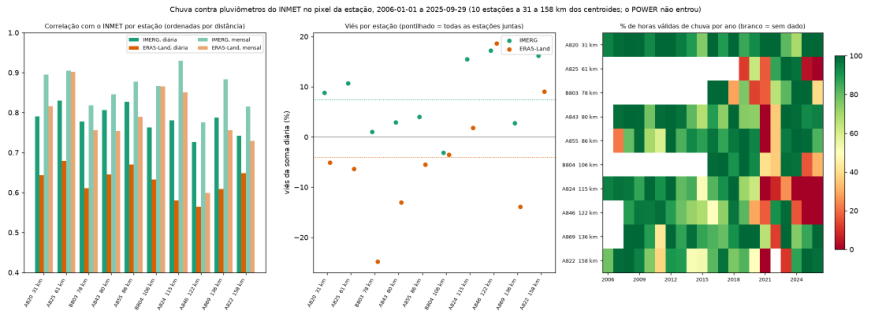

Figura 9: validacao/ingestao_inmet_painel_resumo.png (correlação e viés por estação e cobertura por ano). Um gráfico por estação está em validacao/inmet/inmet_<código>.png.

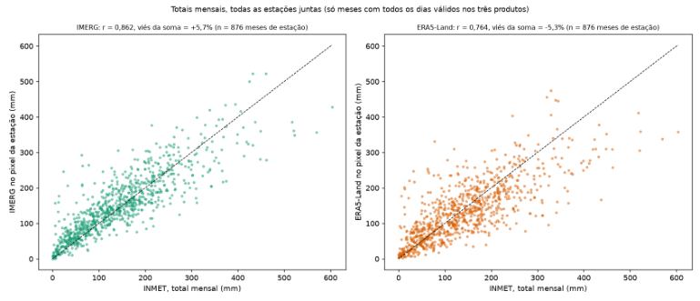

Figura 10: validacao/ingestao_inmet_geral.png (totais mensais de todas as estações juntas).

## **6. Modelos do GDDP**

Quais são completos, quais têm problemas e a causa quando conhecida. Viés de 1981–2014 contra o POWER (temperatura) e o IMERG 1998–2014 (chuva); salto de `tas` entre 2005–2014 e 2015–2020 (média dos cenários).

|**Modelo**|**hist.**|**SSP2-** **4.5**|**SSP5-** **8.5**|**Bandas**|**Completo** **p/ tempera** **tura**|**Viés** **Tmax °C**|**Viés** **Tmin °C**|**Viés** **tmédia** **°C**|**Viés** **chuva** **IMERG %**|**Salto** **tas °C**|**Observação (fonte: dicionário, seção citada)**|
|---|---|---|---|---|---|---|---|---|---|---|---|
|ACCESS-CM2|sim|sim|sim|pr, tasmax, tasmin, tas|sim|0,49|0,21|0,76|-3,7|0,49||
|ACCESS-ESM1-5|sim|sim|sim|pr, tasmax, tasmin, tas|sim|0,52|0,12|0,73|-6,1|0,05||
|BCC-CSM2-MR|sim|sim|sim|pr, tasmax, tasmin, tas|sim|0,51|0,11|0,72|-8,4|0,10||
|CESM2|sim|sim|sim|pr, tas|não|—|—|-0,03|-12,6|0,01|sem tasmax e tasmin no Earth Engine; só pr e tas|
|CESM2-WACCM|sim|sim|sim|pr, tas|não|—|—|-0,06|-3,0|0,47|sem tasmax e tasmin no Earth Engine; só pr e tas|
|CMCC-CM2-SR5|sim|sim|sim|pr, tasmax, tasmin, tas|sim|0,62|8,21|4,83|-10,9|0,14|Tmin alto já no histórico; amplitude térmica de 3,2 °C contra ~11 °C nos outros; dado suspeito na origem (dicionário 17.1)|
|CMCC-ESM2|sim|sim|sim|pr, tasmax, tasmin, tas|sim|0,42|-0,02|0,61|-7,1|0,10||
|CNRM-CM6-1|sim|sim|sim|pr, tasmax, tasmin, tas|sim|0,53|0,13|0,74|-8,8|-0,07||
|CNRM-ESM2-1|sim|sim|sim|pr, tasmax, tasmin, tas|sim|0,52|-0,01|0,67|-11,2|0,10||
|CanESM5|sim|sim|sim|pr, tasmax, tasmin, tas|sim|0,63|0,23|0,84|-9,0|0,70|salto de tasmax de +1,25 °C no SSP5-8.5 (17.3)|
|EC-Earth3|sim|sim|sim|pr, tasmax, tasmin, tas|sim|0,28|0,21|0,66|-5,2|0,52||
|EC-Earth3-Veg-LR|sim|sim|sim|pr, tasmax, tasmin, tas|sim|0,52|0,16|0,75|-11,8|0,40||
|FGOALS-g3|sim|sim|sim|pr, tasmax, tasmin, tas|sim|0,37|0,41|0,80|-10,2|0,16||
|GFDL-CM4|sim|sim|sim|pr, tasmax, tasmin, tas|sim|0,57|0,13|0,76|-11,0|0,42||
|GFDL-ESM4|sim|sim|sim|pr, tasmax, tasmin, tas|sim|0,58|0,42|0,91|-12,0|0,66|chuva baixa: −20% no SSP5-8.5 em 2021–2025 (17.1)|
|GISS-E2-1-G|sim|sim|sim|pr, tasmax, tasmin, tas|sim|0,49|-0,06|0,62|-9,7|0,98|salto de tas de +1,11 °C no SSP5-8.5 (17.3)|
|HadGEM3-GC31-LL|sim|sim|sim|pr, tasmax, tasmin, tas|sim|0,75|-0,07|0,75|-12,1|0,13||
|HadGEM3-GC31-MM|sim|não|sim|pr, tasmax, tasmin, tas|sim|0,44|-0,16|0,55|-10,2|0,49|só em historical e SSP5-8.5 (fora dos 33 comuns)|
|IITM-ESM|sim|sim|sim|pr, tas|não|—|—|-0,03|-2,8|-0,43|sem tasmax e tasmin no Earth Engine; só pr e tas|
|INM-CM4-8|sim|sim|sim|pr, tasmax, tasmin, tas|sim|0,40|0,09|0,66|-3,1|-0,01||

|**Modelo**|**hist.**|**SSP2-** **4.5**|**SSP5-** **8.5**|**Bandas**|**Completo** **p/ tempera** **tura**|**Viés** **Tmax °C**| **Viés** **Tmin °C**| **Viés** **tmédia** **°C**|**Viés** **chuva** **IMERG %**|**Salto** **tas °C**|**Observação (fonte: dicionário, seção citada)**|
|---|---|---|---|---|---|---|---|---|---|---|---|
|INM-CM5-0|sim|sim|sim|pr, tasmax, tasmin, tas|sim|0,42|-0,02|0,62|-5,6|0,45||
|IPSL-CM6A-LR|sim|sim|sim|pr, tasmax, tasmin, tas|sim|0,54|0,15|0,76|-13,9|0,18||
|KACE-1-0-G|sim|sim|sim|pr, tasmax, tasmin, tas|sim|0,39|0,11|0,66|2,0|-0,03||
|KIOST-ESM|sim|sim|sim|pr, tasmax, tasmin, tas|sim|0,52|0,11|0,73|-5,8|0,52||
|MIROC-ES2L|sim|sim|sim|pr, tasmax, tasmin, tas|sim|0,36|-0,03|0,58|-9,6|-0,05||
|MIROC6|sim|sim|sim|pr, tasmax, tasmin, tas|sim|0,59|0,01|0,71|-7,4|0,34||
|MPI-ESM1-2-HR|sim|sim|sim|pr, tasmax, tasmin, tas|sim|0,53|0,13|0,74|-6,2|-0,39||
|MPI-ESM1-2-LR|sim|sim|sim|pr, tasmax, tasmin, tas|sim|0,60|0,22|0,82|-6,4|0,10||
|MRI-ESM2-0|sim|sim|sim|pr, tasmax, tasmin, tas|sim|0,56|0,67|1,03|-14,4|0,22|maior viés de chuva contra o IMERG em 1998–2014 (−14,4%) e segundo maior de Tmin e tmédia|
|NESM3|sim|sim|sim|pr, tasmax, tasmin, tas|sim|0,66|0,24|0,86|-9,2|0,12||
|NorESM2-LM|sim|sim|sim|pr, tasmax, tasmin, tas|sim|0,43|0,22|0,74|-9,8|0,16||
|NorESM2-MM|sim|sim|sim|pr, tasmax, tasmin, tas|sim|0,49|0,26|0,79|-10,6|0,65||
|TaiESM1|sim|sim|sim|pr, tasmax, tasmin, tas|sim|0,73|0,15|0,87|-13,3|3,59|banda tas dos cenários salta +3,6 °C sem salto em tasmax e tasmin; não usar tas nos cenários (17.3)|
|UKESM1-0-LL|sim|sim|sim|pr, tasmax, tasmin, tas|sim|0,54|0,01|0,69|-5,5|0,09||

Fonte: `data/processed/gddp_modelos_por_cenario.csv` , `data/processed/qc_gddp_vies_historico_1981_2014.csv` , `data/processed/qc_gddp_descontinuidade_2014_2015.csv` , `data/processed/qc_gddp_2021_2025_vs_observado.csv` , `data/dicionario_dados.md` .

#### **Quantos modelos cada escolha deixaria, e qual regra produz cada número**

|**Escolha**|**Modelos**|**Regra de exclusão que produz o número**|**Modelos que ficam de fora**|
|---|---|---|---|
|Todos do catálogo|34|sem exclusão|nenhum|
|33|33|só os modelos presentes nos dois cenários (em_ambos_ssp = True)|HadGEM3-GC31-MM|
|30|30|os 33 comuns, sem os três que não têm tasmax e tasmin (completo_para_indices_de_temperatura = sim)|CESM2, CESM2-WACCM, HadGEM3-GC31-MM, IITM-ESM|
|29|29|os 30, sem o CMCC-CM2-SR5 (Tmin +8,2 °C já em 1981–2014)|CESM2, CESM2-WACCM, CMCC-CM2-SR5, HadGEM3-GC31-MM, IITM-ESM|
|27|27|os 30, sem os três fora da curva: CMCC-CM2-SR5, TaiESM1 e GFDL-ESM4|CESM2, CESM2-WACCM, CMCC-CM2-SR5, GFDL-ESM4, HadGEM3-GC31-MM, IITM-ESM, TaiESM1|

**Reprodução.** Os quatro números (33, 30, 29, 27) foram reproduzidos a partir de `gddp_modelos_por_cenario.csv` . As regras de 29 e 27 somam à regra de bandas uma exclusão por viés; o arquivo de modelos não traz regra de exclusão por viés, e a escolha dos três "fora da curva" vem do dicionário (17.1 e 17.3). **Ressalvas:** o GFDL-ESM4 só é "fora da curva" na janela 2021–2025 (chuva −20% no SSP5-8.5); na referência 1981–2014 o viés de chuva dele é -12,0%, dentro da faixa entre modelos (-14,4% a 2,0%), contra -10,9% do CMCC-CM2-SR5 e -13,3% do TaiESM1. No TaiESM1 o problema é a banda `tas` dos cenários (salto de +3,6 °C), enquanto `tasmax` e `tasmin` variam pouco. Linhas com Tmin > Tmax: 45 em 2021–2060 e 24 na rodada histórica e nos cenários 2015–2020; mantidas e sinalizadas ( `manifesto_ingestao.csv` ; dicionário 17.1).

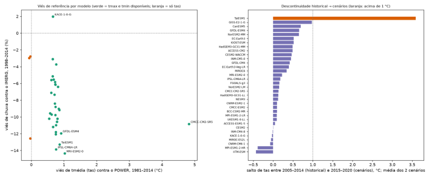

Figura 11: validacao/ingestao_gddp_modelos.png (viés de referência por modelo e descontinuidade historical → cenários).

## **7. Problemas encontrados e como foram tratados**

- **CMCC-CM2-SR5.** Amplitude térmica diária média de 3,2 °C contra ~11,3 °C nos outros modelos: `tasmin` e `tas` altos, `tasmax` normal. Não é erro de conversão (bruto em Kelvin, mesma conversão) nem bandas trocadas. Nenhuma das 45 linhas com Tmin > Tmax é dele. O viés de Tmin (+8,2 °C) já aparece em 1981–2014. Causa na origem não confirmada; mantido e sinalizado.

- **TaiESM1.** A banda `tas` dos cenários salta +3,6 °C em relação ao `historical` , sem salto em `tasmax` e `tasmin` . Explica o viés de tmédia de +4 °C em 2021–2025. Causa na origem não confirmada; recomenda-se não usar `tas` do TaiESM1 nos cenários.

- **Modelos sem tasmax e tasmin.** CESM2, CESM2-WACCM e IITM-ESM só têm `pr` e `tas` no Earth Engine. O primeiro lançamento do job de 2021–2060 morreu no CESM2 (cerca de 2,5 h perdidas). Corrigido: usa só as bandas existentes, acrescenta `tas_c` , falha de uma série não derruba o job e as falhas são repetidas.

- **Fila de jobs esperava por si mesma.** `tmux has-session -t ing_gddp` casava por prefixo com `ing_gddp_hist` ; o job histórico ficou cerca de 55 min sem começar e foi lançado à mão. Corrigido com correspondência exata ( `=nome` ) e registrado em `execucao_non/como_rodar_na_non.md` .

- **ERA5-Land só desde 1998.** A primeira coleta começava em 1998 para poupar o Earth Engine; o viés dos modelos em 1981–1997 exigia a referência. Estendido para 1981–1997 e a tabela diária foi regerada.

- **Lacuna falsa no NDVI de 2000.** O controle esperava 22 composições em 2000; o ano tem 20 (a série começa em 18 de fevereiro). Corrigido; lacuna de NDVI passou a 0.

- **Toledo e Assis na mesma célula do POWER.** Valores de ponto idênticos em todas as variáveis, chuva idêntica. A chuva é diferenciada pelo IMERG, com ERA5-Land como validação; temperatura e ET0 seguem do POWER (correção por altitude fica para a modelagem).

- **Fim do IMERG Final em 2025-09-29.** O registro Final V07 foi encerrado porque os produtos de entrada migram para a V08 (notícias do GPM). A tabela já traz o provisório até 2026-11-07, marcado em `status_imerg` .

- **Viés da chuva do POWER e do ERA5-Land.** POWER 14% a 16% abaixo do IMERG; ERA5-Land 5% a 8% abaixo. Nada foi corrigido; IMERG é o padrão de 1998 em diante.

- **INMET: API sem retorno, rota por ZIP anual funcionou.** API de dados sem retorno (204 e 404, inclusive para Porto Alegre); BDMEP exige cadastro por e-mail (não feito); a rota por ZIP anual do portal funcionou: 21 ZIPs (2006 a 2026), cada um apagado depois de extrair o recorte. A comparação com IMERG e ERA5-Land está na seção 5.8.

- **INMET: convenção do carimbo horário não documentada.** Não se sabe pelos textos lidos se a hora do CSV é o início ou o fim do acúmulo. Foram testadas as duas; a diferença é desprezível (r diário 0,7058 com o carimbo como fim da hora e 0,7057 como início); usada a primeira.

- **INMET: lacunas nas estações.** A843 e A855 sem dado em 2021; A846 sem dado em 2025 e 2026; B803 com 13% a 18% em 2020 e 2021; A820 consta como Pane no catálogo, mas tem dado válido até 2026-10-31.

- **INMET: lista oficial de anos não confirmada.** A página /dadoshistoricos não respondeu em 9 tentativas; as URLs por ano testadas vão de 2006 a 2026, e a lista oficial de anos não foi confirmada.

- **Limpeza dos dados da máquina de coleta.** Conferência de sha256 antes de apagar: 50 de 50 arquivos finais idênticos; ficaram fora do PC só o CSV de 185 MB do GDDP (dispensado) e os JSONs de manifesto (fundidos). Ver seção 9.

Fonte: `data/dicionario_dados.md` , `mapeamento/riscos_e_lacunas.md` , `validacao/ingestao_relatorio.md` , `CHANGELOG.md` , `execucao_non/como_rodar_na_non.md` , `validacao/inmet_nova_tentativa.md` .

## **8. Riscos e lacunas em aberto**

Transcrição das seções 2 a 12 de `mapeamento/riscos_e_lacunas.md` (a seção 1, de licenças, fica no arquivo). Trechos que citam caminhos de chave ou identificadores de credencial foram abreviados.

#### **2. Credenciais, aceites e cadastros pendentes**

- **CDS e AppEEARS:** licenças do CDS aceitas e usuário/senha do Earthdata preenchidos em 2026-11-09; filas medidas (ver `jit_viabilidade.md` ).

- **FAOSTAT (R082):** exige token (HTTP 401).

- **ANA HidroWebService (R018):** cadastro com CPF/CNPJ; decisão de não fazer. Bloqueado.

- **Sentinel-2 (R061):** download exige conta CDSE.

- **Chave de API do Google colada no chat:** linha `GEE_API` apagada do `.env` ; a chave deve ser revogada no Google Cloud. O JSON da conta de serviço deve ficar fora de pastas versionadas.

- **Credenciais coladas no chat (CDS, Earthdata usuário/senha, token do Earthdata):** estão só no `.env` local (600); considere rotacioná-las ao fim do hackathon.

#### **3. Quebras de série e homogeneidade**

- **TRMM → GPM IMERG (R014 → R013):** IMERG V07 começa em 1998 e junta sensores; quebra de calibração não quantificada.

- **MODIS → VIIRS (R055 → R056):** continuidade de NDVI exige ajuste; não quantificada.

- **GLDAS 2.0 (1948–2014) → 2.1 (2000–):** forçantes diferentes; tratar como duas séries.

- **POWER:** meteorologia vem do MERRA-2 e, nos últimos meses, do GEOS-IT; radiação só desde 1984 e atrasa 69 dias.

- **MapBiomas:** usar só a Coleção 11 para toda a série; `lulc/v1` mistura as coleções 10, 10.1 e 11 (filtrar por `collection_id` ).

- **PAM:** valor da produção muda de moeda seis vezes (Cruzeiro a Real); soja sem valor municipal em 1985–87; valores idênticos repetidos em anos seguidos (Cascavel 2021–24, Toledo 2018–21).

- **ONI v6 × RONI:** a NOAA passou a usar o RONI no monitoramento oficial (NWS PIS 26-05); o projeto usa o ONI v6. Comparar com o RONI antes de fixar os limiares de estado.

#### **4. Divergências medidas entre fontes**

- MapBiomas × PAM (soja, 1988–2025): viés +11,5% (Assis), +12,6% (Cascavel), +20,7% (Toledo); anos 1991–96 com até +75%.

- Pivô central, MapBiomas × Censo 2017: Assis 24 × 124 ha, Cascavel 112 × 4 ha, Toledo 156 × 98 ha. Não valida.

- IMERG × POWER em 2025-09-30: −8,2%.

#### **5. Latência e atualização**

- **IMERG:** último granule **Final** em 2025-09-30 (CMR). **Atualização de 2026-11-09:** a tabela de ingestão já traz o IMERG provisório (Late/Early) do Earth Engine até 2026-11-07, sinalizado em `status_imerg` ; ver seção 9.

- **SMAP L4 (SPL4SMGP):** problema de geolocalização de 2026-05-14 a 2026-07-28, em reprocessamento.

- **CMR:** buscas de 1 ano levam 12–106 s; cachear a lista de granules.

- **NEX-GDDP (NCCS):** migração para o Nexus Compute até o fim de 2026.

- **ECOSTRESS:** a v003 não tem granule sobre a bbox em 2024 (0 de 0); a v002 vai a 2026-06-30.

#### **6. Lacunas de informação (NÃO ENCONTRADO)**

- Páginas bloqueadas ao leitor automático: LP DAAC/Earthdata (403), CEPEA (403), SNIRH (403), EcoCrop (503), PROJETA ("socket closed"), B3 (vazia), Monitor de Secas e Cemaden (JavaScript).

- Precisão vertical do Topodata; licenças de MERRA-2, GLDAS, SMAP, HLS; capítulo 6 da FAO-56: as tabelas existem, mas os valores de Kc não foram copiados (copyright); citação e DOI da Coleção 11 do MapBiomas; soja e trigo na planilha do GAEZ.

- Landsat Collection 2 (R059): coleção `LANDSAT_OT_C2_L2` não encontrada no CMR.

#### **7. Escopo agronômico**

- Irrigação é marginal no recorte (1.189 ha em 2017, 0,28% do território): não condiciona a rotação.

- A classe de soja do MapBiomas não separa milho 1ª safra nem trigo; a matriz de transição não é de rotação. A 2ª safra (produto beta) só detecta milho, algodão e outras.

- 2026 termina em El Niño muito forte (ONI ASO 2026 = +2,46 °C); a relação com chuva e rendimento no Oeste do Paraná não foi testada.

#### **8. Limites dos dados da fase de ingestão (2026-11-09)**

- **Toledo e Assis Chateaubriand caem na mesma célula do NASA POWER** (altitude 430,2 m, valores de ponto idênticos em todas as variáveis). O POWER (0,5° × 0,625°, radiação em 1° × 1°) é mais grosseiro que os municípios (981 a 2.094 km²). A média regional ponderada pela área separa um pouco os dois, mas a diferença é pequena. **Decisão do projeto:** para chuva, diferenciar os municípios com o **GPM IMERG** (0,1°, ~11 km) e usar o **ERA5-Land** (0,1°) como validação; para temperatura e ET0, manter o POWER e corrigir pela altitude do NASADEM (item 10).

- **Dia de referência = dia local (UTC−3).** O POWER permanece em LST (hora solar local, ~UTC−3,6 em Cascavel); IMERG e ERA5-Land são agregados em dias locais UTC−3 a partir dos passos de 30 min e de 1 h. A diferença entre os dois dias de referência (~0,6 h) é pequena, mas a comparação diária de chuva é sensível a ela; por isso a validação também compara totais semanais e mensais.

- **IMERG V07 no Earth Engine não tem produtos "permanentes" após 2025-09-30** (o provedor migra para a versão 8); os meses recentes são provisórios e a tabela marca o status por dia ( `status_imerg` ). Alguns dias recentes têm menos de 48 meia-horas ( `dia_completo = falso` ).

- **POWER:** a radiação só existe desde 1984; a ET0 de 1981–83 ( `et0_preench_*` ) usa radiação estimada por Hargreaves (erro diário de 0,5 mm; 3–4% na soma anual) e fica separada; o modelo de produtividade usa ET0 a partir de 1984.

#### **9. Chuva: viés entre fontes, fim do IMERG Final e INMET (2026-11-09)**

- **Viés medido (janela 1998–2025-09-29,** `data/processed/qc_chuva_validacao.csv` **):** o POWER dá 14–16% **menos** chuva que o IMERG (o IMERG é 16,7–18,3% maior) e o ERA5-Land 5–8% menos que o IMERG; o viés aparece igual em escala diária, semanal e mensal. Nada foi corrigido: IMERG é a chuva padrão de 1998 em diante; POWER e ERA5-Land ficam sem correção como alternativas e para antes de 1998. **A fase de modelagem deve tratar esse viés** (não misturar fontes na mesma série sem decisão explícita).

- **Por que o IMERG termina em 29/09/2025 (Final):** segundo as notícias do GPM (gpm.nasa.gov, data news; busca de 2026-11-09), o registro **Final V07** (1998-01-01..2025-09-30) foi encerrado porque os produtos de entrada (CORRA e GPROF) estão sendo atualizados para a V08 e continuar misturaria entradas V08 num código V07; os arquivos V07 continuam disponíveis. O **Final V08** (reprocessamento desde 1998) tem lançamento previsto para o outono de 2026, atrasado por um produto-pai; **não confirmado que já saiu** (verificar). Os runs Late/Early seguem em modo "V07 híbrido" (GPROF V08).

- **Dá para completar até hoje:** sim, e já está feito. A coleção do Earth Engine tem os passos provisórios (Late/Early) até 2026-11-07; a tabela os traz com `status_imerg = provisorio` (403 dias por município, 2025-10-01..2026-11-07, mais 1 dia `misto` , 2025-09-30). Provisório não é igual ao Final (sem ajuste mensal por pluviômetros GPCC): tratar o período após 2025-09-29 como menos confiável e sinalizado. Quando o V08 Final sair, reprocessar 1998+ inteiro (não emendar versões).

• **INMET: API sem retorno de dados (testada em 2026-11-09 e de novo em 2026-11-10 na non, User-Agent genérico; a rota por ZIP anual do portal funcionou, ver seção 12):** `apitempo.inmet.gov.br/estacoes/T` e `/estacoes/M` respondem 200 (lista de estações), mas a rota diária `/estacao/diaria/{ini}/{fim}/{cod}` devolve 404 `E_ROUTE_NOT_FOUND` e a rota horária `/estacao/{ini}/{fim}/{cod}` devolve **204 sem conteúdo** para A843 (Dois Vizinhos, 2024), A855 (Planalto, 2024), A820 (Mal. Cândido Rondon, 2018 e 2023), A869 (Cidade Gaúcha, 2024) e A846 (Foz do Iguaçu, 2024). Não há estação dentro dos três municípios; as mais próximas (haversine até os centroides): A820 a 31 km de Toledo (situação "Pane"), A843 a 80 km de Cascavel, A855 a 86 km, B803 a 78 km (Pane). Em 2026-11-09 a validação de chuva usava só POWER × IMERG × ERA5-Land; em 2026-11-10 entrou a comparação com pluviômetros (seção 12). O BDMEP exige e-mail com confirmação (não feito).

#### **10. Soja: MapBiomas × PAM (2026-11-09;**

#### **`data/processed/qc_soja_mapbiomas_x_pam.csv`)**

- O MapBiomas C11 fica **acima** da PAM (área plantada) na soja: média +11,5% (Assis), +12,6% (Cascavel) e +20,7% (Toledo), faixa geral de +11% a +21% nos anos recentes; em **1985–1995 a diferença chega a +75%** (Cascavel; Toledo até +62%). Cascavel 2003 é −30,5% (ano isolado, causa não verificada).

- **Hipótese de uso (a testar na modelagem, não adotada):** MapBiomas para a **sequência espacial/temporal de culturas** (onde há soja, segunda safra, ciclos) e PAM para a **magnitude** de área e produção. Hipóteses para o viés (não verificadas): pixel de 30 m inclui bordas e estradas internas; PAM é declaratória e repete valores em anos seguidos (Cascavel 2021–24, Toledo 2018–21).

- **Cautela nos anos anteriores a ~1995:** a PAM cai fortemente enquanto o MapBiomas não, e a classificação Landsat da época é menos confiável; não usar a razão MapBiomas/PAM desses anos como calibração.

#### **11. Clima futuro (NEX-GDDP): vieses e inconsistências medidos (2026-11-10)**

- **Viés de referência 1981–2014 (sem correção):** mediana entre modelos Tmax +0,52 °C, Tmin +0,13 °C, tmédia +0,74 °C contra o POWER; chuva −9,1% contra o IMERG (1998–2014), −7,2% contra o POWER e −15,3% contra o ERA5-Land (1981–1997). Como o POWER subestima a chuva (seção 9), o viés dos modelos depende da referência escolhida: **a modelagem precisa fixar a referência de chuva antes de comparar cenários** .

- **CMCC-CM2-SR5:** Tmin +8,2 °C (e tmédia +4,8 °C) já em 1981–2014; amplitude térmica de 3,2 °C contra ~11 °C nos outros; dado suspeito na origem. **TaiESM1:** `tas` dos cenários salta +3,6 °C em relação ao `historical` sem salto em tasmax/tasmin; não usar o `tas` dele nos cenários.

- **Cobertura de bandas:** CESM2, CESM2-WACCM e IITM-ESM sem tasmax/tasmin; HadGEM3-GC31-MM só no SSP5-8.5; 33 modelos comuns aos dois cenários (30 com tmax/tmin).

- **24 linhas (histórico/2015–2020) e 45 linhas (2021–2060) com Tmin > Tmax** , mantidas e sinalizadas. Janela 2021–2025 é curta e tem o El Niño de 2023–24: não serve de referência de viés.

#### **12. INMET: nova tentativa (2026-11-10; atualiza a seção 9)**

- **O que mudou:** a API de dados ( `apitempo` ) continua sem retorno (204 e 404), mas os **ZIPs anuais do portal** ( `/uploads/dadoshistoricos/<ano>.zip` ) baixam e trazem chuva horária. Foram usados 21 anos (2006 a 2026-10-31) para 10 estações do Paraná a até 170 km dos centroides, incluindo A820, A843, A855, A869, A846 e B803. A página de listagem do portal não respondeu em 9 tentativas; o portal é intermitente. O BDMEP pede e-mail com confirmação (não feito).

- **Cuidados:** as 10 estações ficam de 31 a 158 km dos centroides (as seis pedidas, de 31 a 136 km), nenhuma dentro dos 3 municípios; há lacunas longas (A843 e A855 sem dado em 2021; A846 sem dado em 2025 e 2026); o catálogo marca A820 como "Pane" apesar de dado válido até 2026-10-31; a convenção do carimbo horário (início ou fim da hora) não está documentada nos textos lidos (efeito desprezível no r diário); valores ausentes são `-9999` nos anos antigos e campo vazio em 2023.

- **Evidência para o D1 (pixel da estação, 2006-01-01 a 2025-09-29, 10 estações):** IMERG +7,4% acima do INMET na soma diária e +5,7% na mensal (r diário 0,784; mensal 0,862); ERA5-Land −4,1% e −5,3% (r 0,626 e 0,764). O POWER não entrou nesta comparação. Detalhes em `validacao/inmet_nova_tentativa.md` .

## **9. Estado da execução**

|**Item**|**Resultado**|**Arquivo de origem**|
|---|---|---|
|GDDP 2021–2060|concluído: 67 de 67 séries, 0 falhas, 2 936 610 linhas|manifesto_ingestao.csv; CHANGELOG.md|
|GDDP histórico e cenários 2015–2020|concluído: 101 de 101 séries, 0 falhas, 1 707 228 linhas|manifesto_ingestao.csv; CHANGELOG.md|
|ERA5-Land 1981–1997|concluído; tabela de 1981-01-01 a 2026-11-02|manifesto_ingestao.csv|
|Tabela diária observada|50 238 linhas, 41 colunas, 1981-01-01 a 2026-11-06|clima_observado_diario_mun icipio.csv|
|Integridade no PC|55 de 55 arquivos do manifesto com sha256 igual ao registrado; nenhum diferente; nenhum ausente|recalculado agora sobre data/processed/|
|Máquina de coleta: conferência antes da limpeza|50 arquivos finais idênticos aos do PC; fora do PC só o CSV de 185 MB do GDDP (dispensado) e os JSONs de manifesto (fundidos)|CHANGELOG.md (2026-11-10)|
|Máquina de coleta: o que foi removido|arquivo da conta de serviço do Earth Engine, dados brutos, temporários, processados e a pasta de validação|CHANGELOG.md (2026-11-10)|
|Máquina de coleta: credenciais|sem arquivo de variáveis de ambiente, sem`.netrc`, sem pasta de credenciais do Earth Engine; busca em logs e scripts sem achados|CHANGELOG.md (2026-11-10)|
|Máquina de coleta: o que ainda existe|apenas scripts, logs,`requirements-non.txt`e o ambiente Python; nenhuma sessão tmux ativa|CHANGELOG.md (2026-11-10)|
|INMET: rota por ZIP anual|21 ZIPs (2006 a 2026), 1904,8 MB no total, o maior com 117,9 MB; recorte de 10 estações extraído e cada ZIP apagado depois|CHANGELOG.md (2026-11-10, INMET); inmet_testes_rotas.csv|
|INMET: máquina de coleta depois da tarefa|data/tmp removido (55,2 MB), scripts e logs do INMET removidos, sem arquivo da conta de serviço, sem arquivo de variáveis de ambiente, sem ZIP e sem sessão tmux; 56 586 240 B liberados; conferido com ls|CHANGELOG.md (2026-11-10, limpeza)|
|Earth Engine na tarefa do INMET|conta de serviço usada com aprovação do usuário, copiada só durante o job e apagada ao fim|CHANGELOG.md (2026-11-10, INMET)|

Esta seção usa o CHANGELOG como fonte para o estado da máquina de coleta; este relatório não acessou a máquina. A conferência de integridade no PC foi recalculada ao gerar o PDF.

## **10. Kanban resumido**

Status do kanban de mapeamento (`Field_Shift_Status.csv`), não status de jobs. `em_andamento` aqui quer dizer recurso com verificação documental incompleta no mapeamento.

|**Status**|**Recursos**|
|---|---|
|verificado|67|
|em_andamento|37|
|bloqueado|2|
|descartado|2|
|total|108|

#### **Recursos bloqueados (2)**

|**ID e recurso**|**ID e recurso**|**ID e recurso**|
|---|---|---|
|R002 SICAR / Cadastro Ambiental Rural|R018 ANA HidroWeb||

#### **Recursos descartados (2)**

|**ID e recurso**|**ID e recurso**|**ID e recurso**|
|---|---|---|
|R037 Cemaden (umidade do solo)|R067 INPE TerraClass||

#### **Recursos verificados (67)**

|**ID e recurso**|**ID e recurso**|**ID e recurso**|
|---|---|---|
|R001 IBGE Malhas Territoriais|R031 INMET (estações)|R070 ZARC - tábua de risco|
|R003 SIGEF|R032 FAO-56|R074 NEX-GDDP-CMIP6|
|R004 NASA POWER (comunidade AG)|R033 SMAP L3 / L4|R075 FAO GAEZ v5|
|R005 MERRA-2|R034 MERRA-2 (superfície terrestre)|R078 IBGE PAM|
|R006 CERES|R035 GLDAS|R079 IBGE LSPA|
|R007 MODIS LST (MOD11/MYD11)|R036 ESA CCI Soil Moisture|R083 NASA: proxies|
|R008 ECOSTRESS LST|R039 IBGE Censo Agropecuário (irrigação)|R084 FAO-56|
|R009 INMET BDMEP|R040 MapBiomas Irrigação|R088 ZARC|
|R010 INMET estações automáticas|R041 NASA: proxies de ET|R089 AGROFIT|
|R011 ERA5 / ERA5-Land|R042 SoilGrids|R091 CONAB custos de produção|
|R012 AgERA5|R045 IBGE Tipos de Solos 1:250.000|R093 IBGE PAM (valor da produção)|
|R013 GPM IMERG|R048 SMAP / EMIT (indiretos)|R094 Banco Central - PTAX|
|R014 TRMM (TMPA)|R049 NASADEM|R095 IPEADATA|
|R015 NASA POWER|R052 Topodata|R099 earthaccess|
|R016 MERRA-2|R054 HLS (Landsat + Sentinel-2)|R100 NASA CMR|
|R017 INMET BDMEP|R055 MODIS VI (MOD13)|R102 AppEEARS (API)|
|R023 GRACE / GRACE-FO|R056 VIIRS VI|R104 API do IBGE / pacote sidra|
|R024 ONI (Oceanic Niño Index)|R057 MODIS Fenologia (MCD12Q2)|R105 Portal de dados abertos do MAPA|
|R025 CPTEC/INPE - boletins de clima|R061 Sentinel-2|R106 Google Earth Engine|
|R026 Temperatura do mar (MERRA-2 / MODIS SST)|R062 MapBiomas Cobertura e Uso|R107 Copernicus Data Space|
|R027 NASA POWER|R063 IBGE PAM|R108 PyAEZ|
|R028 MODIS ET (MOD16)|R064 IBGE Censo Agropecuário||
|R029 ECOSTRESS ET|R068 MODIS Land Cover (MCD12Q1)||

#### **Recursos em_andamento (37)**

|**ID e recurso**|**ID e recurso**|**ID e recurso**|
|---|---|---|
|R019 Cemaden (pluviômetros)|R058 OCO-2 SIF|R082 FAOSTAT|
|R020 CHIRPS|R059 Landsat (Collection 2)|R085 FAO GAEZ v5|
|R021 Monitor de Secas|R060 SATVeg|R086 FAO EcoCrop|
|R022 Cemaden (alertas e índices)|R065 IBGE Monitoramento da cobertura e uso da terra|R087 Embrapa - sistemas de produção|
|R030 SSEBop ET|R066 CONAB mapeamentos agrícolas|R090 Embrapa - publicações fitossanitárias|
|R038 Atlas Irrigação|R069 NASA Harvest|R092 CONAB preços agropecuários|
|R043 WoSIS|R071 Painel de indicadores do ZARC|R096 CEPEA / ESALQ-USP|
|R044 HWSD v2.2 (via GAEZ v5)|R072 CONAB calendário de plantio e colheita|R097 B3 - derivativos agrícolas|
|R046 PronaSolos|R073 GEOGLAM Crop Monitor (calendários)|R098 Futuros CBOT/ICE via yfinance|
|R047 Embrapa Solos (bases de perfis)|R076 INPE PROJETA|R101 Earthdata Search|
|R050 SRTM|R077 CMIP6 (dados brutos)|R103 Giovanni|

|**ID e recurso**|**ID e recurso**|**ID e recurso**|
|---|---|---|
|R051 ASTER GDEM|R080 CONAB séries históricas||
|R053 Copernicus DEM|R081 FAO GAEZ v5||

Fonte: `Field_Shift_Status.csv` .

## **11. Como usar na modelagem**

O plano de modelagem (decisões D1 a D6, módulos M1 a M12 e prazos) está salvo em `docs/plano_modelagem.md` , com o texto fornecido em 2026-11-10, sem alteração. Contexto do plano: simulador de cenários de rotação de culturas (não é recomendação agronômica); evento em 14 e 15/11/2026; a demo precisa funcionar offline em 13/11. Culturas comerciais: soja, milho 1ª safra, milho 2ª safra e trigo; coberturas: aveia-preta, braquiária e crotalária. Esta seção organiza a evidência que já existe nos arquivos; **não decide** nada pelo plano.

#### **11.1 Dado → módulo**

|**Módulo (plano)**|**Conjuntos que o alimentam (ref e período real)**|**Estado dos** **dados**|**O que falta ou cuidado**|
|---|---|---|---|
|M1 Tabela de culturas|FAO-56 Kc e estágios (R084, 1998; 25 linhas); ZARC (R070, safra 2016/2017 a safra 2026/2027) para ciclo e janela; AGROFIT (R089) e Embrapa (R090) para doenças|parcial|Kc pendente de conferência; família, leguminosa, raiz, palhada e temperatura crítica: sem conjunto no inventário (ausente); doenças: R089 e R090 mapeados no kanban, não ingeridos (ausente)|
|M2 Matriz de compatibilidade por regras|nenhum conjunto próprio; regras do usuário sobre a tabela do M1|ausente|Depende do M1; as regras não estão em arquivo de dados|
|M3 Calendário e encaixe de safras pelo ZARC|ZARC (R070, safra 2016/2017 a safra 2026/2027; 4 433 linhas); calendário CONAB (R072, mapeado, não ingerido)|pronto|Valores dos decêndios (0/20/30/40) lidos como risco em %, inferido; nomes de cultura mudam entre safras|
|M4 Balanço hídrico por safra e cultura|Tabela diária observada (R004 ET0, 1981-01-01 a 2026-11-06; R013 IMERG, 1998-01-01 a 2026-11-07; R011 ERA5-Land, 1981-01-01 a 2026-11-02); CAD do SoilGrids (R042, estático); Kc (R084); SMAP (R033, 2015-03-31 a 2026-11-04) como apoio; INMET (R017, 2006-01-01 a 2026-10-31) só para validar a chuva|pronto, exceto Kc|ET0 completa só desde 1984 (1981–83 estimada); Kc inicial NÃO LEGÍVEL em 3 linhas; coberturas sem Kc|
|M5 Modelo de produtividade municipal|PAM (R063, 1988 a 2025); tabela diária; NDVI (R055, 2000-02-18 a 2026-10-16); ONI (R024, 1950-01-15 a 2026-09-15); solo (R042, R045)|dados-base prontos|Índices por safra (chuva acumulada, dias secos, dias quentes, balanço, NDVI máximo) não foram calculados: ficam para a modelagem; PAM repete valores em anos seguidos|
|M6 Cadeia de Markov do clima|IMERG (R013, 1998-01-01 a 2026-11-07); POWER e ERA5-Land sem correção (1981-01-01 a 2026-11-02); ONI (R024); GDDP (R074, 1981-01-01 a 2060-12-31)|dados prontos|Nenhum estado climático foi calculado; correção por quantis (D1) pendente; tercis de cada modelo GDDP (D6) a calcular|
|M7 Markov descritivo do MapBiomas|MapBiomas C11 (R062, 1985 a 2025); tabela de transições agrícolas (1985–2024)|pronto|Classe de soja não separa milho 1ª safra nem trigo; 2ª safra é produto beta|
|M8 Pontuação (filtros duros e critérios 0 a 1)|saídas de M1 a M4; pesos do usuário|ausente|Pesos do usuário: NÃO ENCONTRADO em arquivo|
|M9 Monte Carlo|saídas do M6; GDDP (R074): 33 modelos comuns aos dois cenários|dados prontos|Depende do M6; sensibilidade dos pesos depende do M8|
|M10 Simulador (função única)|nenhum conjunto próprio; usa M1 a M9|ausente|Não é dado|
|M11 Interface da demo, offline|tabelas processadas no PC: Parquet somam 95,7 MB; CSV complementares|dados no PC|Teste offline não é tarefa de dados; GDDP só em Parquet|
|M12 Bônus de preço, câmbio e custo|R098 (yfinance), R094 (PTAX), R091 (custos CONAB)|ausente|Não iniciado; só se sobrar tempo (plano)|

Fonte: `docs/plano_modelagem.md` , `data/processed/manifesto_ingestao.csv` , `mapeamento/tabela_mestre.csv` , `Field_Shift_Status.csv` , `data/dicionario_dados.md` .

#### **11.2 Decisões D1 a D6: evidência existente e o que falta medir**

|**Decisão** **(plano)**|**O que o plano decide**|**Evidência já existente (arquivo)**|**O que falta medir para decidir**|
|---|---|---|---|
|D1 Chuva|IMERG é a série padrão de 1998 em diante. Para a série longa do Markov, testar POWER corrigido por quantis para o IMERG (1981–2025) e ERA5-Land corrigido. Calibrar em 1998–2011, testar em 2012–2025; reportar viés e correlação antes e depois; não emendar fontes.|POWER 14% a 16% abaixo do IMERG e ERA5-Land 5% a 8% abaixo em 1998–2025-09-29 (qc_chuva_validacao.csv). Por janela (calculado de clima_observado_diario_municipio.csv, 3 municípios): 1998–2011 POWER -13,3% (r mensal 0,970) e ERA5-Land -3,6% (r mensal 0,856); 2012–2025-09-29 POWER -16,9% (r mensal 0,917) e ERA5-Land -8,5% (r mensal 0,873); o viés cresce da calibração para o teste.**Pluviômetros do INMET**(10 estações, pixel da estação, 2006-01-01 a 2025-09-29): IMERG r diário 0,784 e viés 7,4% (por estação, de -3,1% a 17,2%); ERA5-Land r diário 0,626 e viés -4,1% (de -24,8% a 18,6%). O POWER não entrou nessa comparação. POWER e ERA5-Land existem de 1981 em diante.|Ajuste por quantis em 1998–2011 e medição de viés e correlação antes e depois em 2012–2025. A chuva de 1981 a 2005 continua sem validação por pluviômetro; o POWER ainda não foi comparado com os pluviômetros. Nada foi corrigido nesta fase.|
|D2 ET0|Padrão a partir de 1984; testar se incluir 1981–83 (preenchimento Hargreaves) muda as matrizes; adotar 1981 se a diferença for desprezível.|Radiação do POWER só desde 1984-01-01. Radiação estimada por Hargreaves: correlação 0,75 a 0,76; erro absoluto diário da ET0 de 0,47 a 0,53 mm; erro da soma anual de 3,4% a 3,8% (qc_power_rs_hargreaves.csv). ET0 de 1981–83 está separada e sinalizada (et0_preench_mm, et0_origem).|Matrizes de Markov com a série de 1981 e com a de 1984 e comparação; nenhum estado climático foi calculado.|
|D3 Temperatura|Avaliar a correção pela altitude do NASADEM contra a altitude da célula do POWER; se mudar a ET0 ou os dias de calor de forma relevante, a versão corrigida vira padrão.|Altitude do município menos a da célula do POWER: Assis -47,8 m, Cascavel +49,2 m, Toledo +72,9 m; na máscara agrícola -43,0, +68,8 e +81,5 m (relevo_municipio.csv). Toledo e Assis compartilham a célula (430,2 m).|Gradiente de temperatura com a altitude: NÃO ENCONTRADO em arquivo. Recalcular temperatura e ET0 e medir o efeito na ET0 e nos dias de calor; o critério de "relevante" não está no plano.|
|D4 Kc|Valores do FAO-56 com ajuste por umidade e vento (eq. 62) para Kc médio e final; se o Kc inicial estiver pendente, usar o procedimento do FAO-56 ou deixar a cultura incompleta.|Extrato com 25 linhas, 25 pendentes de conferência e 0 conferidas; Kc inicial NÃO LEGÍVEL em 3 das 7 linhas da Tabela 12 (soja, milho grão, trigo de primavera); Kc médio e final legíveis nas 7. Aveia-preta, braquiária e crotalária sem linha própria. A tabela diária tem`rh_pct`(RH2M, umidade relativa a 2 m) e `u2_ms`.|Conferência do usuário contra o PDF; a UR mínima diária que a eq. 62 usa não está na tabela diária (NÃO ENCONTRADA em arquivo); decidir o procedimento do Kc inicial ou deixar a cultura incompleta.|
|D5 Histórico de cultivo|MapBiomas para a sequência de culturas, PAM para área e rendimento; cautela antes de ~1995.|Soja: MapBiomas acima da PAM em média +11,5% (Assis), +12,6% (Cascavel) e +20,7% (Toledo); em 1985–1995 até +75% (qc_soja_mapbiomas_x_pam.csv). PAM sem valor em 1985–87; milho 1ª e 2ª safra separados só desde 2003; valores repetidos em anos seguidos (Cascavel 2021–24, Toledo 2018–21).|Testar a divisão de papéis; definir o corte por município antes de ~1995.|
|D6 Clima futuro|Usar os modelos comuns aos dois cenários; estados de cada modelo pelos tercis do próprio período histórico do modelo (1981–2014), nunca pelos limiares do observado.|33 modelos comuns, 30 deles com tasmax e tasmin (seção 6). Rodada `historical`1981–2014 nos 34 modelos (1 707 228 linhas com os cenários 2015–2020). Viés de referência 1981–2014 por modelo (qc_gddp_vies_historico_1981_2014.csv). CMCC-CM2-SR5 com Tmin alto; TaiESM1 com salto de +3,6 °C em`tas`; 3 modelos sem tasmax e tasmin.|Calcular os tercis do balanço de cada modelo em 1981–2014 (nenhum estado calculado); decidir o conjunto de modelos (33, 30, 29 ou 27).|

Fonte: `docs/plano_modelagem.md` , `data/processed/qc_chuva_validacao.csv` , `data/processed/clima_observado_diario_municipio.csv` , `data/processed/qc_power_rs_hargreaves.csv` , `data/processed/relevo_municipio.csv` , `data/processed/qc_soja_mapbiomas_x_pam.csv` , `data/processed/qc_gddp_vies_historico_1981_2014.csv` , `data/processed/fao56_kc_culturas.csv` .

#### **11.3 Prazos e ordem de corte (do plano)**

|**Data**|**O que o plano pede**|**Dados disponíveis hoje (seção 11.1)**|
|---|---|---|
|Até 11/11|D1 a D6, M1 a M4 e M8 para os 3 municípios|M3 pronto; M4 pronto exceto Kc; M1 parcial (Kc pendente; atributos botânicos e doenças ausentes); M2 e M8 sem dados próprios (regras e pesos do usuário); evidência de D1 a D6 na seção 11.2|
|Até 12/11|M5, M6, M9 e M10|M5 e M6: dados-base prontos, índices por safra e estados climáticos a calcular; M9: dados prontos; M10: sem dados próprios|
|Até 13/11|M11 testado offline; M7 e M12 só se sobrar tempo|M11: tabelas no PC; M7: dados prontos; M12: ausente (não iniciado)|
|14 e 15/11|Evento (plano)|—|

**Se atrasar, cortar nesta ordem** (plano): M12, M7, sensibilidade dos pesos no M9, random forest no M5.

Fonte: `docs/plano_modelagem.md` .

#### **11.4 O que a modelagem não pode assumir hoje**

- **Pluviômetro só de 2006 em diante e fora dos municípios.** A chuva de 1981 a 2005 continua sem validação por pluviômetro. As 10 estações do INMET ficam de 31 a 158 km dos centroides (as seis pedidas, de 31 a 136 km), há lacunas longas (A843 e A855 sem dado em 2021; A846 sem dado em 2025 e 2026) e o POWER não entrou na comparação.

- **IMERG provisório depois de 2025-09-29.** São 403 dias por município (2025-10-01 a 2026-11-07), mais 1 dia misto; o provisório não é igual ao Final, e `status_imerg` marca cada dia.

- **Toledo e Assis Chateaubriand na mesma célula do POWER.** Temperatura, ET0 e chuva do POWER são idênticas nos dois; só IMERG e ERA5-Land os diferenciam.

- **Coberturas sem Kc.** Aveia-preta, braquiária e crotalária não têm linha no FAO-56; os substitutos do extrato (linha combinada cevada/aveia/trigo e pastagem de referência) são suposição, e a crotalária não tem substituto. O Kc inicial de soja, milho e trigo de primavera está NÃO LEGÍVEL e as 25 linhas aguardam conferência.

- **Códigos do ZARC inferidos.** Os valores dos decêndios (0, 20, 30 e 40) foram lidos como risco em %, mas o dicionário do MAPA não os define.

- Outros cuidados registrados: POWER e ERA5-Land com chuva abaixo do IMERG (14% a 16% e 5% a 8%); ET0 de 1981–83 com radiação estimada; temperatura e ET0 sem correção por altitude; CMCC-CM2-SR5, `tas` do TaiESM1 e 3 modelos sem tasmax e tasmin; 2ª safra e ciclos do MapBiomas em beta.

Fonte: `mapeamento/riscos_e_lacunas.md` , `data/dicionario_dados.md` , `data/processed/manifesto_ingestao.csv` .

## **12. Pendências, com responsável**

|**Pendência**|**Responsável**|**Origem**|
|---|---|---|
|Conferir as 25 linhas do`fao56_kc_culturas.csv`contra o PDF do FAO-56, preencher`pagina_pdf`e o Kc inicial de soja, milho grão e trigo de primavera|usuário|README; fao56_kc_culturas.csv; dicionário 18|
|Dados bônus: futuros CBOT/ICE via yfinance (R098), PTAX (R094) e custos CONAB (R091); só depois do núcleo validado|NÃO ENCONTRADO (a definir)|Prompt de ingestão; README|
|Valores que a modelagem ainda precisa fixar: gradiente de temperatura com a altitude (NÃO ENCONTRADO), critério de relevante no D3 (NÃO ENCONTRADO), umidade mínima diária para a eq. 62 (NÃO ENCONTRADA na tabela diária) e pesos do M8 (NÃO ENCONTRADO)|usuário|docs/plano_modelagem.md; dicionário 10 e 18|
|Rotacionar as credenciais coladas no chat (CDS, Earthdata, token) ao fim do hackathon|usuário|riscos_e_lacunas seção 2; README|
|Revogar a chave de API do Google colada no chat e guardar o arquivo da conta de serviço fora de pastas versionadas|usuário|riscos_e_lacunas seção 2; README|
|Itens do mapeamento ainda sem verificação completa (status`em_andamento`, 37 recursos)|NÃO ENCONTRADO|Field_Shift_Status.csv; mapeam ento/pendencias_de_verificacao .md|
|DOI e citação formal da Coleção 11 do MapBiomas|NÃO ENCONTRADO|README; ficha R062|
|Teste da relação ENOS, chuva e rendimento no Oeste do Paraná e comparação do ONI v6 com o RONI|modelagem|README; riscos seção 3 e 7|

Fonte: `README.md` , `mapeamento/riscos_e_lacunas.md` , `Field_Shift_Status.csv` .
